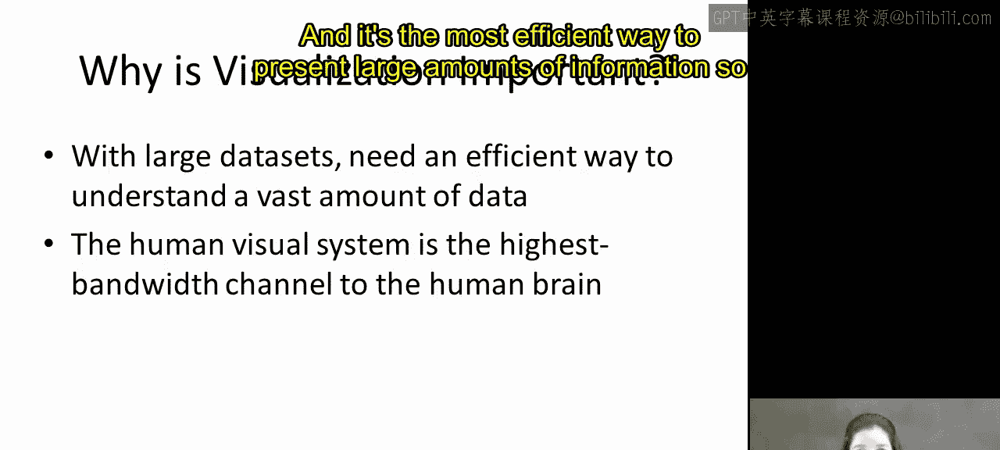

# 杜克大学《大规模数据科学（预测分析，交流数据科学结果，第2、3课⧸共3课有视频）｜Data Science at Scale》中英字幕 p70 0_01 引言：什么和为什么.zh_en -BV1xf421Q7bH_p70-

。

Hi everyone， My name is Cecilia Aragon and I'll be your guest lecturer this week。

 We're going to be talking about basic principles of information visualization。 This is。

 in my opinion， one of the most important， interesting and fun components of the data science pipeline。

 We're going to be talking about how you take the data that you've collected and analyzed and then actually presented in a form that makes sense to the human brain。

I'm a professor here at the University of Washington in the Department of Human Centered Design and Engineering。

 and it'll be my pleasure to introduce you to this exciting subject。

My research interests lie in the visual presentation of very large scientific and social data sets。

 so let's start with a few definitions， the word visualization is extremely overloaded。

 there are many possible meanings of the term so what are we talking about when we say we're studying information visualization Well we want to consider the visual representation of information。

The goals of information visualization include the effective communication of information or data。

With clarity， that means that the information should be presented in a way that's easy to understand by a human。

With integrity。You present all the data。And nothing but the data。

And you want to stimulate viewer engagement with the data。

Our focus in this course will be on effectiveness。We're talking about the clear and effective presentation of data to the human mind。

Data visualization。Usually falls into three academic categories， information visualization。

 scientific visualization， and visual analytics。Information visualization typically involves abstract information that may not have a position in space for example。

 on the slide you can see a graph of stock prices around the year 2000， we graph the price。

 the dollar amount on the Y axis and time on the X axis。

Scientific visualization usually involves displaying data that has a physical position in space。

 for example， here you see a methane combustion data where each of the data points has a 3D location。

Visual Ana is a combination of highly interactive visual interfaces and sophisticated statistical learning algorithms。

😊，In this course， we're going to be talking about basic principles of information visualization。

We're not going to be talking about scientific visualization specifically。

 nor about visual analytics， nor about the artistic field of visual design。The principles， however。

 of information visualization that we are discussing， are applicable to all three domains。

We will be discussing specifically this week how to map data variables to visual attributes。

 so why is visualization important？Say you have a million numbers。

 What's the best way to communicate that information to the human brain？Well。

Imagine a table of a million numbers。 It seems almost too vast to comprehend。

 much less to find meaningful trends or information about it。But on the other hand。

 if you consider the number of pixels on your computer screen。

 it's typically around a million and you have no trouble understanding it very quickly and being able to act on the information you've gleaned。

 So the human visual system is the highest bandwidth channel to the human brain and it's the most efficient way to present large amounts of information so they make sense。

