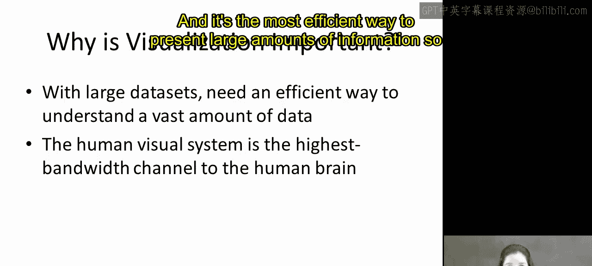

# 数据科学大规模应用：第2课：信息可视化基础原理 🎨

在本节课中，我们将学习信息可视化的基本概念、重要性及其在数据科学流程中的核心作用。我们将探讨如何将分析后的数据，以清晰、有效且引人入胜的方式呈现给人类大脑。

大家好，我是塞西莉亚·阿拉贡，本周将由我担任客座讲师。我们将讨论信息可视化的基本原理。在我看来，这是数据科学流程中最重要、最有趣也最令人愉快的组成部分之一。我们将探讨如何将你收集和分析的数据，以一种对人类大脑有意义的形式实际呈现出来。

我是华盛顿大学人本设计与工程系的教授，很高兴能向大家介绍这个激动人心的主题。我的研究兴趣在于大型科学和社会数据集的视觉呈现。

## 定义与范畴 📖

上一节我们介绍了课程主题，本节中我们来看看信息可视化的具体定义和学术范畴。

“可视化”这个词的含义非常广泛，该术语有许多可能的解释。当我们说研究信息可视化时，我们指的是什么？我们考虑的是信息的视觉表示。

信息可视化的目标包括：
*   **有效的信息或数据沟通**。
*   **清晰性**：信息应以易于人类理解的方式呈现。
*   **完整性**：呈现所有数据，且仅呈现数据。
*   **激发观众与数据的互动**。

本课程的重点将放在**有效性**上。我们讨论的是向人脑清晰有效地呈现数据。

数据可视化通常分为三个学术类别：
1.  **信息可视化**：通常涉及抽象的、在空间中可能没有位置的信息。例如，幻灯片上可以看到一张2000年前后的股价图，我们在Y轴上绘制价格（美元金额），在X轴上绘制时间。
2.  **科学可视化**：通常涉及显示在空间中具有物理位置的数据。例如，这里看到的甲烷燃烧数据，其中每个数据点都有一个三维位置。
3.  **视觉分析**：是高度交互的视觉界面与复杂的统计学习算法的结合。

在本课程中，我们将讨论信息可视化的基本原理。我们不会专门讨论科学可视化，也不会讨论视觉分析或视觉设计的艺术领域。然而，我们讨论的信息可视化原理适用于所有这三个领域。

## 可视化的重要性 🤔

上一节我们明确了信息可视化的范畴，本节中我们来探讨为什么可视化如此重要。

假设你有一百万个数字。向人脑传达这些信息的最佳方式是什么？

想象一张包含一百万个数字的表格。它看起来几乎庞大到无法理解，更不用说从中发现有意义的趋势或信息了。但另一方面，如果你考虑一下电脑屏幕上的像素数量，通常也在一百万左右，而你却能毫不费力地快速理解它，并能够根据获取的信息采取行动。

因此，人类视觉系统是通往人脑的最高带宽通道，也是呈现大量信息使其变得有意义的最有效方式。

## 总结 📝

本节课中我们一起学习了信息可视化的基本定义、它在数据科学中的核心作用，以及其重要性。我们了解到，信息可视化旨在通过视觉属性（如坐标轴、颜色、形状）来映射数据变量，从而高效地向人脑传递复杂信息。其核心优势在于利用人类视觉系统的高带宽处理能力，将海量数据转化为易于理解和交互的视觉形式。