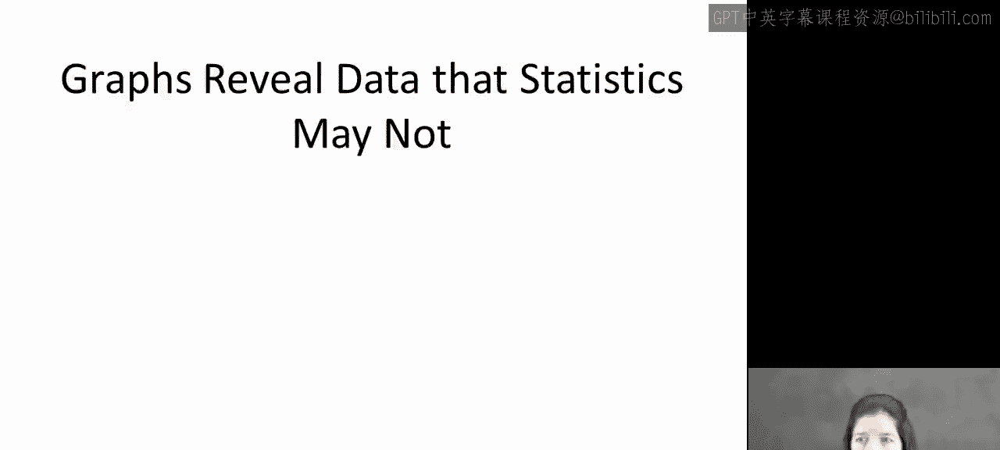
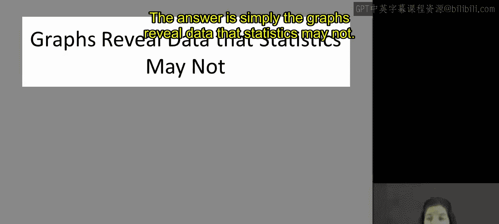
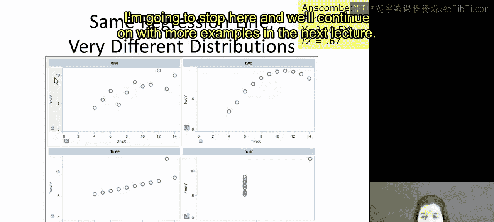

# 杜克大学《大规模数据科学（预测分析，交流数据科学结果，第2、3课⧸共3课有视频）｜Data Science at Scale》中英字幕 p71 1_02 引言：激励示例.zh_en -BV1xf421Q7bH_p71-

。

Let's talk about a few examples。So maybe the first use of visualization historically was for eliciting knowledge from data。

Let's suppose you have a table of numbers we'll start with a relatively small table with only 50 rows。

 one for each state in the union。Three columns in each row， the name of the state。

 the percentage of college graduates in that state， and the per capita income。

So you might have questions about this data， such as which state has the highest income？

Is there a relationship between income and education？Finally， are there any outliers。

 are there any trends？Well， obviously， all the data is present and you could take your time looking at this data。

 you could identify the highest and lowest numbers。

 You could answer all these questions from the data。 Everything is presented here。

 but is this the most efficient way to understand this data。

Here's another way of presenting the data in a scatter plot。

 we have per tapita income on the x axis and the percentage of college degrees on the Y axis。

 and as you can see the question of which state has the highest income is instantly answered。

 we can see that Connecticut has the highest per tapita income。Similarly。

 it's clear there's a trend that there's a correlation between per capita income and the percentage of college degrees。

 and there's also a couple of interesting outliers。

 Nevada has a relatively high per capita income but a very low percentage of college graduates。

So all the information is presented in both of these forms， but the visual representation。

I much more efficient at presenting meaning to the human mind。Well， so， okay。

 the first question that might come up is， well， yeah。

 but all this information could more easily have been accomplished by analyzing the data with a statistical program。

 You can find the maximum。 you can find the minimum。 You can find the regression line。However。

 it turns out the human brain is one of the best pattern matching tools that we have actually。

 the human brain so far is still better at detecting patterns in data than any of our most sophisticated machine learning algorithms。

So an immediate question that arises is why not just use a statistical program and identify the minimum。

 the maximum of the trend lines and go from there， why bother with a visual representation？

The answer is simply the graphs reveal data that statistics may not。

So here's a famous example of Anscom's quartet。Here you have four small data sets that are quite different as you can see by looking at them。

But they have identical linear models。 That is the identical means and the identical trend lines。

 Again， you could just present the data in tabular form。

But see how much more information we can learn about these these individual data sets just by looking at the data。

 So even though we have identical means， identical regression lines。

These data sets are quite different， so statistics may not tell us everything about a particular data set。

I hope I've managed to wet your appetite for this coming week set of slides。

 so I'm going to stop here and we'll continue on with more examples in the next lecture。

