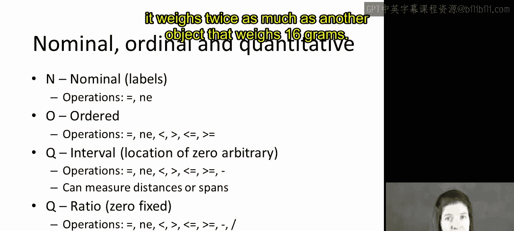

# 杜克大学《大规模数据科学（预测分析，交流数据科学结果，第2、3课⧸共3课有视频）｜Data Science at Scale》中英字幕 p72 2_03 数据类型定义.zh_en -BV1xf421Q7bH_p72-

。

In this lecture， we're going to talk about the heart of information visualization。

 data types and visual mappings。So the central problem in order to visualize data is quite simple。

 we need to map data sets to visual attributes。 This is also known as data encoding。

And the process can be described in a very straightforward manner。One， you classify your data types。

 and two， you determine which visual attributes represent data types most effectively。Of course。

 the devil is in the details。Let's start with data types。There are three basic data types， nominal。

 ordinal and quantitative， which can be further subdivided into interval and ratio。

 I'm going to explain each of these on the next slide。

So nominal data can be thought of as labels or names。An example is fruit， apples， oranges， peaches。

 pears would be described as nominal data。 Ordinal data has an order associated with it。 So。

 for example， the quality of meat might be described as grade A， grade A A， grade Aaa。

 There is an implicit order。 So you can clearly say the grade Aaa is better than grade A A。

 of the two types of quantitative data。Interal data is where the location of zero is arbitrary。

 so dates are an example。 if you're looking at January 5， 2012， or location， for example。

 latitude 47， longitude 122。And these are like a geometric point， you can't compare them directly。

 but only differences that is intervals can be compared。And then finally， you have ratio data。

 which is where the zero is fixed， and you can think of this as any physical measurement， length。

 mass， counts and amounts， the origin is meaningful。

Let's talk a little bit more about the differences between nominal， ordinal and quantitative data。

Sometimes it's not immediately clear given an example what data type that it falls into。

 So one of the best ways to actually identify data as nominal ordinal or quantitative is to look at what are the operations that are permitted on this data。

 So nominal data， there are really only two operations that are permitted。

 either equals are not equals。 For example， with fruit。

 you can say the oranges are not equal to apples。 and apples are equal to apples。

 There's no other comparison that can be made。 You can't say that oranges are somehow better than apples。

Ordinnal data has additional operations besides equals and not equals。

 You can now say that one is greater than or less than another or greater than or equal to or less than or equal to。

 So， for example， with the grades of meat that we described。

 you can say that AAA is better than A A and vice versa greater than less than。

 you can deal with that implicit ordering。Now， moving to quantitative data with interval data。

 for example， dates， now you can subtract so you can measure distances or spans。

 you can say that not only is January 6， 2012 after January 5， 2012。

 but you can say the difference between those two dates is one day。And finally。

 coming to ratio data where the zero is fixed， now you can add division or ratios。

 you can measure ratios or proportions， so for example， if an object weighs 32 grams。

 you can say that it weighs twice as much as another object that weighs 16 grams。

All right， so that's the theory。