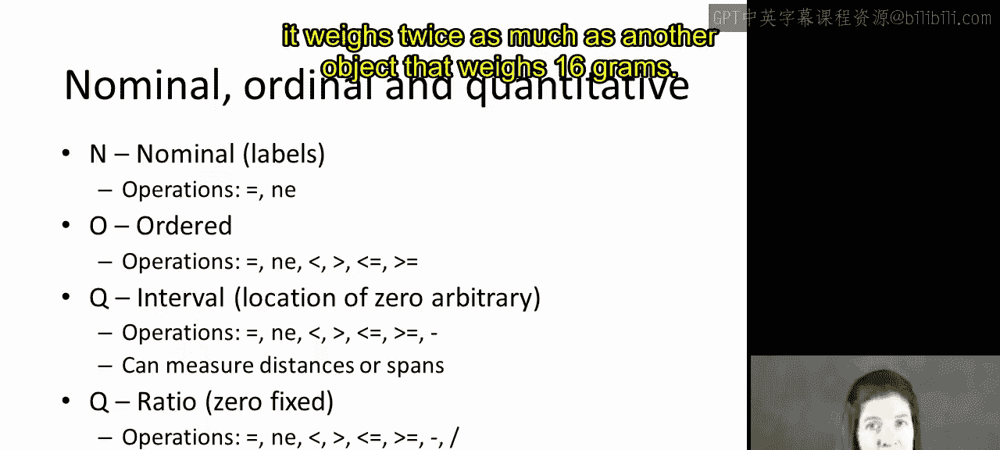

# 大规模数据科学：2_03：数据类型定义 📊

在本节课中，我们将学习信息可视化的核心：数据类型与视觉映射。我们将探讨如何将数据集映射到视觉属性，并理解不同数据类型的特性及其在可视化中的表现方式。

---

## 概述

信息可视化的核心问题很简单：我们需要将数据集映射到视觉属性，这个过程也称为数据编码。该过程可以概括为两个步骤：首先，对数据类型进行分类；其次，确定哪些视觉属性能最有效地表示这些数据类型。当然，细节决定成败。

---

## 数据类型分类

上一节我们介绍了数据可视化的基本流程，本节中我们来看看数据的具体分类。数据有三种基本类型：**名义数据**、**有序数据**和**定量数据**。其中，定量数据可进一步细分为**区间数据**和**比率数据**。

以下是每种数据类型的详细说明：

*   **名义数据**：可视为标签或名称。例如，水果的种类（苹果、橙子、桃子、梨）就属于名义数据。
*   **有序数据**：具有内在顺序的数据。例如，肉类的等级（A级、AA级、AAA级）就存在隐含的顺序，我们可以明确地说AAA级优于AA级。
*   **定量数据**：可测量的数值数据。
    *   **区间数据**：零点的位置是任意的。例如，日期（2012年1月5日）或地理位置（纬度47，经度122）。这类数据类似于几何点，不能直接比较，但可以比较其差值（即区间）。
    *   **比率数据**：零点固定且有意义。例如，任何物理测量（长度、质量、数量、金额），其原点具有实际意义。

---

## 数据类型的操作差异

有时仅凭例子可能无法立即判断其数据类型。区分名义、有序和定量数据的最佳方法之一是观察允许对该数据执行哪些操作。

以下是基于允许的操作对数据类型进行的区分：

*   **名义数据**：只允许两种操作：**等于** 或 **不等于**。例如，对于水果，可以说橙子不等于苹果，苹果等于苹果。无法进行其他比较，例如不能说橙子比苹果好。
*   **有序数据**：除了等于和不等于，还可以进行**大于**或**小于**的比较。例如，对于之前提到的肉类等级，可以说AAA级优于AA级。
*   **定量数据**：
    *   **区间数据**：可以进行**减法**运算，以测量距离或跨度。例如，不仅可以判断2012年1月6日在2012年1月5日之后，还可以说这两个日期相差一天。
    *   **比率数据**：可以进行**除法**或计算**比率**。例如，如果一个物体重32克，可以说它的重量是另一个重16克物体的两倍。

---

## 总结

本节课中，我们一起学习了信息可视化的基础——数据类型。我们明确了三种基本数据类型（名义、有序、定量）及其子类（区间、比率），并通过分析每种类型所允许的操作（如等于、比较大小、计算差值或比率）来加深理解。正确识别数据类型是选择有效视觉映射方案的关键第一步。