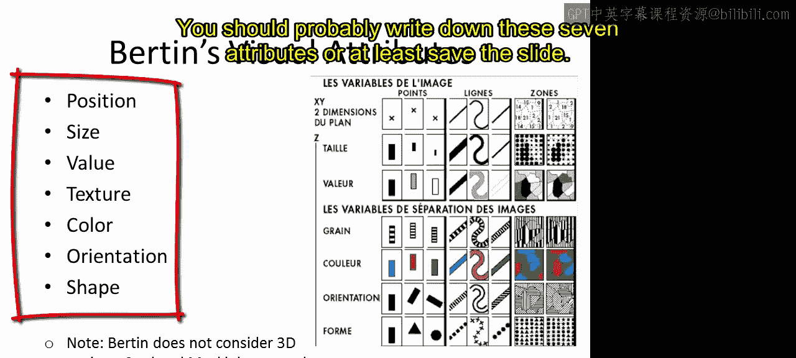
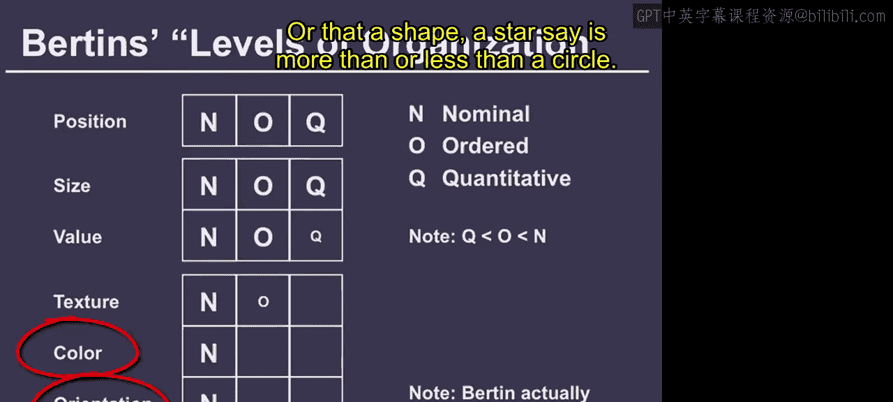
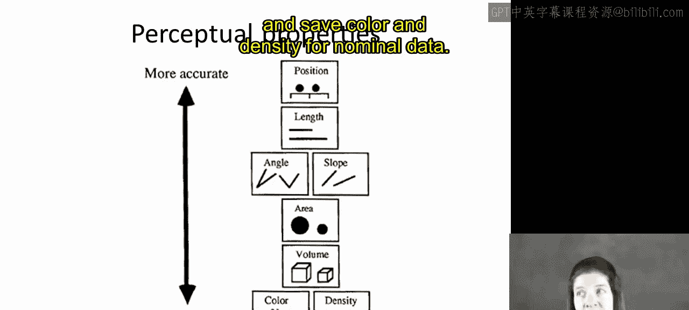
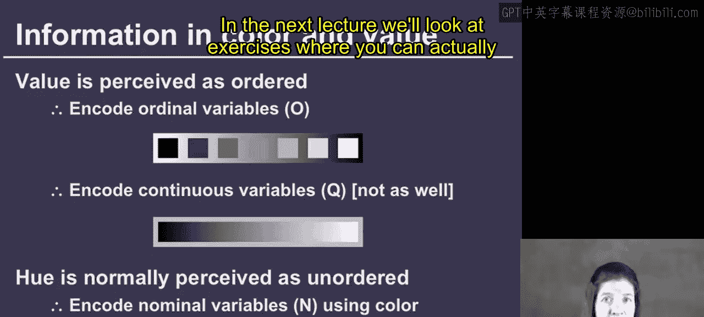

# 杜克大学《大规模数据科学（预测分析，交流数据科学结果，第2、3课⧸共3课有视频）｜Data Science at Scale》中英字幕 p73 3_04 将数据类型映射到视觉属性.zh_en -BV1xf421Q7bH_p73-

。

All right， so moving on， we've now completed step one of the process of information visualization。

 so now let's describe how to do step two， mapping data types to visual attributes。In 1967。

 Jacques Bin， a French cartographer， made the first formalization of visual language and the first attempt at a theoretical foundation for information visualization。

He identified seven key visual attributes illustrated on the right hand side of the page in0，1。

 and two dimensions。And these seven key attributes are position。Size。Value or lightness。Texture。

Color。Orientation and shape。So this is an important slide。

 you should probably write down these seven attributes or at least save the slide。

So now that we have taxonomies of both data types and visual attributes。

 let's talk about how we map one to the other。So Btan offered the following suggestions。

 he said there were levels of organization that you could consider， position can be used for nominal。

 ordinal or quantitative data。As can size， now value or lightness。

Can be used for nominal or ordinal data and perhaps for quantitative data。

 although it's not quite as clear。And texture can be used for nominal data。

 and maybe for ordinal data， you could imagine a denser texture might be seen as having some order over a lighter。

 a less dense texture。And then finally， color， orientation and shape。

Can really only be used for nominal data。 You can't really say that one color is greater than another or that one orientation is less than another。

 or that a shape， a star say is more than or less than a circle。

And further work that involves decades of research in psychology and psychophysics have established this hierarchy of perceptual properties。

Humans can detect differences in position most accurately， then length。Then angle and slope。

 then area。Then volume。And least of all， color and density。

So when you're assigning these attributes to your data。

 make sure to choose position for your most important quantitative data and save color and density for nominl data。

A final note on color。Value can be perceived as ordered， so you can encode ordinal variables。

 In other words， you see this strip that goes from black to white， where value is increasing。

You can see that there is an order to these colors。

You can also even encode continuous values with a grayscale mapping， although not as well。

But H is normally perceived as unordered， so you always only want to encode nominal variables using color。

 There's no order to the colors on the bottom of the slide。

So this was a very brief lecture on the central important problem of information visualization。

 in the next lecture we'll look at exercises where you can actually put this theory into practice。

