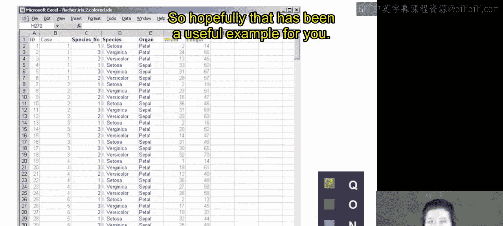

# 杜克大学《大规模数据科学（预测分析，交流数据科学结果，第2、3课⧸共3课有视频）｜Data Science at Scale》中英字幕 p74 4_05 数据类型练习.zh_en -BV1xf421Q7bH_p74-

。

I'm going to show you a spreadsheet， and I'd like you to think about which of the columns in the spreadsheet are nominal。

 ordinal or quantitative。So here we have a set of sepel and pal lengths and widths for three species of iris。

The first column you have an ID number， then a case number。Next， a species number。

Then a species name。The organ， pal or sepel。The width and length of that organ in millimeters。

So why don't you take some time and think about which of these are nominal？Ordinal。And quant it。

You can see that it's not as straightforward as it might appear in the first place。For example。

 we have numbers here that fall into the categories nominal， ordinal and quantitative。

 So let's explain why each of these is defined the way it is。

So the quantitative is probably the easiest。 The orange data。

 the width and the length of the sepel and petal are quantitative。 You can say， for example。

 that for the first species， the length is seven times the width。

 so you can perform ratios and proportions。 So it's quantitative data。 Now， the first two。

 the ID D number and the case number are ordinal。So why are they not quantitative Well。

 because it's really not something where you can say that the distance between the ID number three and the ID number two has any meaning。

 but it clearly has an order。 The ID numbers were assigned in some particular order。

So therefore it's ordinal and the cases were assigned in a particular order。

 but there's not necessarily a meaning for the differences between them。

 so the ID and the case numbers are ordinal。Now we have the species number， the species in the organ。

 which are nominal。 Well， it's probably pretty clear that the species name and the organ would be nominal because they're names。

 All you can do is say whether they're equal or not equal to each other。

 You can't say that the sequel is somehow greater than the petal so that those are pretty easy。

 but what about the species number Why isn't that ordinal。

And the answer to that is simply because in this case， the species number is simply a label。

 there is no order to it。 It was assigned to the species simply as a labeling convention。All right。

So hopefully that has been a useful example for you。

