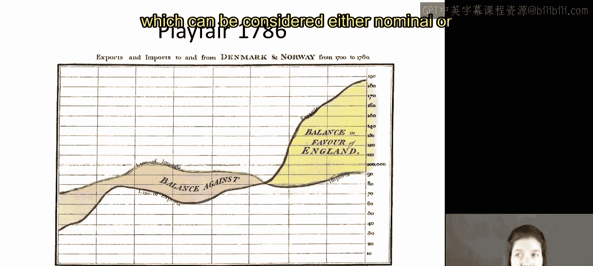
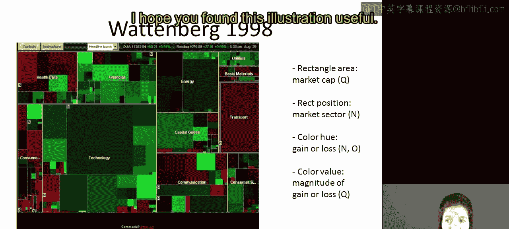

# 杜克大学《大规模数据科学（预测分析，交流数据科学结果，第2、3课⧸共3课有视频）｜Data Science at Scale》中英字幕 p75 5_06 数据类型和视觉映射练习.zh_en -BV1xf421Q7bH_p75-

。

Last time。We talked about the theory behind the central problem and information visualization。

 mapping data types to visual attributes。 In this lecture。

 we're going to put that theory into practice。 So for these exercises。

 I'm going to show you three visualizations， and in each of them。

 I'd like you to identify which types of data and mappings are represented。

So here we have a stock chart from around 2000 the year of the dot co bust。

How many data types are represented on this graph？What are they？Are they nominal。

 ordinal or quantitative， what are they mapped to， which visual attributes that is？

And is that a good mapping， why or why not？What is your opinion on the visualization。

 take some time to study it and come up with the answers to these questions。

Okay here are the answers， it's actually quite simple。

 there are two dimensions of data represented on this chart。

 they're both quantitative and they're both mapped to position。

 you have the time which is quantitative or interval data on the X axis。

 and then price in dollars is mapped to the Y axis。All right， let's try another one。

This is one of the earliest graphs made in 1786 by William Playfair。

 a Scottish engineer and the inventor of several common types of diagrams and use today。

So on this diagram， how many data types are represented？What are they， are they nominal。

 ordinal or quantitative， which visual attributes are they mapped to？And is this a good mapping。

 why or why not？There are four dimensions of data represented in this graph。The year。

 which is quantitative， is mapped to position on the x axis。Imports in pounds， also quantitative。

Maap to position on the Y axis。Similarly， exports， which are quantitative。

 are mapped to position on the Y axis。And then finally， the balance of trade。

 which can be considered either nominal or ordinal。Is map2， color and area。

Here we have the US stock market， visualized with a version of Ben Schneiderman's tree map。

 where quantitative data is mapped to a set of space filling rectangles， in this case。

 market capitalization is mapped to rectangle area。This was created by Martin Watenberg in 1998。

How many data types are represented？What are they， are they nominal， ordinal or quantitative。

 which visual attributes are they mapped to， and is this a good mapping， why or why not？

In this visualization， we have four variables。The market capitalization quantitative is mapped to the rectangle area。

 the market sector， technology， energy， capital goods， transport， etc cea， is nominal data。

 and that's mapped to the rectangle position， third。

 whether there is a gain or loss is represented by the color hue， red or green。

 so if there' is a gain， it's green and if there's a loss， it's red。

 this is nominal or perhaps ordinal data。Finally。The magnitude of the gain or loss。

 which is quantitative data， is represented by the color value。

 so you can see that the brighter the green， the greater the gain。Similarly， the brighter the red。

 the greater， the loss。So this concludes our set of three exercises。

 I hope you found this illustration useful。

Next time we're going to talk about data combinations and dimensions。

