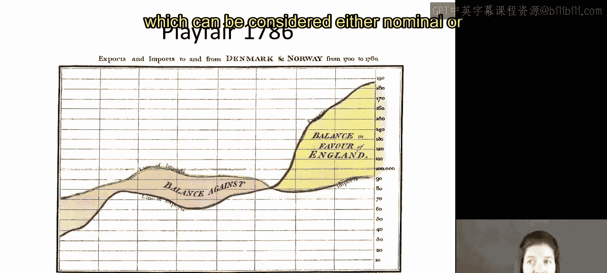
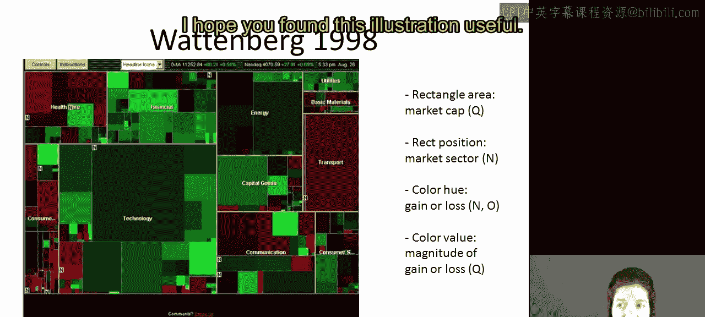

# 大规模数据科学：第2课：数据类型与视觉映射实践 🎯

在本节课中，我们将学习如何将数据类型映射到视觉属性，并通过三个具体示例来实践这一理论。我们将分析每个图表中使用的数据类型、视觉映射方式，并评估其有效性。

---

上一节我们介绍了信息可视化的核心问题与理论基础，即如何将数据类型映射到视觉属性。本节中，我们将通过三个实际案例来应用这些理论。

以下是第一个练习，请仔细观察图表并思考相关问题。

这是一张大约2000年互联网泡沫时期的股票走势图。请分析以下问题：
*   图表中呈现了多少种数据类型？
*   它们分别是什么类型（定类、定序还是定量）？
*   这些数据被映射到了哪些视觉属性上？
*   这种映射方式是否合理？为什么？

请花些时间研究图表并得出你的答案。

以下是参考答案。这个案例实际上相当简单：
*   图表中呈现了**两个**维度的数据。
*   它们都是**定量**数据。
*   两者都映射到了**位置**属性上。
*   **时间**（定量/区间数据）映射到X轴的位置。
*   **价格**（美元）映射到Y轴的位置。

---

接下来我们尝试第二个案例。这个图表由苏格兰工程师威廉·普莱费尔于1786年创建，他是当今几种常用图表类型的发明者。

请分析这张图表：
*   图表中呈现了多少种数据类型？
*   它们分别是什么类型？
*   这些数据被映射到了哪些视觉属性上？
*   这种映射方式是否合理？为什么？

以下是分析结果。这张图表呈现了**四个**维度的数据：
1.  **年份**（定量数据）映射到X轴的**位置**。
2.  **进口额**（英镑，定量数据）映射到Y轴的**位置**。
3.  **出口额**（定量数据）同样映射到Y轴的**位置**（通过另一条线表示）。
4.  **贸易差额**（可视为定类或定序数据）映射到**颜色**和**面积**（通过填充区域表示）。

---

最后，我们来看第三个案例。这是马丁·瓦滕伯格于1998年创建的一个可视化作品，它使用了本·施奈德曼树状图的一个变体，通过空间填充矩形来展示数据。

请分析这个可视化作品：
*   其中呈现了多少种数据类型？
*   它们分别是什么类型？
*   这些数据被映射到了哪些视觉属性上？
*   这种映射方式是否合理？为什么？

在这个可视化中，我们识别出**四个**变量：
1.  **市值**（定量数据）映射到**矩形的面积**。
2.  **市场板块**（如科技、能源、资本货物、运输等，属于定类数据）映射到**矩形的位置**（分组）。
3.  **盈亏状态**（盈利或亏损，属于定类或定序数据）映射到**色彩**（色相）：盈利为绿色，亏损为红色。
4.  **盈亏幅度**（定量数据）映射到**色彩明度**：绿色越亮表示盈利越多，红色越亮表示亏损越大。

---

本节课中我们一起学习了如何通过三个具体案例来分析和评估数据可视化中的数据类型映射。我们实践了识别数据类型（定类、定序、定量）、判断其映射的视觉属性（如位置、颜色、面积），并思考了这些映射的有效性。

下次课我们将讨论数据的组合与维度。