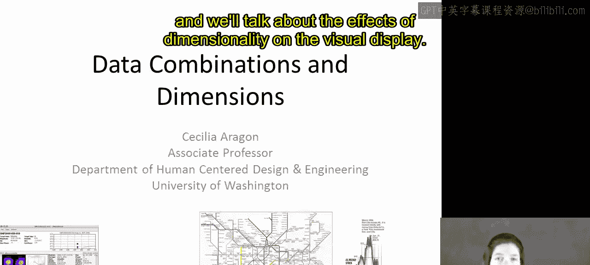
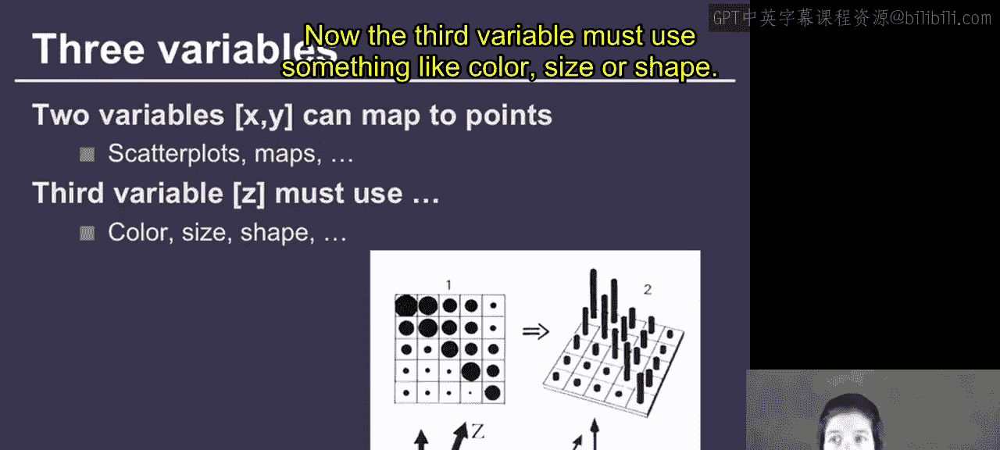
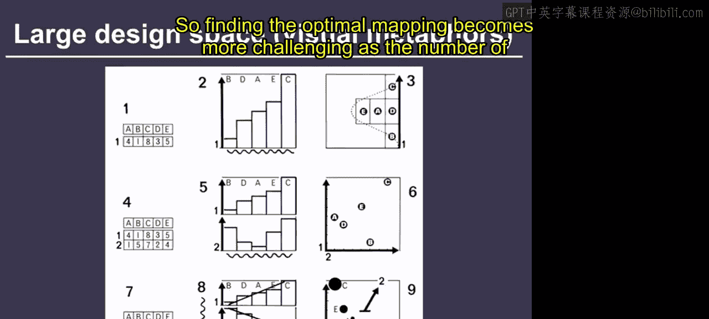
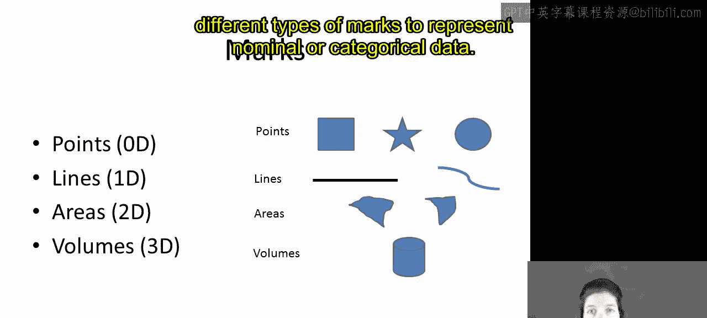
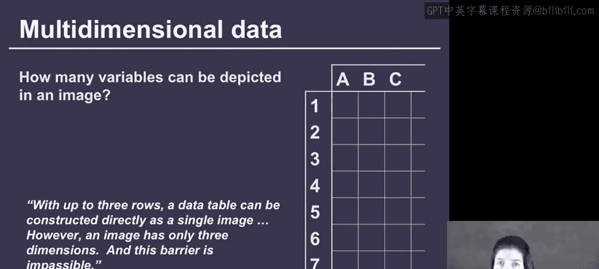

# 杜克大学《大规模数据科学（预测分析，交流数据科学结果，第2、3课⧸共3课有视频）｜Data Science at Scale》中英字幕 p76 6_07 数据维度.zh_en -BV1xf421Q7bH_p76-

。

In the last lecture， we provided a set of three exercises on mapping data types to visual attributes。

In this lecture， we're going to give more examples of data combinations and the mapping of data to visual attributes and we'll talk about the effects of dimensionality on the visual display。

😊。

So if you have a single variable to display or unitivaria data。

 you have a plethora of choices for visualizations。Dot plots。Line plots。

 bar graphs or two key box plots are but a few of the examples。For bivariate quantitative data。

The scatter plot is the most common choice， so here we have two quantitative variables and the scatter plot describes the information quite clearly。

Moving up to three dimensions， now it's getting a bit more challenging。

 so we can try a 3D scatter plot， but what are some of the problems。

 Let's look at the 3D scatter plot on the right with blue cubes。

Where exactly are E and F in relation to each other？

It's a bit of a problem trying to represent three dimensional information on a two dimensional surface。

A better choice might be to use a two dimensional scatter plot with a third dimension represented by some other attribute here we use area for the red circles for the third quantitative dimension。

Area is not perceived as accurately as position， so you want to put the most important dimensions on the X and Y axes and save the least important or perhaps the most easily distinguished for the third。

Since we already discussed what are the issues in trying to map three variables to a third spatial dimension。

 let's look at other ways to deal with mapping three variables to a visualization。

 so we know that two variables on the X and Y axis can map to points， so we have scatterpls。

 maps etc。Now the third variable must use something like color， size， or shape。

And as you can imagine。We have a very large design space。

 so finding the optimal mapping becomes more challenging as the number of dimensions increases。

You can always use shape or different types of marks to represent nominal or categorical data。

Now moving up to multidimensional data。How many variables can be depicted in an image。

 We've talked about1，2， and three dimensions。 But what about more if theres some perceptual limit。

Starting in 1967， Bertan and others asked this question。And Btan stated， with up to three rows。

 a data table can be constructed directly as a single image。However。

 an image has only three dimensions， and that barrier is impassable。

We'll look into answering this question in the next lecture。

