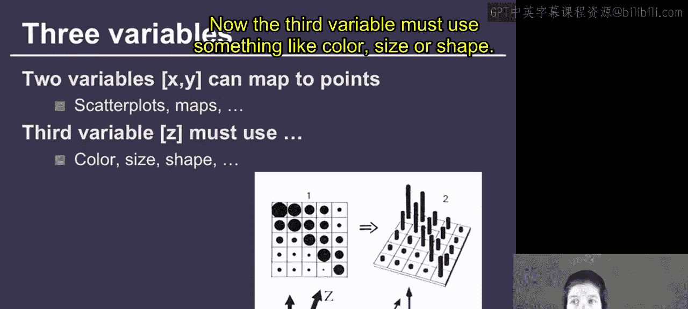
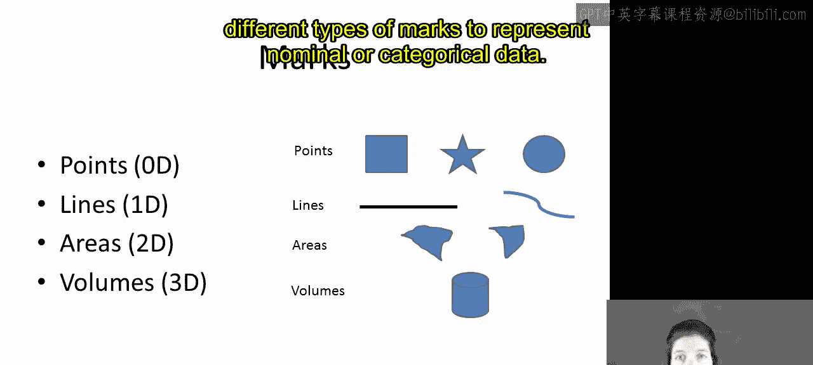
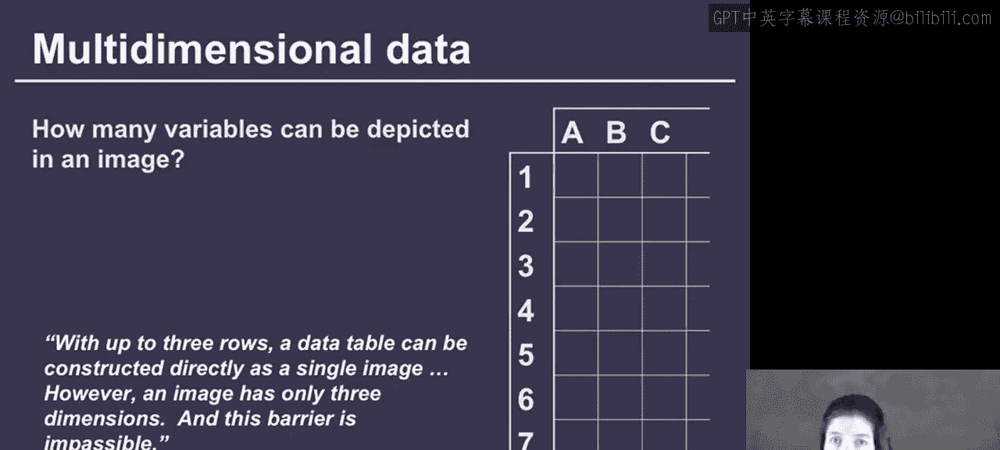

# 大规模数据科学（预测分析，交流数据科学结果，第2、3课⧸共3课有视频）：6_07：数据维度

在本节课中，我们将学习数据维度如何影响可视化设计。我们将探讨从单变量到多变量数据的可视化方法选择，并理解在二维平面上展示多维信息时面临的挑战。

在上一讲中，我们提供了三个关于将数据类型映射到视觉属性的练习。

本节中，我们将给出更多数据组合及其视觉属性映射的示例，并讨论数据维度对视觉展示效果的影响。

## 单变量与双变量数据可视化

如果你需要展示单个变量，即单变量数据，你有多种可视化选择。以下是部分示例：

*   点图
*   折线图
*   条形图
*   箱线图

对于双变量定量数据，散点图是最常见的选择。这里我们有两个定量变量，散点图可以清晰地描述它们之间的关系。

## 三维数据的可视化挑战

当数据维度增加到三维时，可视化变得更具挑战性。我们可以尝试使用三维散点图，但它存在一些问题。让我们看看右侧用蓝色立方体表示的三维散点图。点E和点F之间的相对位置关系究竟如何？在二维平面上表现三维信息存在一定困难。

一个更好的选择可能是使用二维散点图，并用其他视觉属性来表示第三个维度。例如，我们可以用红色圆点的面积来代表第三个定量维度。然而，人们对面积的感知不如对位置（坐标）的感知准确。因此，通常应将最重要的维度放在X轴和Y轴上，而将最不重要或最容易区分的维度留给第三个视觉属性。

既然我们已经讨论了将三个变量映射到三维空间时存在的问题，接下来让我们看看处理三个变量可视化的其他方法。

## 映射第三个变量的方法

我们知道，X轴和Y轴上的两个变量可以映射为点，因此我们有散点图、地图等可视化形式。现在，第三个变量必须使用颜色、大小或形状等其他属性来表示。

可以想象，我们拥有一个非常庞大的设计空间。随着数据维度的增加，找到最优的映射方案变得更加具有挑战性。

你总是可以使用形状或不同类型的标记来表示名义数据或分类数据。

## 多维数据的限制

现在，让我们上升到多维数据。一幅图像中可以描绘多少个变量？我们已经讨论了1维、2维和3维的情况。但如果维度更多呢？是否存在某种感知上的限制？

从1967年开始，贝尔坦等人就提出了这个问题。贝尔坦指出，对于最多包含三行的数据表，可以直接构建为单一图像。然而，一幅图像只有三个维度，这个障碍是无法逾越的。

我们将在下一讲中深入探讨如何回答这个问题。

## 总结

本节课中，我们一起学习了数据维度对可视化设计的影响。我们回顾了单变量和双变量数据的可视化方法，探讨了在二维平面上展示三维数据时遇到的挑战，并介绍了通过颜色、大小和形状等属性来映射额外变量的策略。最后，我们触及了多维数据可视化的感知限制，为后续内容奠定了基础。