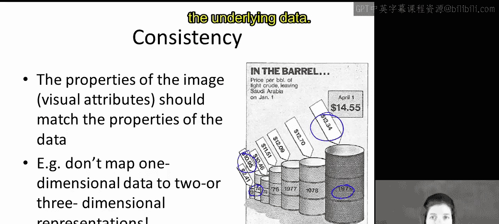

# 杜克大学《大规模数据科学（预测分析，交流数据科学结果，第2、3课⧸共3课有视频）｜Data Science at Scale》中英字幕 p77 7_08 有效的视觉编码.zh_en -BV1xf421Q7bH_p77-

。

Last time we talked about data types， dimensions， and how to map data to visual attributes based on the number of data dimensions。

Clearly， there's a large design space for this visual encoding。

Information visualization is about choosing the most effective visual encoding for a given data set in this lecture。

 we're going to describe how to do that。We saw earlier that there are different data types。

 and those can be mapped to a set of visual attributes and some mappings are better than others。

So now we have a challenge， how do we pick the best mapping of all possibilities？

So in order to do this， we're going to follow three basic principles。Importance ordering。

 expressiveness and consistency。This was first described by Jack McKinley in 1986。

So importance ordering has to do with encoding the most important information in the most perceptually accurate way。

Expressiveness has to do with depicting all the data and only the data。And finally。

 consistency means that the properties of the image， the visual attributes。

 should match the properties of the data。I'll go into more detail on how to do this on the following slides。

We'll start with importance ordering， we've seen this slide before。Now， as we discussed earlier。

 decades of research have taught us that certain visual attributes more accurately represent quantitative data to the human brain。

MKinley defined expressiveness in the following manner。

 He said a set of facts is expressible in a visual language if the sentences， I。e。

 the visualizations in the language express all the facts in the set of data and only the facts in the data。

So what does this mean？Well， using color Hue， we cannot express the fact that one item is greater than another。

 so color Hue simply can't represent ordinal data。Ordinnal or quantitative data。

So color Hues simply can't represent ordinal or quantitative data。It's best use for nominl data。

On the other hand。You don't want to express facts that are not in the data。

 so a length is interpreted as a quantitative value。In this incorrect use of a bar chart。

 the length of the bar says something untrue about the data。So on the X axis。

 we have the national origin of these cars and on the Y axis， the Macon model。Now。

 the length of the bar suggests an ordering on the axis。

 so it implies that somehow Germany is greater than the USA。So therefore。

 using bars for nominal data is an incorrect choice。Number three， we have consistency。

 the properties of the image， the visual attributes should match the properties of the data。

What this means is you don't want to do something like mapping one dimensional data to two or three dimensional visual representations。

This diagram represents why that's not a good idea。

 So here we have the price per barrel of oil represented as the height of a three dimensional barrel。

 You can see the obvious problem here。 Look at 1974， the price。Is 10，95。And then for 1979。

The price is 1334。Well， this is less than a 30% increase。

And yet the 1979 barrel looks significantly larger than the 1974 barrel。 So clearly。

 this is an inconsistent representation。The three dimensional representation is implying something false about the underlying data。

