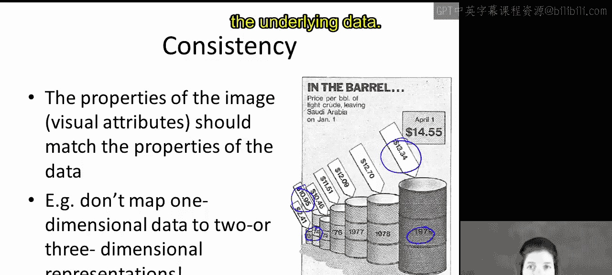

# 数据科学大规模应用：第2课：有效的视觉编码 📊

在本节课中，我们将学习如何为给定数据集选择最有效的视觉编码方式。我们将介绍三个基本原则：重要性排序、表达性和一致性，并通过具体示例说明如何应用这些原则来创建准确、清晰的数据可视化。

---

上一节我们讨论了数据类型、维度以及如何根据数据维度将数据映射到视觉属性。显然，视觉编码的设计空间非常广阔。信息可视化的核心，就是为特定数据集选择最有效的视觉编码方式。本节我们将详细描述如何做到这一点。

我们之前了解到存在不同的数据类型，这些类型可以映射到一组视觉属性上，且某些映射方式优于其他方式。因此，我们面临一个挑战：如何在所有可能性中选择最佳的映射方式？

为了解决这个问题，我们将遵循三个基本原则：**重要性排序**、**表达性**和**一致性**。这些原则最早由 Jack McKinley 于 1986 年提出。

---

## 重要性排序 🥇

重要性排序是指，以人类感知最准确的方式编码最重要的信息。

我们之前见过这张图表。正如我们之前讨论的，数十年的研究告诉我们，某些视觉属性能更准确地向人脑传达定量数据。例如，**位置**和**长度**在表示定量数据时最为准确，而**颜色饱和度**和**形状**的准确性则较低。因此，在设计中，应将最重要的数据维度映射到最准确的视觉通道上。

---

## 表达性 🎯

接下来，我们看看表达性原则。McKinley 对表达性的定义如下：如果一种视觉语言中的“句子”（即可视化图表）能够表达数据集中**所有**的事实，并且**仅**表达数据中的事实，那么这组事实在该视觉语言中就是可表达的。

这意味着什么？例如，使用**色调（Color Hue）**无法表达一个项目大于另一个项目的事实。因此，色调根本不能表示有序数据或定量数据。它最适合用于表示**名义数据（Nominal Data）**。

另一方面，你也不希望表达数据中不存在的事实。例如，**长度**通常被解读为定量值。在下图这个条形图的错误用法中，条形的长度传达了关于数据的不真实信息。

在 X 轴上，我们有这些汽车的原产国，Y 轴上是车型。条形的长度暗示了轴上存在一种排序关系，这错误地暗示了德国在某种意义上是“大于”美国的。因此，对名义数据使用条形图是一个错误的选择。

---

## 一致性 🔄

最后，我们讨论一致性原则。一致性的含义是：图像的属性（即视觉属性）应与数据的属性相匹配。

这意味着，你不应该做诸如将一维数据映射到二维或三维视觉表示这样的事情。下图说明了为什么这不是一个好主意。

这里，每桶石油的价格用一个三维桶的高度来表示。你可以看到明显的问题。看 1974 年，价格是 10.95。而 1979 年的价格是 13.34。这实际上是一个不到 30% 的增长。然而，1979 年的桶看起来明显比 1974 年的桶大得多。显然，这是一种不一致的表示。三维表示暗示了关于底层数据的错误信息。

---

## 总结 📝

本节课我们一起学习了有效视觉编码的三个核心原则：

1.  **重要性排序**：将最重要的数据维度映射到人类感知最准确的视觉通道上。
2.  **表达性**：可视化应表达数据中所有且仅有的信息，避免使用不合适的视觉属性（如用色调表示顺序）。
3.  **一致性**：视觉属性的特性（如维度）应与数据本身的特性相匹配，避免产生误导（如用三维体积表示一维数据）。

遵循这些原则，可以帮助我们创建出更准确、更清晰、更具洞察力的数据可视化图表。