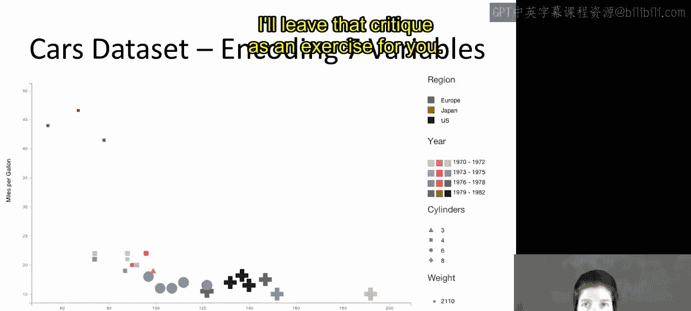

# 杜克大学《大规模数据科学（预测分析，交流数据科学结果，第2、3课⧸共3课有视频）｜Data Science at Scale》中英字幕 p78 8_09 有效视觉编码练习.zh_en -BV1xf421Q7bH_p78-

。

Let's move to a data encoding exercise。Here we have a data set of cars。

 we have the model on the first column。The country of origin， the year。The number of cylinders。

The horsepower。The miles per gallon。And finally， the weight in pounds。

I would like you to create a visualization that encodes all seven dimensions of this data set。

Make the perceptually appropriate choices and be prepared to explain。

I'll describe the steps you need to do and show you Bertan's examples once more。So step one。

 determine which columns represent nominal ornal or quantitative data。Step 2。

Review Burtan's visual attributes on the next slide。

And assign the most perceptually appropriate choices to each data set。Step three。

 create a visualization that encodes as many of the seven dimensions as you can。

 Don't worry if you can't get all of them， but do try to do so。To review。

 here are Btan's visual attributes， position， size， value， texture。Color， orientation and shape。

Are you done。Here's one attempt made by one of my students。

So this is an attempt at encoding seven variables from the CA's data set in a single visualization。

So this student chose to put two of the quantitative variables。

 horsepower and miles per gallon on the x and Y axes， the third ratio data weight。

 he encoded with area of the marks。It's not a bad choice since you can only put two of those ratio variables on axes。

He also chose to encode cylinders， which are quantitative interval data。

By using the shape of the mark。And then finally， he used color Hue for the region， Europe。

 Japan or US。And color value or Lightness for the year。Additionally， in his visualization。

 you can mouse over each of the marks and the name of the model of the car would pop up。So。

What do you think of this visualization？What works？What doesn't。And what could you do better？

I'll leave that critique as an exercise for you。

