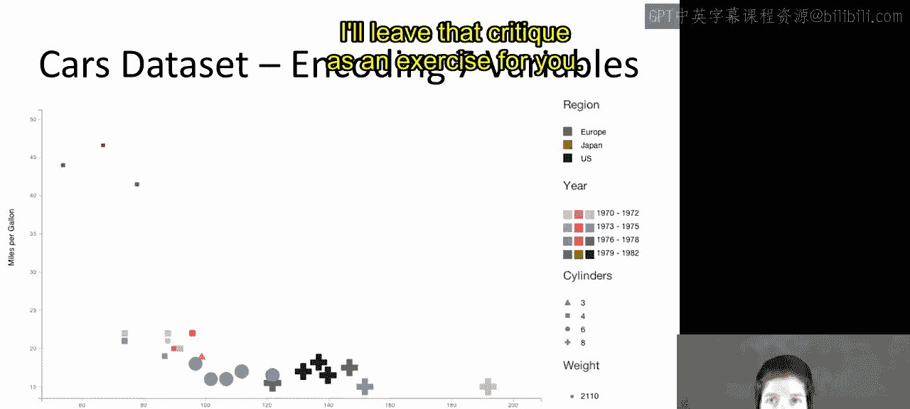

# 数据科学大规模应用：第2课：有效视觉编码练习 🚗

在本节课程中，我们将通过一个具体的数据集练习，学习如何为多维数据选择合适的视觉编码方式。我们将使用汽车数据集，尝试在一个可视化图表中编码全部七个维度的信息。

---

上一节我们介绍了视觉编码的基本概念和伯坦的视觉属性理论。本节中，我们来看看如何将这些理论应用于一个实际的数据集。

我们有一个汽车数据集，包含以下七列信息：
*   **Model**：车型
*   **Country of Origin**：原产国
*   **Year**：年份
*   **Number of Cylinders**：气缸数
*   **Horsepower**：马力
*   **Miles per Gallon**：每加仑英里数（油耗）
*   **Weight in Pounds**：重量（磅）

我们的目标是创建一个可视化图表，尽可能多地编码这七个维度的数据。

以下是完成此练习的三个步骤：

**第一步：识别数据类型**
首先，需要确定每一列数据是**定类数据**、**定序数据**还是**定量数据**。这是选择合适视觉编码的基础。

**第二步：回顾视觉属性**
回顾伯坦提出的七种视觉属性，它们分别是：
1.  **位置**
2.  **大小**
3.  **明度**
4.  **纹理**
5.  **色相**
6.  **方向**
7.  **形状**

**第三步：创建可视化**
根据前两步的分析，为数据集中的每个维度分配最符合感知特性的视觉属性，并尝试创建一个能编码尽可能多维度（目标是全部七个）的可视化图表。

---

现在，让我们来看一位学生的尝试。

这位学生选择将两个定量变量——**马力**和**每加仑英里数**——分别放在X轴和Y轴上。第三个定量变量**重量**，则用标记点的**面积**来编码。这是一个不错的选择，因为坐标轴通常只能容纳两个定量变量。

此外，他将**气缸数**（定量区间数据）用标记点的**形状**来编码。对于**原产国**（定类数据），他使用了**色相**（如欧洲、日本、美国用不同颜色表示）。对于**年份**（定量数据），他使用了**颜色的明度**（或亮度）来编码。

在他的可视化中，你还可以将鼠标悬停在每个标记点上，**车型名称**会弹出显示。

---

那么，你如何评价这个可视化图表？哪些地方做得好？哪些地方有待改进？你能否设计出更好的方案？

我将这个批判性思考留作你的练习。通过分析这个案例，你可以更深入地理解如何平衡信息密度与视觉清晰度，从而创建出更有效的图表。

---

本节课中，我们一起学习了如何为一个包含七个维度的数据集设计视觉编码方案。我们实践了从识别数据类型、匹配视觉属性到最终构建图表的完整流程。记住，优秀的可视化是在准确传达信息和保持视觉可读性之间找到最佳平衡。