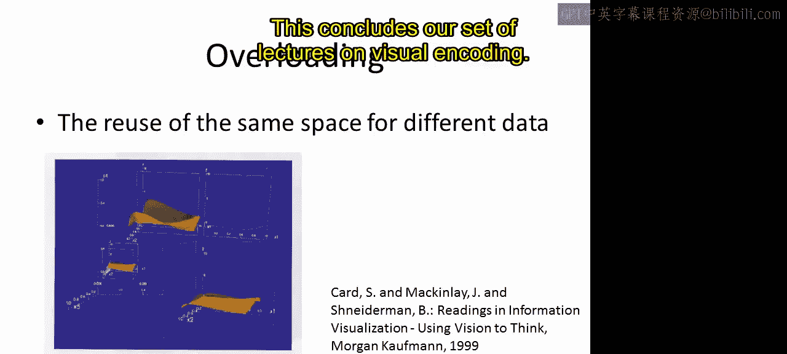

# 杜克大学《大规模数据科学（预测分析，交流数据科学结果，第2、3课⧸共3课有视频）｜Data Science at Scale》中英字幕 p79 9_10 视觉编码的设计标准.zh_en -BV1xf421Q7bH_p79-

。

In this final lecture on effective visual encoding。

 we're going to start with two quick exercises on effective presentation of data。

 and then we're going to discuss five key techniques for increasing the amount of information represented by spatial position。

So we've already talked about。Why effective visual encoding is important。

 Here is an example that I'd like you to consider。 So look at these two representations of quantitative data Here we have the top level  one where color is used to represent it and at the bottom。

 a line graph。Why would the line graph be better to use than the color。 By now。

 you should know it's faster to interpret。 as you take the time to look at it。

 you can see that there are more distinctions。 You can clearly see the quantitative information。

Much more easily with a line graph and with a color， and there are fewer errors of interpretation。

 pretty simple。Is this an effect of visual representation？Yes or no。If no， what's wrong with it？

This visual representation is not expressive because it implies an incorrect ordinal relationship among the countries。

All right， moving on to some new material。We already know from research data in human perception that spatial position is the most accurate representation of quantitative data。

 So how can we leverage this fact。In 1999， Car McKinley and Schneiderman proposed five techniques to increase the amount of information encoded by spatial position。

Composition， alignment， folding， recursion， and overloading。

 we're going to go through each of these slide by slide。

Composition refers to an orthogonal placement of axes。

 you create a 2D metric space and you can line the data up along the X and Y axes in multiple different ways。

Alignment， this refers to the repetition of an axis at a different position in the space。

So here you see we have the same time axis repeated in two places。

 but two different graphs representing different amounts of information on the Y axis。Folding。

 continuation of an axis in orthogonal dimension。Recursion or the repeated subdivision of space。

And finally， overloading where we reuse the same space for different data。All right。

 this concludes our set of lectures on visual encoding。

 the next set of lectures will move to visual perception。

