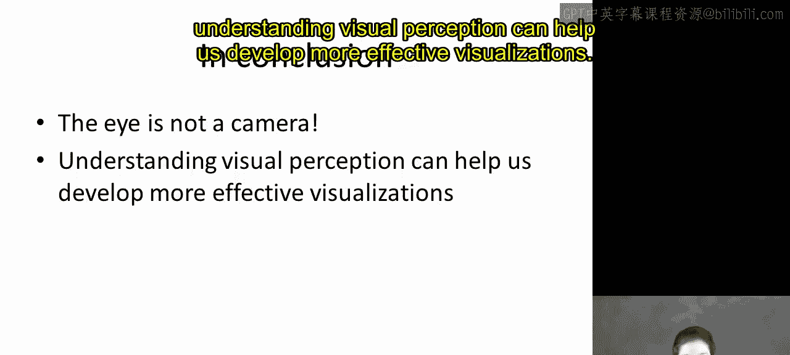

# 杜克大学《大规模数据科学（预测分析，交流数据科学结果，第2、3课⧸共3课有视频）｜Data Science at Scale》中英字幕 p80 10_11 眼睛不是相机.zh_en -BV1xf421Q7bH_p80-

。

🎼In the previous lectures， we've been discussing data and visual mappings。 Now。

 we're going to talk about the other end of the pipeline。

 how that information is processed by the human brain。

 This is the first of three lectures on visual perception。

Sty% of our body's sense receptors reside in our eyes。

 our very language resonates with the importance of our eyes。

 metaphors to describe understanding often refer to vision， I see， insight or illumination。

Columware stated in 2004， the eye and the visual cortex of the brain form a massively parallel processor that provides the highest bandwidth channel into human cognitive centers。

In these three lectures， we're going to describe how it's important to understand how visual perception works in order to effectively design visualizations。

 The first key principle to keep in mind is that the eye is not a camera。

A better metaphor for vision was given by Christopher Healley in 1995。

 It's a dynamic and ongoing construction project。And it's important to keep this in mind as you go through the next three lectures。

 because when you design a visualization， if you think of the eye as a camera。

 it can lead you to some erroneous conclusions。Attention is selective。

 we all know that it's filtered to a high degree， and it's really cognitive processes that transform the visual information into something that we can comprehend。

The field of psychophysic he is concerned with establishing quantitative relationships between physical stimulation and perceptual events。

 So we're going to be talking about some of the important discoveries made in this field in the next three lectures。

Let's think a little bit about how to use perceptual properties。

Information visualization should cause what is meaningful to stand out。

So what do you see in this image？Can you see the two spots that differ from their surroundings？

Why do you see them？We're going to answer that question in the next few slides and lectures。

Some important differences between eyes and cameras。Cameras have very good optics。

They have a single focus， they maintain a white balance and a single exposure。

And they also do what's known as a full image capture。 In other words。

 all the photons coming into the eye are captured with equal importance and at the same time。

The eyes， on the other hand， have relatively poor optics。 They're constantly scanning。

 This is known as scades。 the shifting of your eyes to various positions。

 They're constantly adjusting focus。 They're constantly adapting both the white balance and the exposure。

 What's really going on is a mental reconstruction of the image sort of， As we'll find out。

 it's not even a complete image that's reconstructed。So here's one example。

Visual perception really isn't just camera work。Looking at this checker board。

 it's pretty clear that square A is darker than square B， right？Turns out if you gray out the image。

 you see the truth。Square A and square B have identical pixel values。As a matter of fact。

 when I first saw this image， I didn't believe it， I actually put the image in Photoshop and used the Idropper tool in order to find out what the RGB values were of those two squares and yes indeed they are identical so you're welcome to do the same you can take a screen capture and test it out yourself。

But it's pretty interesting。The human visual system is so dependent on context and upon reconstructing the image that we see these two squares。

 which identical is quite different。Color is relative， as are many other of our perceptions。

 If you look at this slide， doesn't it look like the X on the left hand side is gray。

 and the one on the right hand side is yellow。But if you go look at the where they connect in the center bottom of the slide。

 you'll see they're identical， and that's again， because the eye perceives differences。

 it does not perceive actual pixel values。So in conclusion。

I hope youve taken away from this lecture that the eye is not a camera。

 and the next two lectures we're going to discuss more about how understanding visual perception can help us develop more effective visualizations。

