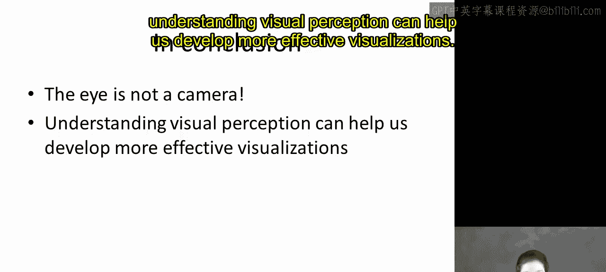

# 数据科学可视化：第2课：视觉感知基础

在本节课中，我们将要学习视觉感知的基本原理，理解人眼处理视觉信息的方式与相机有何不同，以及这对设计有效的数据可视化有何重要意义。

---

在之前的课程中，我们讨论了数据和视觉映射。现在，我们将探讨信息处理流程的另一端：人脑如何处理这些信息。这是关于视觉感知的三讲课程中的第一讲。

我们身体中70%的感觉接收器位于眼睛。我们的语言也反映了眼睛的重要性，描述理解的隐喻常常与视觉相关，例如“我明白了”、“洞察力”或“启发”。

Columware在2004年指出，眼睛和大脑的视觉皮层构成了一个大规模并行处理器，提供了进入人类认知中心的最高带宽通道。

在这三讲课程中，我们将描述理解视觉感知的工作原理对于有效设计可视化的重要性。需要牢记的第一个关键原则是：**眼睛不是相机**。

Christopher Healley在1995年给出了一个更好的视觉隐喻：它是一个动态且持续进行的构建项目。在学习接下来的三讲课程时，牢记这一点非常重要。因为当你设计可视化时，如果将眼睛视为相机，可能会导致一些错误的结论。

注意力是具有选择性的，我们都知道它经过了高度过滤。真正将视觉信息转化为我们可以理解的内容的是认知过程。

心理物理学领域关注的是建立物理刺激与感知事件之间的定量关系。在接下来的三讲课程中，我们将讨论该领域的一些重要发现。

---

让我们思考一下如何利用感知特性。信息可视化应该让有意义的内容凸显出来。

那么，你在这张图片中看到了什么？你能看到两个与周围环境不同的点吗？为什么你能看到它们？我们将在接下来的几张幻灯片和课程中回答这个问题。

以下是眼睛和相机之间的一些重要区别：

*   **相机**：拥有非常好的光学系统。具有单一焦点，能保持白平衡和单一曝光。并且进行所谓的全图像捕捉。换句话说，所有进入相机的光子都被同等重要地、同时地捕捉。
*   **眼睛**：光学系统相对较差。它们不断扫描，这被称为**扫视**，即眼睛向不同位置的移动。它们不断调整焦点，不断适应白平衡和曝光。真正发生的是图像在心理上的重建。正如我们将发现的，它甚至不是一个完整图像的重建。

---

视觉感知确实不仅仅是相机的工作。请看这个棋盘，很明显，方格A比方格B颜色更深，对吗？事实证明，如果你将图像灰度化，就会看到真相。方格A和方格B具有相同的像素值。

事实上，当我第一次看到这张图像时，我并不相信。我实际上将图像放入Photoshop，并使用吸管工具来找出这两个方格的RGB值，结果它们确实是相同的。你也可以这样做，截取屏幕截图并亲自测试一下。

但这非常有趣。人类的视觉系统如此依赖于上下文和图像的重建，以至于我们看到这两个完全相同的方格时，感觉却截然不同。

颜色是相对的，我们的许多其他感知也是如此。如果你看这张幻灯片，左边的X看起来是不是灰色的，而右边的X看起来是黄色的？但如果你去看它们在幻灯片底部中心连接的地方，你会发现它们是相同的。这再次证明，眼睛感知的是差异，而不是实际的像素值。

---

在本节课中，我们一起学习了眼睛不是相机这一核心观点。在接下来的两讲课程中，我们将进一步讨论理解视觉感知如何帮助我们开发更有效的可视化。