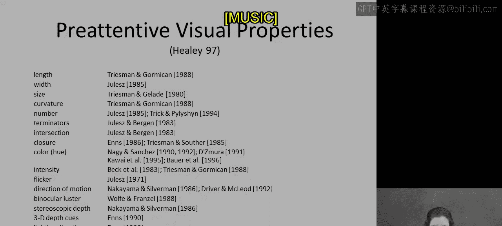

# 杜克大学《大规模数据科学（预测分析，交流数据科学结果，第2、3课⧸共3课有视频）｜Data Science at Scale》中英字幕 p81 11_12 预注意处理.zh_en -BV1xf421Q7bH_p81-

。

Welcome to our second lecture on visualual Per。In this lecture。

 we'll be discussing a very intriguing property of the visual system， preattentive processing。

I'd like you to look at this slide and tell me how many fives there are in this array of numbers。

Do you have the answer？All right， I'd like you to think about how long it took you to find them and what techniques you use to detect these fives。

And now I'm going to show you the same array with one small change。Now how many fives？

All fives are red， by the way。Notice how easy it was to come to the answer。

 the color made the fives pop out at you。Psychologists have given this property a name。

Your immediate detection of the red fives is called preattentive。

It turns out that certain basic visual properties are detected immediately by the low level visual system。

It means they pop out at you rather than requiring a visual search through all the elements。

In general， if the detection of a target takes less than about 200 to 250 milliseconds。

 it qualifies as preattentive。And the reason is because eye movements take at least 200 milliseconds。

 And yet， we find that certain processing can be done very quickly。

 And this implies low level processing in parallel before the eyes even have a chance to move。

 In general， if a decision takes a fixed amount of time， regardless of the number of distractors。

 it is considered to be pre attentive。Now only a limited set of properties can be perceived pre attentively。

 that means without the need for focusing attention。

And you can see why this would be important for designing visualizations。

What can be perceived immediately？What properties are good discriminators， what can mislead viewers。

 how can you use the ability to process information pre attentively？To strengthen your visualization。

Let's talk about a couple examples。So looking at these two squares in which one is there a red circle。

 left or right？Pretty obvious， right， you could instantly see that the red circle is visible in that group of blue circles。

 it jumps out at you。 It seems almost ridiculous to think that there might be a question。

Detection of the red circle in a sea of blue circles is preattentive。

Now which square contains the red circle， left or right？The form， the curvature。

 is also pre attentive， the curved circle pops out at you。However。

 you may have noticed that it doesn't seem quite as immediately obvious as the different color。

Pre attentive processing lies on a spectrum， just like many other such visual features。

Now which square contains the red circle， left or right？So that one required serial search。

So this is interesting， so even though form is pre attentive and color is preattentive。

 the conjunction of the two is not。So the red circle and the sea of red square and blue circle disors could not be perceived pre attentively。

This can be used in practice to save lives。 detection of a slanted line in a C of vertical lines is pre attentive。

In this case， the slanted line in a number of cockpit dials is used to indicate systems failure。

And I'm going to conclude with a list of preattentive visual properties for you to consider。

 for more detail， please see Christopher Healy's article on the web。

 the link is given in the lower right hand corner。I hope that you have found this lecture interesting and that you're able to use this information while you're designing your own visualizations。

