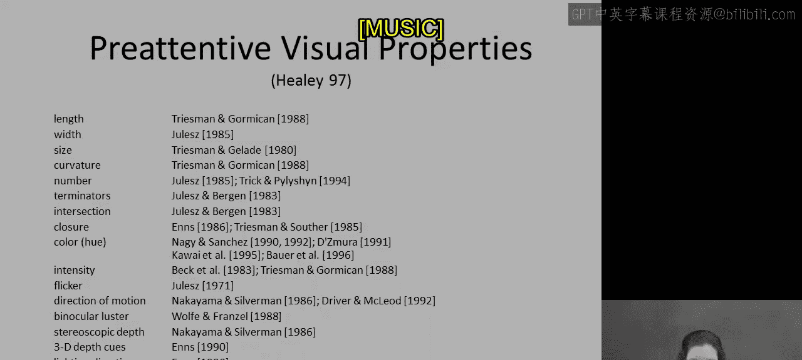

# 大规模数据科学（预测分析，交流数据科学结果）：第2课：预注意处理 👁️

在本节课中，我们将要学习视觉系统的一个非常有趣且重要的特性——预注意处理。理解这一特性对于设计高效、直观的数据可视化至关重要。

## 概述

上一节我们介绍了视觉感知的基础。本节中，我们来看看视觉系统如何能在我们集中注意力之前，就快速、自动地处理某些视觉信息。这种能力被称为“预注意处理”。

## 什么是预注意处理？

请看下图，并告诉我这组数字中有多少个“5”。

你找到答案了吗？请回想一下你花了多长时间找到它们，以及你使用了什么技巧来识别这些“5”。

现在，我将向你展示一个只做了一处微小改动的相同数组。现在，有多少个“5”？

（顺便说一下，所有的“5”都是红色的。）你是否注意到，得出答案变得多么容易？颜色让“5”立刻从背景中“跳”了出来。

心理学家给这种特性起了一个名字。你立即检测到红色“5”的过程，就叫做**预注意处理**。

事实证明，某些基本的视觉属性可以被低层视觉系统立即检测到。这意味着它们会自动“凸显”出来，而不需要你逐一搜索所有元素。

## 预注意处理的定义

一般来说，如果检测一个目标所需的时间少于大约 **200到250毫秒**，它就符合预注意处理的标准。原因在于，眼球的运动至少需要200毫秒。然而，我们发现某些处理可以非常快速地完成。这意味着，在眼睛甚至有机会移动之前，低层次的并行处理就已经发生了。

更正式的定义是：如果一个决策所花费的时间是固定的，**不随干扰项数量的增加而增加**，那么它就被认为是预注意的。

## 预注意处理的重要性

只有一组有限的属性可以被预注意地感知，这意味着它们不需要集中注意力就能被识别。

你可以想象这对于设计可视化图表有多么重要。了解哪些信息可以被立即感知、哪些属性是良好的区分器、哪些可能误导观众，以及如何利用预注意处理信息的能力，都可以极大地增强你的可视化效果。

## 实例分析

以下是几个例子，帮助我们理解预注意处理及其边界。

### 示例一：颜色差异

观察下面两个方块，哪一个里面有红色的圆形？左边还是右边？

这非常明显，对吧？你可以立刻看到红色圆形在一群蓝色圆形中显现出来，它直接“跳”入你的眼帘。思考这个问题本身似乎都显得有些多余。

**结论**：在蓝色圆形的海洋中检测红色圆形是**预注意的**。

### 示例二：形状差异

现在，哪一个方块包含红色的圆形？左边还是右边？

形状（曲率）也是**预注意的**，弯曲的圆形会凸显出来。然而，你可能已经注意到，它似乎不像颜色差异那样立即明显。预注意处理是一个连续谱，就像许多其他视觉特征一样，其“凸显”程度有所不同。

### 示例三：特征结合

现在，哪一个方块包含红色的圆形？左边还是右边？

这一个需要你进行**序列搜索**。这很有趣：尽管形状是预注意的，颜色也是预注意的，但**两者的结合（特定颜色+特定形状）却不是**。因此，在红色方块和蓝色圆形的干扰项海洋中，那个红色的圆形无法被预注意地感知。

## 实际应用

这种特性在实践中可以拯救生命。例如，在一系列垂直线中检测一条倾斜的线是**预注意的**。

在实际应用中，飞机驾驶舱的多个仪表盘上使用倾斜的线条来指示系统故障，飞行员可以瞬间察觉到异常。

## 预注意视觉属性列表

我将以一份预注意视觉属性的列表作为结尾，供你参考。更多细节，请参阅Christopher Healy在网上的文章（链接在右下角）。

以下是主要的预注意视觉属性类别：

*   **颜色**：色调、强度（亮度/明度）。
*   **形状**：方向、线条弯曲度、大小、空间分组。
*   **运动**：闪烁。
*   **空间位置**：三维深度线索。

## 总结

本节课中，我们一起学习了**预注意处理**这一核心概念。我们了解到，人类的视觉系统能够在不集中注意力的情况下，并行且快速地处理某些基本视觉特征（如特定颜色、形状、方向等）。在数据可视化设计中，巧妙利用这些预注意属性（例如，用颜色突出关键数据点，用方向表示趋势变化），可以让我们设计的图表信息传递更高效、更直观，帮助观众瞬间抓住重点，避免不必要的认知负荷。希望你能在未来的可视化设计中运用这些知识。