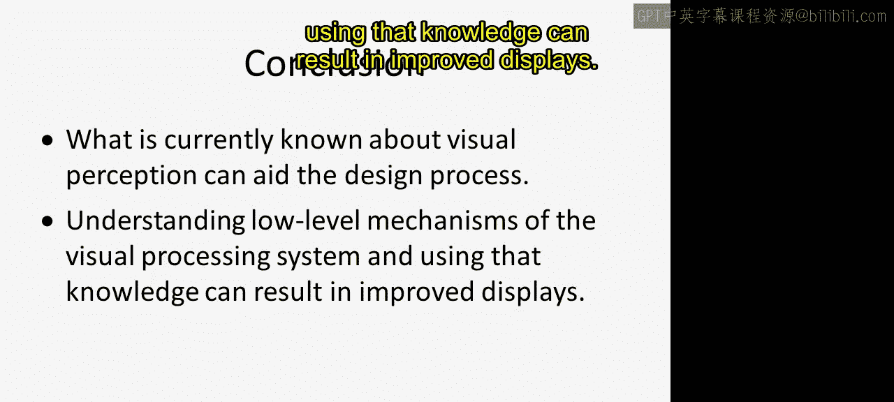

# 杜克大学《大规模数据科学（预测分析，交流数据科学结果，第2、3课⧸共3课有视频）｜Data Science at Scale》中英字幕 p82 12_13 估计量级.zh_en -BV1xf421Q7bH_p82-

。

In our third and final lecture on visual perception。

 we'll be discussing how humans estimate magnitude。

If you'll recall from our earlier lectures on mapping quantitative data to visual attributes。

 you can see how understanding common misperceptions or inaccuracies in the visual system can be very helpful when it comes to designing and effective visualization。

We're fortunate in that there is a large body of psychophysics research that we can draw on。

All right， so I'd like you to look at these two circles and tell me what is your impression of the difference in areas between the two circles？

I want you to come up with two numbers first。Your first impression。

And then what you think it is after considering it more。Write down both numbers。

Both your first impression and your more detailed analysis。So what did you get？

The correct answer is 25。The idea of a power law for visual perception was first mentioned in the 19th century。

But Stanley Stevens， in the mid 1950s came up with a body of work to justify it。

 And he formalized the power law。 His experimental results for perceptual estimation gave an exponent for length of pretty close to ones。

 in other words， fairly accurate。But in area 0。6 to 0。9。

 so you get some underestimation and in volume， 0。5 to 。8， even more underestimation。

So in the previous slide， even though the area differential was 25。

 most people tend to say it's around 16。So how close did you come？And perhaps more importantly。

How can you use this for designing visualizations that will be accurate and effective？

It turns out cartographers have already known about this for quite some time。In the 1970s。

 Jay Flannery， a cartographer， conducted a set of experiments and produced a set of empirical guidelines for how to represent quantitative information using area。

So what cartographers do when presenting quantitative data， they'll use apparent magnitude scaling。

Right let's consider a set of visual attributes and how good humans are at estimating magnitude。

 This data comes from again， for many decades of research and psychophysics。

 It turns out that humans are most accurate。At estimating differences in position。

 if there's a common scale， if the scales are non aligned， then they're slightly less accurate。

 but still fairly accurate， then comes length， slope and angle。

And then much less accurate are area and even less so volume。 And finally。

 humans are most inaccurate at using color to judge magnitude。So again， we have evidence that。

The hue， saturation and value are not very good choices to use when estimating quantitative when representing quantitative data。

 so the conclusion to these three lectures on visual perception is that what is currently known about visual perception can aid the design process。

Understanding the low level mechanisms of the visual processing system and using that knowledge can result in improved displays。

