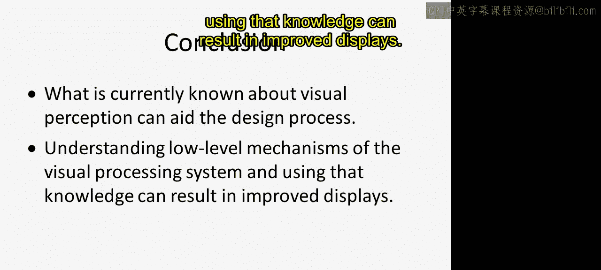

# 大规模数据科学（预测分析，交流数据科学结果）：第3课：视觉感知与量级估计 🧠

在本节课中，我们将学习人类如何估计视觉量级，并探讨如何利用这些知识来设计更准确、更有效的数据可视化。这是关于视觉感知的第三讲，也是最后一讲。

## 概述

在前两讲中，我们讨论了如何将定量数据映射到视觉属性。理解视觉系统中常见的误判或不准确性，对于设计有效的可视化至关重要。幸运的是，我们可以借鉴大量心理物理学的研究成果。

## 量级估计的挑战

让我们从一个简单的练习开始。请看下图中的两个圆，并告诉我你对两者面积差异的第一印象是什么？

首先，请写下你的第一印象。然后，再经过更仔细的思考后，写下你认为的数值。请记录下这两个数字。

正确答案是 **25**。然而，大多数人倾向于回答 **16** 左右。这个差异揭示了人类在估计面积时存在系统性低估的倾向。

## 视觉感知的幂定律

视觉感知的幂定律思想在19世纪首次被提出。到了20世纪50年代中期，斯坦利·史蒂文斯通过一系列工作证实并形式化了这一定律。

他的实验结果表明，人类对不同属性的感知估计遵循幂定律，其指数因属性而异：
*   对于**长度**的感知，指数接近 **1.0**，这意味着估计相当准确。
*   对于**面积**的感知，指数在 **0.6 到 0.9** 之间，表明存在一定程度的低估。
*   对于**体积**的感知，指数在 **0.5 到 0.8** 之间，低估现象更为明显。

因此，在上一个练习中，尽管面积的实际差异是25倍，但大多数人感知到的差异更接近16倍（因为 25^0.8 ≈ 16）。

## 不同视觉属性的估计准确性

基于数十年的心理物理学研究，我们可以对不同视觉属性在量级估计上的准确性进行排序。以下是人类估计量级准确性的列表，从最准确到最不准确：

*   **位置（在同一条基线上）**：当元素共享一个共同尺度时，人类对位置差异的估计最为准确。
*   **长度**：对长度的估计也相当准确。
*   **斜率和角度**：准确性略低于长度。
*   **面积**：对面积的估计准确性显著下降。
*   **体积**：对体积的估计比面积更不准确。
*   **颜色（色相、饱和度、明度）**：使用颜色来判断量级是最不准确的。

这个排序再次证明，**色相、饱和度和明度**并不是表示定量数据的好选择。

## 设计启示：表观量级缩放

那么，如何利用这些知识来设计更准确的可视化呢？制图师们早已掌握了这个问题的答案。

早在20世纪70年代，制图师杰伊·弗兰纳里就通过实验，总结出一套使用面积表示定量信息的经验法则。他们所采用的方法被称为 **“表观量级缩放”**。

这种方法的核心是，在设计时（例如，用圆的大小表示数据值），不是简单地让圆的面积与数据值成线性比例，而是根据幂定律的指数进行调整，使得人眼感知到的大小差异与实际数据差异相匹配。

## 总结

在本节课中，我们一起学习了人类估计视觉量级的原理和挑战。我们了解到：
1.  人类对面积和体积的感知存在系统性低估，这由幂定律描述。
2.  不同视觉属性在量级估计上的准确性存在显著差异，**位置**和**长度**优于**面积**和**体积**，而**颜色**最差。
3.  通过应用 **“表观量级缩放”** 等设计原则，我们可以补偿人类的感知偏差，从而创建出更准确、更有效的可视化图表。

理解视觉处理系统的底层机制，并运用这些知识，可以显著提升数据展示的效果。这就是视觉感知研究为数据科学可视化设计带来的核心价值。

