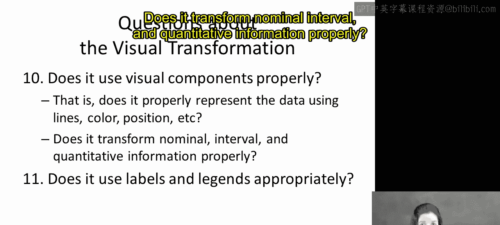

# 杜克大学《大规模数据科学（预测分析，交流数据科学结果，第2、3课⧸共3课有视频）｜Data Science at Scale》中英字幕 p83 13_14 评估可视化.zh_en -BV1xf421Q7bH_p83-

。

In this lecture， we're going to go through the step by step process of how to evaluate a visualization。

The first step is to consider the purpose of a visualization and who the intended audience is。

 In other words， is it to educate， to inform or is it for exploration。Is the audience。

 the general public or a specialized body of scientists， for example。

 that's very important in deciding what the overall value is of this particular type of visualization。

 Don't make the mistake of judging a visualization without understanding the intended audience。Next。

 determine your initial reaction。Is it generally positive or negative。

 It's all right to have an emotional reaction to a visualization。

 but also try to step back and analyze it somewhat dispassionately。

Examine the visualization in detail， what works well， what doesn't。And finally。

 answer questions such as the following。Is the design aesthetically pleasing？

Is it immediately understandable， if not， is it understandable after a short period of study？

Does it provide insight or understanding that was not obtainable with the original representation。

 text or table， etc ce。 This is very important if the only difference between the visualization is that somebody added color to the design and made a pie chart out of it that does not necessarily make it valuable。

 a visualization should add value over a textual representation or it is not a good visualization。

Fourth， does it provide insight or understanding better than some alternative visualization would。

 or does it require excessive cognitive effort？What kind of visualization might have been better？

For example， if somebody has given you a set of multiple pie charts and you have to compare pie wedges from one to the other。

 is that really the best way to make those comparisons or could a bar chart have done the job just as well？

Maybe better。Does the visualization reveal trends， patterns， gaps， or outliers？

Can the viewer make effective comparisons？Does the visualization successfully highlight important information while providing context for that information？

Is new information gleaned from the visualization that wouldn't have come from an alternative method and is the important information highlighted and is the context not hidden。

Number seven， does it distort the information？If it transforms it in some way。

 is this misleading or helpfully simplifying？Does it omit important information？Is it memorable？

Does it use visual components properly？That is， does it represent the data using lines。

 color position， et cetera， as we discussed in the earlier lectures？

Does it transform nominal interval and quantitative information properly？

And does it use labels and legends appropriately？