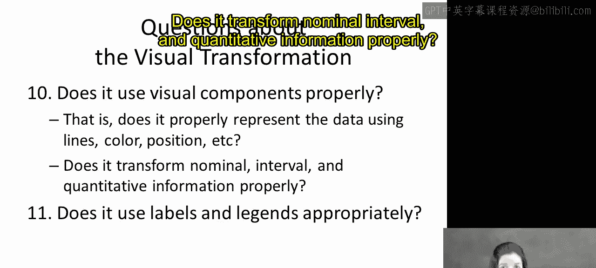

# 数据科学规模化：第2课：评估可视化 📊

在本节课中，我们将学习如何系统性地评估一个可视化作品。我们将通过一个分步流程，帮助你判断一个可视化图表是否有效、清晰，并能为观众提供真正的洞察。

---

## 概述：评估可视化的步骤

评估一个可视化作品并非简单地判断“好看”或“难看”。它是一个结构化的过程，需要考虑其目的、受众和实际传达信息的效果。接下来，我们将详细介绍这个评估流程的每一步。

---

### 第一步：明确目的与受众 👥

在开始评估之前，首先要考虑可视化的**目的**和**目标受众**。

*   **目的**：这个可视化是为了**教育**、**告知**，还是为了**探索**数据？
*   **受众**：观众是**普通大众**，还是**某个领域的专家**（例如科学家）？

理解这两点对于判断这个特定可视化的整体价值至关重要。**切勿**在不了解目标受众的情况下就贸然评价一个可视化作品。

---

### 第二步：记录初步反应与详细审视 🔍

首先，记录下你的**第一反应**。这个图表给你的整体感觉是积极还是消极？对可视化产生情绪反应是正常的，但之后需要退一步，尝试更客观地分析它。

接下来，**仔细审视**可视化的细节。找出它做得好的地方和不足之处。

---

### 第三步：回答关键评估问题 ❓

以下是评估时需要回答的一系列核心问题。每个问题都旨在检验可视化的不同方面。

**1. 设计与可理解性**
*   **设计是否美观？**
*   **是否一目了然？** 如果不是，经过短暂研究后能否理解？

**2. 价值与洞察**
*   **它是否提供了原始数据（文本、表格等）无法提供的洞察或理解？** 这一点非常重要。如果可视化仅仅是为设计添加了颜色或将数据做成了饼图，这并不一定使其有价值。**一个优秀的可视化应该比纯文本表述增加价值，否则就不是一个好的可视化。**

**3. 效率与替代方案**
*   **与其它可能的可视化方案相比，它是否更好地提供了洞察？或者它是否需要过多的认知努力？** 什么样的可视化可能更好？例如，如果有人给了一组多个饼图，需要你比较不同饼图之间的扇形区域，这真的是最好的比较方式吗？用条形图是否同样有效，甚至更好？

**4. 数据揭示能力**
*   **可视化是否揭示了趋势、模式、数据缺口或异常值？**
*   **观众能否进行有效的比较？**

**5. 重点与上下文**
*   **可视化是否在提供上下文的同时，成功地突出了重要信息？** 是否从可视化中获得了其他方法无法得到的新信息？重要信息是否被突出显示，而上下文没有被隐藏？

**6. 准确性与完整性**
*   **它是否扭曲了信息？** 如果它以某种方式转换了数据，这种转换是具有误导性，还是起到了有益的简化作用？
*   **它是否遗漏了重要信息？**

**7. 记忆点与组件使用**
*   **它是否令人印象深刻？**
*   **它是否正确使用了视觉组件？** 即，它是否如我们在之前课程中讨论的那样，恰当地使用了**线条**、**颜色**、**位置**等元素来表征数据？
*   **它是否正确转换了名义、区间和定量信息？**

**8. 标注与图例**
*   **它是否恰当地使用了标签和图例？**

---

## 总结

本节课我们一起学习了评估可视化作品的系统化方法。我们从明确可视化的**目的和受众**开始，然后记录**初步反应并进行详细审视**，最后通过回答一系列**关键问题**来全面评判其设计、有效性、准确性和实用性。记住，一个优秀的可视化不仅仅是美观，更重要的是它能清晰、准确、高效地为目标观众传达洞察，其价值应超越原始的数据表现形式。