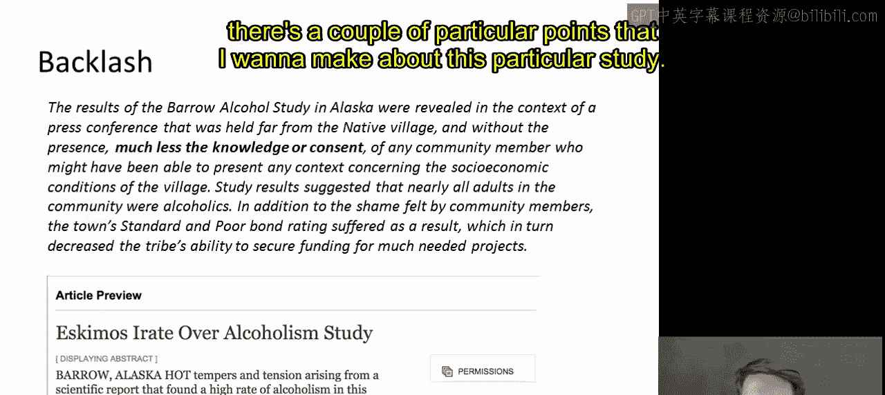

# 杜克大学《大规模数据科学（预测分析，交流数据科学结果，第2、3课⧸共3课有视频）｜Data Science at Scale》中英字幕 p84 14_动机：巴罗酒精研究.zh_en -BV1xf421Q7bH_p84-

。

So in this module we're going to talk about ethics and privacy and as with many of the topics in these courses in this specialization。

 this topic warrants a entire course unto itself， but just like we've done with the other topics we're going to do is try to give you an overview of the important concepts in the area。

 we're going to motivate this with real worldor examples and we're going to do a technical deep dive into particular。

Particularly important concepts in order to make sure that you have an intuition for how to use them and how to apply them elsewhere and then what we hope is that you know this will be enough of an appetite weighting exercise to encourage you to go take a entire course on ethics and privacy in big data and data science of which there are many starting to emerge and so we've done this with databases and large scale data management systems we've done this with machine learning with statistics we've done this with visualization and now we're going to try to give it a treatment of this topic。

Cherry picking topics that we think are especially relevant given the theme of the course and given things that I'm interested in。

I want to start off with a study that was conducted quite a while ago，1979 in Barrow， Alaska。

 So Barrow is the northernmost point in the。United States， northernmost city in the United States。

And it's a rural community this is a you know zoom in shot you can see those lakes and here from the area but you can see those lakes as well。

 This was a you know Native American community that has been hunting whales for thousands of years and since World War I there have been significant economic changes over a short time and native leaders and city officials were concerned about。

the use of alcohol in the community and the associated violence and invited a group of sociology researchers to assess the problem and work with them to devise solutions。

So the methods used here， so a team came in and the methods used here were to collect a representative sample。

Of everyone over age of 15， although they， as we'll mention in a moment they。

Targeted the native community in particular， and they interviewed them on attitudes and values associated with the use of alcohol。

 including psychological histories， and they gave them a standardized alcoholism screening test that had been devised previously and asked them to draw a picture of a person which was intended。

To determine cultural identity。 So if you draw someone in a certain style。

 then that suggests that your。Coming from a perspective of a particular community。

 if you draw someone another style， then it's just from another particular community。

 and that's a method that was accepted at the time。So。The results of the study。

 the particular numbers are not terribly important， and you can look them up。

 but the overall effect was that alcoholism was pretty extreme there。

A widespread use in abuse of alcohol and associated with the problems that that would entail。

The reason why I want to bring up this study， though， is not so much just for the results itself。

Manner in which it was released and the overall context in which this study was done。

In order to motivate some of the ethical considerations。 So in particular。

 the results of this study were announced unilaterally and publicly in the。2 forms simultaneously。

 One was a report was released and simultaneously， a press conference was held。

To the Barrow community。Crucially without representation from the tribal communities that were reflected in the study。

 even at the press conference。Okay， so this， the report was picked up by the press and it became a front page New York Times story titled alcoholcohol Pla Eskimos。

 alcoholcoism Plas Eskimo。Village。So you can imagine the effect here。 you know。

 the quotes here in this article you can see is the practically committing suicide by mass alcoholism。

 University of Pennsylvania researchers said yesterday。

 the alcoholism rate 72% among the 2000 Nesco men and women in the village of Brow violence is becoming leading cause of injury and death。

 So the effects of this study。All the populace were were pretty immediate。

 If you were a member of the Bough community， If you were a member of the Annupiac tribe。

 you were associated with the。Brand presented in this in this article in a very， very public。Wei。

You knowFurther， the results of the Barough alcohol study here。

 it says here were revealed in the context of a press conference was held far away from the native village without the presence and much less the knowledge or consent of any community member who might have been able to present any context concerning the socioeconomic conditions of the village。

So a study results suggested that nearly all adults in community were alcoholics in addition to the shame。

 the towns standard and poor bond rating suffered as a result。

 which in turn decreased the tribe's ability to secure funding for much needed projects so this was a you know。

Direct financial harm。Incred by the community， the inability to get loans in order to proceed with public works。

Projects， and so there's a number of articles that were written after this reflecting how they were upset about this and the harms they had faced and that。

 you know， there's this subtle side effect， too， that's been one of the reasons why the study is so well known in the。

Medical and sociological。In ethics communities as as an example。

 is that research itself has a bad reputation among。Native peoples， not only in this area。

 but but widespread in part because of this， this study and others like it。 So， you know。

 research has been described as probably one of the dirtiest words in the indigenous worlds vocabulary as a result of this。

 So this is important to understand。What went wrong here and there's a couple of particular points that I want to make about this particular study。

