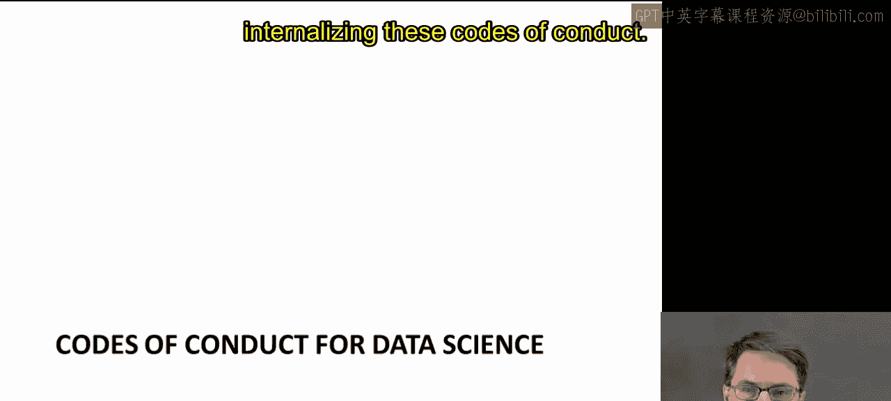

# 杜克大学《大规模数据科学（预测分析，交流数据科学结果，第2、3课⧸共3课有视频）｜Data Science at Scale》中英字幕 p85 15_巴罗研究问题.zh_en -BV1xf421Q7bH_p85-

。

So， you know， some of the problems were indeed methodological the some quotes here， you know。

 there was a technical advisory group as as is typically required in these kind of。

Research projects who had repeatedly stated their concern that only natives were studied and that outsiders in the town had not been included in the study。

 some of the linkages that were trying to be formed between the frequency of intoxication based on the association based associated with the probability of being detained。

 so if he sort of typically went to jail you could infer and you degree of intoxication。

Made no sense， at least at least to some people there were criticisms， significant criticisms levied。

 But back to this first point that that only natives were studied。 You know。

 some of this methodology suggests that they were had a conclusion in mind when they were designing the study and design it around confirming that。

Hypothis。 so there was a confirmation bias that perhaps was leaking in here。 So fine。

 so that's methodological problems。 But the more subtle thing that I want to talk about here is that you know participants were not in control of their data nor the context in which they were presented at any point here。

 And so you could demonstrate as I mentioned， you can demonstrate specific significant harms and theig stigmatization socially and know even even。

Clear and present financial。Okay。Difficulties。So how could this have been avoided。

 I mean one thing that we hear about today when we think about big data and privacy is about making sure that no personally identifiable information is leaked and we'll talk about techniques for doing that in a little bit。

You know， but here， there was no personal identifiable information leaked， right。

 even those who did not participate in the study at all incurred harm because they were associated with the group that was studied。

 Are they a member of that group or they're from that town or or they're from that tribe。

So the ability to sort of boil down these privacy issues into a technical problem to solve。You know。

 to prove that something is either safe or unsafe or private or not private or leaked or not leaked。

 I want to convince you that it's inadequate， and that's why the study of ethics is an important component of any data scientist's toolbox because it's important to consider you know what studies should be done and which studies should not be done know at some point you' make a decision about which which projects to engage in and you need to have that ethical sixth sense that you have to smell the ethics when you're deciding on these projects and then during the course of a project you have to think about what kind of red flags might things raise。

 who might suffer from my actions， even independently of these formal guarantees so just because you can do something doesn't mean you should and that's not currently a frequent part of the data science conversation but increasingly it is which is why we've included at least some minimal treatment of it in this course。

Okay， so one key takeaway here is that an entire group people were harmed。

 even though no one really broke the rules and。That's why。

Ethical guidelines become increasingly important。Yeah。

There are two topics I want to talk about in this next lesson。

 One is the social component of the ethics considerations that we're discussing。

 and those are manifest in these codes of conduct that you see emerging from organizations attempting to represent the data science community in various capacities The other is a technical component and here we're going to discuss what kind of formal guarantees we can make about privacy。

 what kind of statements we can make about what happens with data when it's released and in particular。

 I want to talk about differential privacy， which is a pretty important development really that's seen explosive growth even in the last five and six years。

 although some of the ideas are from a little bit prior to that so。Codes of conduct for data science。

 So the reason I want to bring these up is one is to。Given make sure that you've seen them。

In the course of an introduction to data science class and to make sure that I assert that these codes of conduct and the ethical considerations that they represent。

Are just as important of a topic to learn as many of the other things we've discussed。

 And you've seen this， you， perhaps it's even more important in the realm of data science because as we're sort of starting to see。

 there's not a whole lot of limits to what you might be able to do with some of these techniques。

 right the data data sets are becoming increasingly public。

 It's increasingly easy to get your hands on data。 And so the only limit to what we should be doing is going to come from our understanding of what we should be doing And and our decision about what we should be doing。

 And that requires this kind of ethical consideration。

 And that requires reading and understanding and。Internalizing these codes of conduct。

