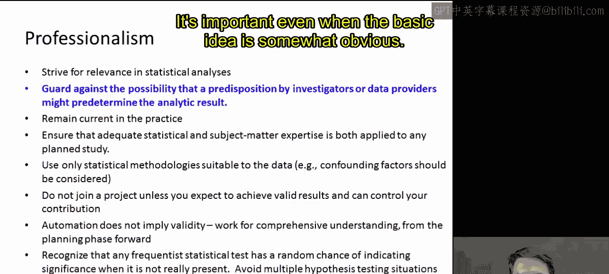

# 杜克大学《大规模数据科学（预测分析，交流数据科学结果，第2、3课⧸共3课有视频）｜Data Science at Scale》中英字幕 p86 16_具体化伦理：行为准则.zh_en -BV1xf421Q7bH_p86-

。

So。One discussion that you see in。Ethics in general is whether you're talking more about principles or more about rules。

 and so principles are these overarching guidelines。

 but stop short of really trying to specify specific behavior。

 Other folks believe that ethical the right thing to do is to actually write down a firm set of rules that should not be。

Violated and adherence to these rules constitutes ethical behavior。

So I think that I come down fairly strong on the side of。Pinciples， because once you get into rules。

 you really， you know， I push， let's see， just from the previous slide。If youre to talk about rules。

 then I want to talk about formal guarantees， mathematical proofs about things。 and that。

 we'll talk about some of the limits of what you can do with that。

 And if you're going to give up on those， it's not clear to me that。Legislative rules。

Have any extra power。Declaring and agreeing on the principles that we should agree to and writing them down。

 perhaps in the form of these codes of conduct， I think is is the right way to go。

 What you're doing is appealing to people's。Beliefs about these topics as opposed to trying to sort of control their behavior。

 Okay， so I think in the B example， I think， demonstrates this where really the ethical principles that were violated。

 they essentially followed the rules that were applied to the time。

 and really many the rules that have been apply that have been developed since then in terms of how to handle private data were not necessarily violated。

 but at several steps along the way。 there were ethical principles violated。

 putting their own needs and their own interests ahead of those of the research subjects。

 the client and society and recommendations against doing that do appear in these code of conduct that we'll look at briefly。

So I want to just consider three。 And what's sort of interesting is that。

This is not really cherry pickedked。 This is kind of an attempt at finding all the lists。

 all the codes of conduct that one can on you know put out there by organizations representing the data science community so I won't claim that it actually is exhaustive I'm sure they're popping up all the time and I'm sure there's many that I've missed。

 but there's not a lot of them。Nor is there one single one that everyone's agreed on。

 and that's the reason why there's not a lot of them it's still quite early。

 The other thing I'll point out is that this first one on this list。

 the American Statistical Association。Is just that the American Statistical Association。

 is's not a data science organization。 And so this code of ethics has been around longer。

 And I think you can tell just from reading that the maturity is is， is is higher。 So， you know。

 one question you can ask is whether we actually need a separate data science code of conduct different from。

That of statisticians。Whether you think you should or not。

 it's useful I think to be aware of at least these three have read through them and sort of consider what points they're bringing to the forefront and what emphasis they're placing on things and I think it was instructive for me to sort of prepare some of these points and I think it'll be instructed for you to have seen them at least in this form of this lecture。

OkaySo the first one we're going to look at is the code of conduct from the American Statistical Association。

 it has the following top levelve sections， one on professionalism and then the rest of it is broken out by responsibilities to various parties and the first one is funders。

 clients and employers， publications and testimony， research subjects， research team colleagues。

 other statisticians or statistical practitioners the community at large in your field and regarding allegations of misconduct and then of employers themselves so rather than your responsibility to the employers were the responsibility of an employer of statisticians and I really like is breakdown because。

We'll see a couple of other ways to try to divide up the space。

 but I think it gets a lot muddier I think thinking specifically about the parties that are that have the stakeholders you have involved when you're taking on these projects and thinking about their needs and considering them all at every step along the way is the right way to think about this。

 Okay， so I just want to。Show in some cases I paraphrase these and in some cases I've provided them verbatim。

And we're not going to necessarily read every bullet on every page because you can go to the web and do that。

 But one is I want to make sure you have access to them as you're sort of watching through this video of an excuse to kind of look at them and read through them if you wish。

 And then the other thing I'll think I'll do is highlight a few of the ones that strike me as relevant or。

Arguably perhaps violated in the Barrow example。We considered。

 so the first section of the code of conduct。From the AsA is just professionalism。

 And this is corresponds pretty well to the。Codes of contact for you know。

 professional engineering societies as well where it's sort of how to do the job properly。 So。

 you know， relevance and statistical analyses， you know， remaining current in the practice。

 bringing a certain level subject matter expertise， you know。

 using only those methodologies that are appropriate for the data。

 The one I've highlighted in blue here is guard against the possibility that a predisposition by investigators or data providers might predetermine the analytic result。

 I think that's unique to statistic or in data science as opposed to engineering。

 And I think it was relevant。Perhaps in the in the Barrow example。

 where it seemed like the sampling procedure and it seemed like the way the results were presented and it seemed like some of the methodologies were were designed with a specific outcome in mind。

 namely that the。Ethnic and cultural identity of the research subjects。Would be linked to the。

Use of behavior certain behaviors are the use of alcohol， okay， and so that's a pretty。

Dangerous idea to come in to the study with now I'm'm not going to。

feeling claim that we have proof of that one way way or the other。

 but I think there's I think that argument， I think a strong argument could be developed。

In favor of that。Okay， so other things here is respect the contributions and intellectual property。

 disclose conflict conflicts of interest and so on。 The last one here is sort of interesting， too。

 which is expert testimony should be given with the same level of rigorous peer reviewed research So this is you know。

When you're adding something to the scientific literature， you jump through all sorts of hoops。

 but if you're。Talking to your employer and just sort of giving them results and say a PowerPoint presentation。

 you know maybe you can be a little looser with the rigor and the point here is no you shouldn't do that。

 And these things， you know as as to all of the ethical topics， things are sort of obvious。

 but I think crafting the language around them， holding it up as a document that people can sort of read and internalize so that they start using that language too is important even when the basic ideas。

Is somewhat obvious。