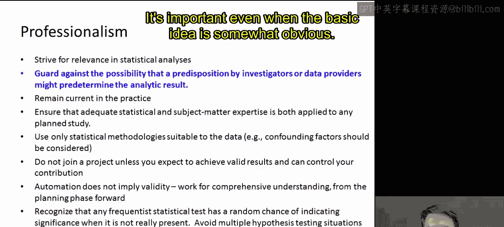

# 大规模数据科学：第2课：具体化伦理：行为准则 📜

在本节课中，我们将探讨数据科学伦理中的一个核心议题：是应该依赖宽泛的原则，还是制定具体的规则。我们将通过分析几个专业组织的行为准则，来理解如何在实际工作中应用伦理考量。

---

## 概述

伦理讨论通常围绕“原则”与“规则”展开。原则是宏观的指导方针，而规则是具体的行为禁令。本节将论证，在数据科学领域，基于原则的行为准则比僵化的规则更为有效和实用。我们将审视三个代表性行为准则，并分析它们如何帮助我们识别和避免伦理陷阱。

---

## 原则与规则之辩

在一般伦理讨论中，一个核心议题是应更侧重于原则，还是更侧重于规则。

原则是宏观的指导方针，但通常不具体规定特定行为。
另一些人则认为，正确做法是制定一套不应违反的明确规则，遵守这些规则即构成伦理行为。

我个人强烈倾向于**原则**。因为一旦陷入规则，我们就需要讨论形式化保证和数学证明。我们稍后会探讨这种方法的局限性。如果放弃形式化保证，那么立法式的规则在我看来并无额外效力。

因此，声明并认同我们应遵守的原则，并以行为准则的形式将其记录下来，我认为是正确的方法。这样做是在诉诸人们对此类主题的信念，而非试图控制其行为。

以B案例为例，它很好地说明了这一点。当时被违反的实际上是伦理原则，而他们基本遵循了当时的规则。后来制定的关于如何处理私人数据的许多规则，在当时并未被违反。但在整个过程的多个环节中，确实存在伦理原则的违反，例如将自身需求和利益置于研究对象、客户和社会利益之上。我们即将简要查看的行为准则中，确实包含反对此类做法的建议。

---

## 审视行为准则

接下来，我们将考虑三个行为准则。有趣的是，这并非刻意挑选的结果，而是试图找到所有由代表数据科学社区的组织发布的行为准则列表。我不敢声称这个列表是详尽的，新的准则随时可能出现，我也可能遗漏了许多。但总体而言，这类准则并不多，也没有一个被所有人一致认同的单一准则，这也是其数量不多的原因——这个领域仍处于早期阶段。

需要指出的是，列表中的第一个——美国统计协会的准则——并非来自纯粹的数据科学组织。这份伦理准则存在时间更长，从其内容可以看出其成熟度更高。因此，一个可以提出的问题是：我们是否需要一份独立于统计学家的、专门针对数据科学的行为准则？无论你认为是否需要，了解至少这三份准则，思考它们强调的重点和赋予不同方面的权重，都是有益的。对我而言，准备这些要点很有启发性，相信对你们通过本讲座了解它们也会有所帮助。

---

### 1. 美国统计协会行为准则

我们要看的第一份准则是美国统计协会的行为准则。其顶层结构如下：首先是关于专业素养，其余部分则按对不同方的责任进行划分。

以下是其主要章节：
*   对资助者、客户和雇主的责任
*   对出版物和证词的责任
*   对研究对象的责任
*   对研究团队同事的责任
*   对其他统计学家或统计从业者的责任
*   对所在领域及整个社区的责任
*   关于不当行为指控的处理
*   对统计师雇主的责任（此处指雇主自身的责任，而非你对雇主的责任）

我非常喜欢这种划分方式。我们将看到其他几种划分空间的方式，但我觉得那些更模糊。具体思考参与项目各利益相关方，并在每一步都考虑他们的需求和权益，是思考伦理问题的正确方式。

以下，我将展示部分内容，有些是转述，有些是原文引用。我们不会逐条阅读每一页，因为你可以自行上网查看。我的目的是确保你在观看视频时能接触到它们，并提供一个审视和阅读它们的契机。同时，我会重点强调那些我认为相关、或者在B案例中可能被违反的条款。

**第一节：专业素养**
这与许多专业工程学会的行为准则非常相似，即关于如何正确开展工作。例如，确保统计分析的相关性、保持实践技能的更新、具备一定水平的专业知识、仅使用适合数据的方法论等。

我用蓝色高亮的一条是：“警惕调查者或数据提供者的先入之见可能预先决定分析结果的可能性。”我认为这一点在统计学或数据科学中比在工程学中更为独特，并且在B案例中可能具有相关性。在该案例中，抽样程序、结果呈现方式以及部分方法的选择，似乎都带有特定的预期结果，即研究对象的民族和文化身份将与某些行为（如饮酒）的使用相关联。带着这种先入之见进行研究是相当危险的。我并非声称我们有确凿证据证明这一点，但我认为可以就此提出一个强有力的论证。

其他条款还包括：尊重贡献和知识产权、披露利益冲突等。最后一条也很有趣：“专家证词应给予与经过严格同行评审的研究同等水平的严谨性。”这意味着，当你为科学文献添砖加瓦时，你需要跨越重重障碍；但如果你只是在向雇主汇报结果，比如通过PPT演示，你或许可以稍微放松严谨性。而此处的要点是：**你不应该这样做**。

这些事情，就像所有伦理话题一样，有些是显而易见的。但围绕它们构建语言，将其作为一份可供人们阅读和内化的文件，以至于人们也开始使用这种语言，这很重要，即使基本理念本身可能有些显而易见。

---

### 2. 数据科学协会行为准则

上一节我们介绍了美国统计协会以利益相关方为核心划分的详细准则。现在，我们来看看数据科学协会的准则，它采用了不同的组织框架。

数据科学协会的准则结构如下：
*   持续教育并提升数据科学能力
*   以专业和尊重的方式代表数据科学领域
*   尊重隐私、保密和匿名
*   了解并遵守所有相关法律
*   以合乎道德且对社会负责的方式开展数据科学工作
*   诚实、清晰和彻底地沟通
*   在数据科学工作中保持客观
*   尊重并适当承认他人的工作和贡献
*   保护并维护他人的数据
*   鼓励和支持其他数据科学家

这份准则更侧重于**个人行为和专业实践**。它强调持续学习、尊重他人、遵守法律以及对社会负责。其中，“以合乎道德且对社会负责的方式开展数据科学工作”是一条核心原则，它要求从业者超越技术层面，思考其工作的广泛影响。

---

### 3. 数据与社会科学行为准则

最后，我们来看一份由学术界发起的准则——数据与社会科学行为准则。它试图弥合数据科学与社会科学的伦理传统。

这份准则围绕几个核心承诺展开：
*   **尊重个人与社区**：认识到数据背后是人，研究应致力于改善人类状况。
*   **促进正义与公平**：警惕算法偏见，努力确保数据分析不会加剧社会不平等。
*   **确保透明与可重复性**：方法论和过程应尽可能透明，以支持同行评审和知识积累。
*   **承担社会责任**：考虑研究对社会的潜在影响，并对其负责。

这份准则的独特之处在于其强烈的**社会导向**。它明确将数据工作与社会价值（如正义、公平）联系起来，要求从业者积极思考其工作的社会后果，而不仅仅是技术正确性。

---

## 总结

在本节课中，我们一起学习了数据科学伦理中“原则”与“规则”的辩证关系。我们论证了基于原则的行为准则因其灵活性和对内在信念的诉诸而更具实用性。通过具体分析美国统计协会、数据科学协会以及数据与社会科学三份行为准则，我们看到了伦理考量的不同组织框架和侧重点：从利益相关方责任，到个人专业操守，再到广泛的社会影响。这些准则共同为我们提供了识别伦理风险、指导负责任实践的重要语言和思维工具。记住，伦理不是一份简单的检查清单，而是一个需要在整个数据科学项目生命周期中持续进行批判性反思的过程。