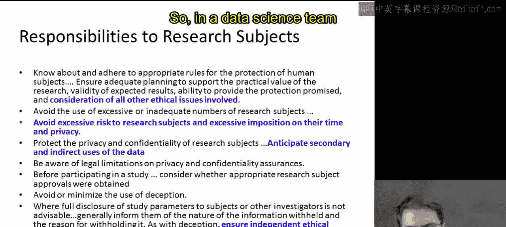

# 杜克大学《大规模数据科学（预测分析，交流数据科学结果，第2、3课⧸共3课有视频）｜Data Science at Scale》中英字幕 p87 17_ASA行为准则：对利益相关者的责任.zh_en -BV1xf421Q7bH_p87-

。

Okay， so responsibilities to funders， clients and employers， I've hired a few things here in。Blue。

 present a client with， I thought this was interesting。

 present a client or employer with choices among alternative statistical approaches that may vary in scope。

 cost or precision when appropriate。 And so I think this may be relevant in the Brow case as well。

 in that they kind of rolled in with a particular methodology， but there were。

Concerns about that methodology expressed and the stakeholders who had actually invited them to come in to perform the study。

It's not clear from reading the discussion of the。A study and some of the retrospective。

Reports that have come out afterward that they that theyre。Inpoint was really。

Had much influence right so if they've given multiple choices。And said， look。

 we can go either this way， we can go this way and let the stakeholders decide some of the problems may have been avoided。

Okay， so you clearly state your qualifications respect to different roles。

Apply statistical sampling analysis procedures scientifically without predetermining the outcome。

 again we talked about that there may be some evidence that there was an outcome kind of in mind and that may have flavored the way the methodology was set up and of course guard privileged information for the employer。

 client or funder and here， know although technically the data itself was protected properly。

Privileged information， one might consider the results of the study to be privilege information and that guarding it。

May entail deciding deliberately when and where and how you present that information to the public。

 which was done in a pretty aggressive way。Okay。Responsities to research subjects。

The first bullet here is of course， human institutional review boards at universities。

 you'll understand the rules that are in play for protection of human subjects。

 this might be institutional review boards if you're at a university。

 there's also commercial analogs through institutional review boards that tend to have a little bit less teeth but they exist and so being fully cognizant of those rules and applying them is crucially important。

And the。Phrase that I highlight in blue here is just consideration of all other ethicalological issues involved。

 Now， that's a pretty broad claim。 but again， the fact that it actually appears in the code of conduct suggests that。

 you know， stop and think is an important is an important part of this。

 And the next1 I've highlighted here is actually， the second bullet is sort of interesting as well。

 avoid the use of excessive or inadequate numbers of research subjects。 This is， you know。

 understanding that there is going to be some cost， even if it's small to collecting data。So。

You know。Collecting data from the number of subjects required to ensure statistical validity of the results。

 but no more。It is important when human subjects are involved。

So even bringing them in and having to interview them has some cost。

Not just of their time but also perhaps of their privacy and also it's sort of a stress in many cases it might be a stressful sort of interaction。

 as you can imagine it might have been for the Barrow study。Okay， and in blue here。

 avoid excessive risk to research subjects and excessive imposition on their time and privacy， again。

 I think there was an excessive risk that wasn't properly considered。

Anticipate secondary and indirect uses of the data。

 this is know maybe of the data is a bit is questionable here。

 but anticipates secondary indirect uses of the results really namely to sell articles to sell newspapers that was a secondary and indirect use of the results of the study that helped the careers of the scientists evolve perhaps well I guess in the long term perhaps not。

 but getting pressed for your research is typically a good thing for you。

 but it's a secondary and indirect use of the data that should be considered and the harms involved should be considered。

Okay， so the the last one here that I've highlighted is you know。

 ensure independent ethical review of the protocol and continue monitoring the research。

 I think this is。Ptty important having explicit role of an ethics officer involved。

 especially in large scale studies， this tends to exist in many institutions。

 but may not on the small scale。 So you know in a data science team。

Understanding who's going to represent the ethical considerations。

 whether someone's explicitly charged with that in the company or if one of your team。

Should play that role， even though it's not their explicit job。

 I think it's important to have that discussion and perhaps elect someone。

