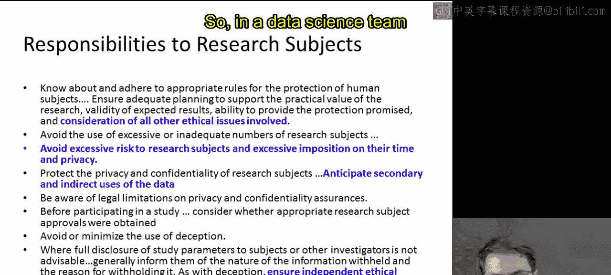

# 数据科学伦理：第2章：对利益相关者的责任 📋

在本节课中，我们将学习美国统计协会（ASA）伦理准则中关于数据科学家对资助者、客户、雇主以及研究对象的责任。这些原则是确保数据科学工作诚信、可靠且对社会负责的基础。

---

上一节我们介绍了伦理准则的总体框架，本节中我们来看看数据科学家对两类关键利益相关者的具体责任。

## 对资助者、客户和雇主的责任 💼

数据科学家在与资助方、客户或雇主合作时，需遵循以下核心原则。

以下是关键的责任条款：

*   **提供选择**：在适当情况下，向客户或雇主提供在范围、成本或精度上可能不同的替代性统计方法选择。这在“巴罗研究”案例中具有参考意义，因为研究者最初只采用了一种特定方法，而邀请他们进行研究的相关方对该方法表达了担忧。如果当时提供了多种方案供利益相关者选择，或许可以避免一些问题。
*   **明确资质**：清晰陈述自身在不同角色上的资质。
*   **科学应用**：科学地应用统计抽样和分析程序，不预先决定结果。有证据表明，“巴罗研究”可能事先设想了某种结果，这影响了其方法设置。
*   **保护机密信息**：保护雇主、客户或资助者的特权信息。虽然研究数据本身得到了适当保护，但研究结果也可被视为特权信息。保护这些信息意味着需要审慎决定何时、何地以及如何向公众公布，而“巴罗研究”在这方面采取了相当激进的方式。

---

理解了对外部合作方的责任后，我们接下来关注研究中最直接的参与者——研究对象。

## 对研究对象的责任 👥

保护研究对象的权益和福祉是数据科学伦理的重中之重。

以下是必须遵守的关键责任：

*   **遵守审查规定**：充分理解并应用保护人类受试者的规则。在大学环境中，这通常指机构审查委员会（IRB）。商业领域也有类似的审查委员会，尽管约束力可能稍弱。遵守这些规则至关重要。
*   **考虑所有伦理问题**：考虑所涉及的所有其他伦理问题。这是一项宽泛但重要的要求，它提醒我们在研究中必须停下来深入思考。
*   **避免使用过多或过少的受试者**：使用足以确保结果统计有效性的受试者数量，但不要超过。当涉及人类受试者时，收集数据本身就会带来成本，不仅是他们的时间，还可能涉及隐私和压力。
*   **避免过度风险与负担**：避免让研究对象承受过度的风险，并避免过度占用他们的时间和侵犯其隐私。在“巴罗研究”中，可能存在未被充分考虑到的过度风险。
*   **预见数据的二次使用**：预见数据（或更确切地说是研究结果）的二次和间接用途。例如，利用研究结果来销售文章或报纸，这是一种二次使用，可能有助于科学家职业生涯的发展，但其中涉及的潜在危害也应被考虑。
*   **确保独立的伦理审查与持续监督**：确保研究方案经过独立的伦理审查，并对研究进行持续监督。在大型研究中，通常设有专门的伦理官员。在小型数据科学团队中，即使没有明确设立该职位，团队内部也应讨论由谁来代表伦理考量，并可能指定专人承担此角色。

---

本节课中我们一起学习了ASA伦理准则中关于对资助者、客户、雇主以及研究对象的核心责任。关键点在于：**提供透明的选择、科学客观地开展工作、严格保护机密信息，并始终将研究对象的权益、隐私和安全置于首位**。将这些原则付诸实践，是每一位负责任的数据科学家的基本素养。