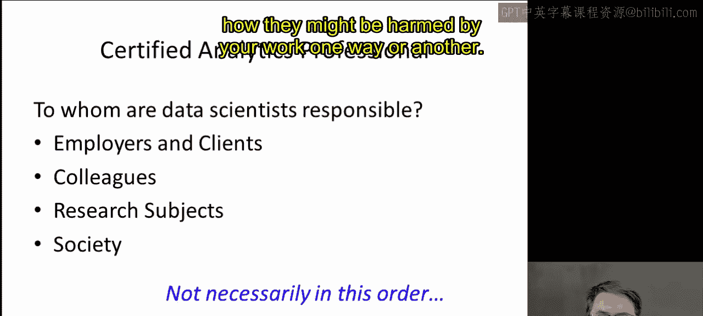

# 杜克大学《大规模数据科学（预测分析，交流数据科学结果，第2、3课⧸共3课有视频）｜Data Science at Scale》中英字幕 p88 18_其他行为准则.zh_en -BV1xf421Q7bH_p88-

。

And in these last。A few will' just put up here， are I'd argue less relevant for the Barrow example。

 which is why I haven't highlighted anything， butresponsibilities to research team colleagues inform colleagues from other disciplines about relevant aspects of statistical ethics。

 making sure that people aren't sort of using your methods and then you haven't conveyed some of these ethical considerations as well。

 you know them but you don't convey them that lack of communications itself a violation of ethics。

You know。Generally promote the proper use of statistics。

 you have an obligation to convey the proper use of things when given the opportunity。

 respect the reciprocally respect the ethical obligations of people from outside your field if they have a professional code of conduct that they need to follow as a industrial engineer or as。

InAnother engineering field， you need to understand that。And。

Professional reporting in the last one here is comproising statistical validity for exp that you know you don't want to trade off quality for。

Efficiency。Understanding that， of course， approximations are appropriate。 So overall。

 what I like about these is that that there's many of them are not kind of the bland。

 obvious generic sort of ethical considerations that you find in at sort of the highest level。

 many of them really do have have specific teeth。Related to statistical analysis。

Responsiities to other statisticians or statistics practitioners， this is， you know。

 when you're reviewing other people's papers， you're reviewing other people's work or you're doing performance reviews for other people in the company that from these skills。

 make sure you're being sort of fair and。Appropriate， assess the methods， not the individuals。

Be willing to sort of offer them training。You know， as I mentioned， I think this one。

 this this code of conduct is pretty good because it's pretty complete。 Its's， it's mature。

 It's been thought about。 And I think this is an interesting。啊呃。

Stakeholder community that may not be the first thing you think of when you think about a code of ethics。

 but is important nonetheless， especially if this term data science will persist and become a strong community。

 making sure you're sort of figuring out opportunities to help each other out is going to be increasingly important。

And responsibilities of employers， including organizations。

The the first one I've highlighted here is recognize that the results of valid statistical studies cannot be guaranteed to conform to the expectations of those conditioning the study。

 And this is， again， pretty obvious， but it's also pretty crucial。 This is the。

Source of the trouble over the years with， you know。

 perceived or real conflicts of interest where you imagine that， look。

 a company should be perfectly justified in funding a study。

 But what you don't see is the publication bias in effect。

 If they don't publicize results that didn't come out the way they want， that's that's a。

Nearly undetectable， but very strong way of。Of steering。Research to。

Produce the outcome they that they want， right， They could fund 20 studies and only publish the one that came out in favor of the results that they。

Then that helped their business。Okay， so。The fact that there's a section in here。

 specifically for employers and statisticians， whether or not they're reading it。

 it seems I approve of the effect that they include that in there on equal footing with some of the other groups of stakeholders。

Okay， and the other ones are are。啊。You can read them here and I won't just read them out。

So the second code of conduct I want to just quickly go through is the data science association。

 and this one is less mature than the ASA code of conduct， as I've mentioned。

 So I'm just going to show you the top level。Categories and let you you know click the link to read it yourself and then highlight a couple of differences in what it chooses to emphasize so here are the categories number two first one is really just terms and definitions and you can take a look at them the second is notion of competence which we saw emphasize pretty strongly in the Ass code of conduct number three is。

Interesting because it calls out the tension between。Legal requirements and what the client asks。

And also the ethical considerations。 And so we've seen this come up more and more often。

Where you may be in a position where you need to make a decision about whether you're going to collect the data or not。

 not because you think it might be released or misused by you or you're not planning on sort of publishing the results。

 it's only for some internal usage， but it could be subpoenaed。

 and so you need to consider that if you put your hands on that data at all。

 you may be required in the future to give it up in which case you're faced with either violating the law。

 violating your client's interests or violating some ethical consideration。

Communication with clients， they call out as explicit in a category which I thought was interesting is。

Don't take the problem specification， run away into a hole， do the work。

 and then come back out and dump the results， you should be in constant communication as you work through the decisions。

Again， this is。General enough you where it seems obvious， but I think it's interesting to analyze。

To consider what they've chosen emphasize and what they've not chosen to emphasizeize。

Confidential information we've we've had that covered conflicts of interests。

Number seven is more on conflicts of interest and confidentiality。

 number it is more of a generic thing on scientific integrity。

 I think overall the point I want to make is that trying to break it down by topic seems more difficult and result in kind of a mudier collection of rules than breaking it down by the parties and how they might be harmed。

 which is what the ASA did。Fine。And then the last one I want to mention is the certified analytics professional。

 I won't claim that either one of these last two again are are necessarily。

Indicative of the organizations that present them aren't necessarily representing the entire data science community。

 but they did take the time to sort of publish these codes of conduct and therefore。

 it's worthwhile to be aware of them。 Really， the only thing I want to point out here is that they all along with ASA。

Emphasized the the parties involved and how they might be harmed。

 I think the AsA code of conduct did a better job of。

Being exhaustive about that and being clear about that。

 but it's one important takeaway that if you're going to think about a codezy conduct。

 think about who has interests in your work and how they might be harmed by your work one way or another。

 what their interests are and how you can try to meet them。

