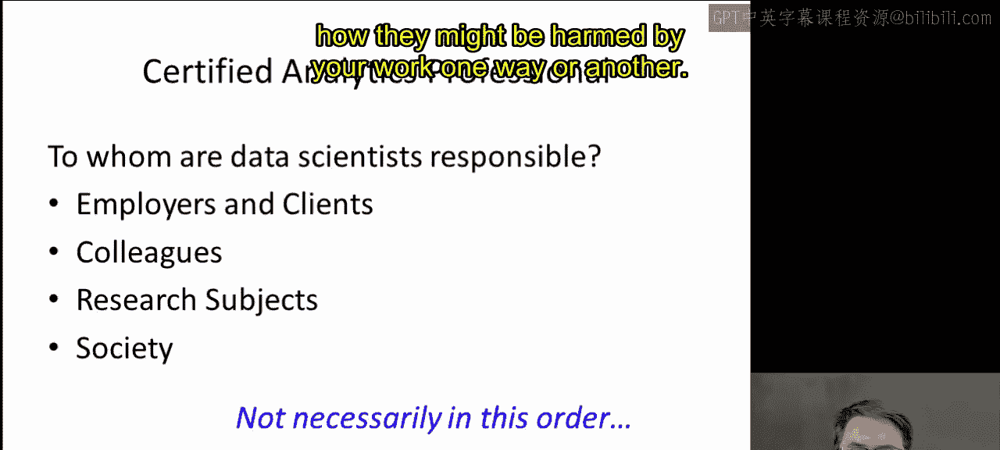

# 大规模数据科学（预测分析，交流数据科学结果，第2、3课⧸共3课有视频）：第18章：其他行为准则

在本节课中，我们将学习数据科学领域内，除了数据隐私和算法公平性之外的其他重要行为准则。我们将重点探讨美国统计协会、数据科学协会以及认证分析专业人士等组织提出的伦理规范，并理解它们如何从不同利益相关者的角度来构建伦理框架。

上一节我们讨论了数据隐私和算法公平性的核心伦理问题。本节中，我们来看看数据科学家在更广泛的工作场景中应遵循的其他行为准则。

## 📜 美国统计协会行为准则

美国统计协会的行为准则非常成熟和全面。它没有停留在宽泛的伦理原则上，而是针对统计分析的具体场景提出了具有实际指导意义的条款。该准则的一个显著特点是，它按照可能受到影响的**不同利益相关方**来组织条款，这有助于我们更清晰地思考自身行为的影响。

以下是该准则中针对不同群体的责任概述：

*   **对研究团队同事的责任**：需要确保跨学科的同事了解统计伦理的相关方面。如果你没有将某些伦理考量传达给使用你方法的人，那么这种沟通缺失本身就可能违反伦理。
*   **对统计同行的责任**：在评审他人论文、工作或进行绩效评估时，应确保公平、恰当。评估的重点应是**方法本身，而非个人**。同时，应乐于为他人提供培训机会。
*   **对雇主及组织的责任**：准则特别强调了雇主需要认识到，有效的统计研究结果**无法保证**符合资助方的预期。这一点至关重要，因为它触及了多年来因发表偏倚而产生的利益冲突问题。例如，一个公司可能资助20项研究，但只公布结果对其有利的那一项。

该准则将雇主责任与其他利益相关方责任并列，体现了对这一问题的高度重视。

## 🔄 数据科学协会行为准则

接下来，我们快速浏览数据科学协会的行为准则。与ASA的准则相比，它尚不成熟，但其强调的重点有所不同，值得关注。

以下是该准则的主要类别及其特点：

*   **术语与定义**：对核心概念进行界定。
*   **专业能力**：与ASA准则一样，强烈强调专业能力的重要性。
*   **法律、客户要求与伦理的冲突**：明确指出了法律要求、客户指令与伦理考量之间可能存在的张力。例如，收集某些数据可能在未来被依法传唤，这将使数据科学家陷入法律、客户利益和伦理的三难困境。
*   **与客户的沟通**：明确将“与客户保持持续沟通”作为一个独立类别，反对“接受问题后闭门造车，最后直接抛出结果”的工作模式。
*   **保密信息与利益冲突**：涵盖了数据保密和避免利益冲突的常见原则。
*   **科学诚信**：提出了关于保持科学诚信的通用原则。

总体而言，该准则试图按主题分类，但相比ASA按利益相关方分类的方式，其结构略显模糊。

## 🎯 认证分析专业人士行为准则

最后，我们提及认证分析专业人士的行为准则。与数据科学协会的准则类似，它不一定代表整个数据科学界，但作为一份公开的伦理声明，值得我们了解。

该准则与ASA准则有一个重要的共同点：它们都**强调关注所涉及的各方以及他们可能如何受到损害**。ASA准则在这方面做得更详尽、更清晰。这给我们一个关键启示：在思考行为准则时，应系统性地思考你的工作涉及哪些利益方，他们的利益是什么，以及你的工作可能以何种方式损害他们，并思考如何尽力满足各方的合理利益。

---

本节课中我们一起学习了数据科学领域内多个组织提出的行为准则。我们重点分析了美国统计协会按利益相关方构建的、具有实际操作性的伦理框架，并对比了数据科学协会和认证分析专业人士准则的不同侧重点。核心收获是，一个有效的伦理准则应帮助从业者系统地识别工作影响的各方，并以此指导负责任的实践。