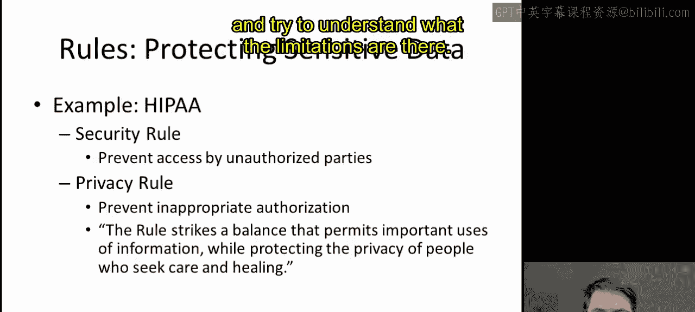

# 杜克大学《大规模数据科学（预测分析，交流数据科学结果，第2、3课⧸共3课有视频）｜Data Science at Scale》中英字幕 p89 19_成文规则示例：HIPAA.zh_en -BV1xf421Q7bH_p89-

。

And then。This is just a last slide as， as a bit of a segue into the technical component。

 we'll talk about next。 But we， I you know， I have their word rules here。

Coodes of conduct really represented this ethical principles as the。

Main way you codify ethical considerations right in terms of general principles of behavior。

Although some of them have rules in there as well， but I think generally they're pretty high level。

Attempts at specific rules exist as well。 And one of the better known one is HIPAA。Which。

Legislates how sensitive patient。Medical data can be handled and there's other rules as well。

 FERPA is a set of rules around student data grades， personal information and so on。 So for example。

 i'm not allowed to email your grades。Two outside parties。Or otherwise publish on them。嗯。But HIPAA。

 especially because it's relevant to people who work in a variety of different fields。

 is worth at least understanding at this kind of a level。

 so there's really two rules to be aware of here。 there's a security rule which is to prevent access by unauthorized parties and then there's the privacy rule。

 which is to prevent you know sort of inappropriate what I call authorization here， which means。

You've granted access to somebody and you shouldn't have as opposed to security rule。

 which is well no one ever intended someone to have access， but they broke in anyway。Okay。

 and so this this course， we're not going to talk too much about security。

 we are going to talk about privacy。And the reason why I think it's a bit of a segue here is that HIPAA is an why I'm not a big fan of these rules attempt is that it stops short of any kind of specification of a formal guarantee。

 and therefore it's left somewhat ambiguous in places， it's left impossible in other places。

 it's easy to satisfy the letter of the law when you might be violating the spirit of the rule。

 the law rule there's all kinds of problems with attempting to implement。You know。

 hipPAA compliance system。 It's very difficult to define what exactly that would mean。Meanwhile。

 it leaves all kinds of gaps that I think are better covered by the codes of conduct。 so my interest。

My opinion is that the two extremes are what's important。

The formal guarantees that we can make and the。General codes of conduct that should guide our behavior。

 but trying to work sort of work in the middle there with laws。

 it ends up not being terribly effective and you get sort of perverse incentives。

 you get know gaps in the rules you get rules that are sort of unnecessarily applied， for example。

 there's cases in HIPAA where patients have a very difficult time getting hold of their data in order to give it to researchers even though that's their goal that's what they want to do they say it'll help me it might help improve my chances of a positive outcome from my say terminal illness if I can get my information in the hands of as many researchers as possible and the rules around HIPAA have made that more difficult rather than easier this is obviously not the intent of the HIPAA rules。

 but this is what can happen。Okay。So next we're going to talk about how we can actually formalize the privacy problem。

And try to understand what the limitations are there。

