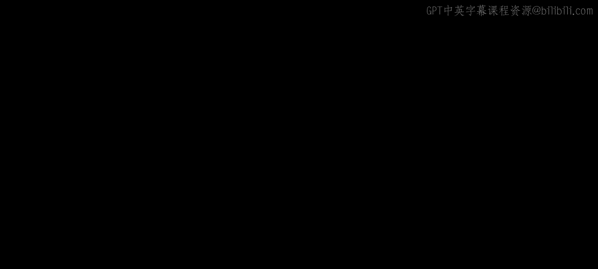
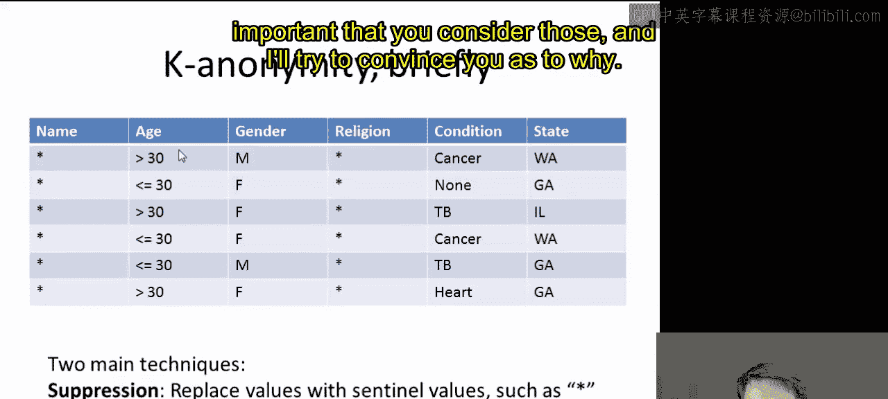

# 杜克大学《大规模数据科学（预测分析，交流数据科学结果，第2、3课⧸共3课有视频）｜Data Science at Scale》中英字幕 p90 20_隐私保证：初步尝试.zh_en -BV1xf421Q7bH_p90-

。

So we talked about the social component of ethics and privacy manifest in these codes of conduct that try to guide your behavior and really tap into what people intuitively understand about what's the right and wrong thing to do and I like that because I think trying to legislate specific rules of behavior too much。

s sort of ends up with perverse incentives and sort of gets things wrong。Leavs gaps and so on。

 while clarifying the language on what you intend is useful for sort of inspiring people to do the right thing。

On the other end of the spectrum， which I want to talk about now。

 is know exploring what kind of technical guarantees we can make about privacy。

 what kind of technical guarantees can we give to people about protecting their privacy。So， the。

Attempts for protecting privacy that techniques for protecting privacy fall broadly into these categories where you either control access to the data。

You knowYou only give it out to certain people or in certain circumstances， you restrict the。

Querries you can ask over the data。 So this is instead of handing it over。

 you put it behind an API and are trying to be careful about what kind of questions people can ask。

 you have perturbation based techniques where you add noise to the data in order to try to muddy up the true signal and prevent certain kinds of questions from being answered。

 you have secure multiparty computation， So this is you know if you've heard of homomorphic encryption where。

I allow you to have the data， but it's encrypted， and then I give you my computation。

 you can evaluate the computation over the encrypted data。

And give me the answer back and even though you run the computation and you have the data you don't actually get to see anything about the results。

 so this is a subfield of cryptography and that's just one example of multi multiplly computations there's other problems under that label that have been studied。

And then there's anonymity where you try to scrub the data of certain information。

In order to prevent certain kinds of questions from being answered。ok ， so我啦。What we'll focus on is。

Aspects of these two， and they'm not going to talk about。

The others and I think I'll be able to convince you why these are the two that you should be most familiar with。

 So to try to make this a little more concrete， consider how you might actually protect privacy and practice Well。

 you know as we say， we can control access to the information itself。

 we can control the flow of information， perhaps through APIs。

 we can try to control the purposes for which the information is used。When you're releasing data。啊。

How might you actually go about doing this Well， you might be tempted to remove the identifiers。

 but there's lots of different ways to identify people。

 so one step better maybe is to try to reason about k anonymity。

Which says for a given data set for any query， you know。

 each record cannot be distinguished from at least k -1 other records， right。

 so you can narrow it down to at least K individuals， but you can't go any further than that。

 And so that gives people anonymity within a cluster of。Five or 10 or whatever。

And then maybe you can just take a subset of the data and release a representative sample and let people study that。

 And so you're trying to you're trying to balance the privacy of the individuals with the utility of the overall。

Data set， and these are various proposals。 So my claim here is that none of these are going to guarantee。

Privacy， and I I want you to think about why not， and we'll talk a little bit about in a second。

First， though， just to make sure you have seen canonymity。

 I don't want to spend a lot of time on this because as we'll show， it it's not。

It generated a lot of work， but ultimately it's a fairly weak notion。

But just so you know what the term means， imagine you have a data set that looks like this。

 you've got fields。And you want to ensure that。No individual can be identified or you can't zero in on a single on a particular record。

 you want to keep it at least the clusters of size。K similar or indistinguishable records。 Well。

 there's two main approaches to this or two main tools in your toolbox。

 There's suppression where you replace identifying information with some sentinel value like an asterisk。

So you redact it， you remove that that value from the data set and then generalization。

 where you replace individual values with a。A range or a category。Okay。

 and so this data set where we have name and age。Name and age and gender， religion。

Some medical condition and the state they're in， well。

 we don't want to include name because that's obviously identifiable and religion is perhaps not useful for the particular study that people are going to be doing。

So you want to suppress those values completely， but you're not done yet because the age would uniquely identify the records as well and so you want to generalize the age enough to where you。

Can't use that as an identifying feature anymore。Okay。And so here's an anonymized data set。

 although I've actually。It's not quite true because Illinois， the state would individually identify。

This person as well， you know， and the diseases would as well。 here's there's no condition at all。

 that would uniquely identify someone in heartly identify someone So I've actually tap。

Taking a subset of a broader data set， and that's not leable， But you can see the technique。

 at least that name。Replaced with an asterisk， religion is replaced with an asterisk， and with age。

 we've replaced it with these。Ranges greater than 30 and less than or equal to 30 and various techniques to derive the right kind of ranges for all the values to ensure certain kind of guarantees algorithms to do this efficiently。

How to do this with there's lots of columns versus fewer columns。

 all these things have been considered and studied。

 but ultimately it's not terribly important that you consider those and I'll try to convince you as to why。

