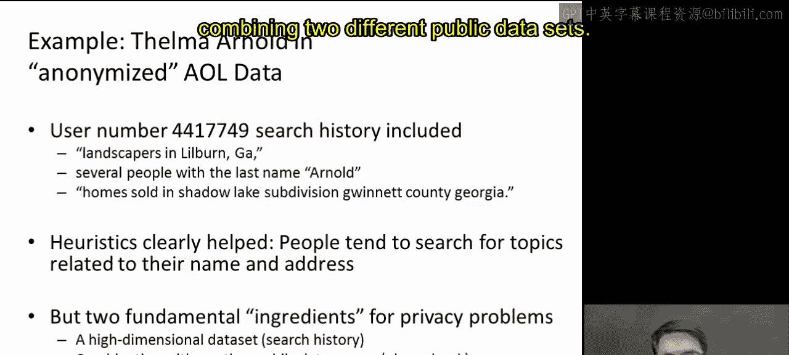

# 杜克大学《大规模数据科学（预测分析，交流数据科学结果，第2、3课⧸共3课有视频）｜Data Science at Scale》中英字幕 p91 21_隐私泄露示例.zh_en -BV1xf421Q7bH_p91-

。

So let's consider an example of a privacy leak。The Netflix Pri data set that you may be familiar with。

 this was a set of movie preferences by user released to spur a competition in who could beat Netflix's algorithm for a movie recommendation right so a lot of collaborative filtering。

Techniques， and they removed the users users identifying information。 Of course。

 know there's no name in there。 There's no other personally identfiable information。

 It's just their movie recommendations。 But as was shown in this paper that I've cited here。

You can deanonymize the Netflix data。 So how do we do this， Well， there's there's two ways。

 and the one they focused on in this paper is。The use of high dimensional data。So why does this work。

 Well， there's lots and lots and lots and lots of columns in the data set you can。

 you can imagine here， each column is， you know， did they see a particular movie。

 Did they see For Gump， Did they see the matrix， Did they see Star Wars。

 And there's either either one or a0， You can think of it this way。 This would be an enormous。

Data set。very， very high dimensional data set。Moreover， this high dimensional data set is sparse。

And I will argue that it will always be sparse， so why is that？

It's the cursesed of dimensionality again， as the number of dimensions increases。

 everything becomes further and further apart。 So things become less and less similar。

 right they're less densely packed。 And so you can think of this intuitively is no two people are really all that similar in their movie preferences。

 right， There's so many movies out there that the probability that you're going to have someone that agrees that you've seen exactly all the same movie or given the same rating rather。

 because it's not just it's actually not just a one or a0。

 It's rather a rating that they gave to that movie that they've seen that。

Given to people that the ratings they will have seen given to the movies are exactly the same。

For the most part， is very， very low probability。 And so it's not hard to distinguish。

 the more the more movies there are， the easier it becomes to distinguish two different viewers。

 Okay， and so similar， you can think about two different documents， right。

 No two documents look exactly the same。 There's a lot of words。

 right So if you think about the word vector。Representation of a document where you just have single column is an individual word in the English language and you put a frequency number in there for the number of times that word appears in the document。

 which is what we did for the assignment earlier in the first course in the specialization。

Then the chances you're going get to two documents that overlap too heavily in this represented this way is very。

 very small okay so high dimensional data is always going to be sparse and it allows you to identify individuals。

More easily。Okay，In order to take advantage of this to deanonymize the Netflix data， well。

 with large probability， no two profiles are similar up to some epsilon。

And it turns out that in the Netflix data， no two records are more than 50% similar。

RightSo we've never seen we've never identically， even though there's a lot of users out there that are watching Netflix movies。

 no two have the exact same values for more than 50% of the data， 50% of the movies。If the profile。

Can be mastered to 50% similarity。To a profile in some other data set like Internet movie database。

 Then the adversary knows with a good chance the true identity of the profile。

 They're able to sort of fill in the mission information and disambiguate the。

Identity identity of the user。Okay， so。Another example。

 I'll come back to what we've learned from that， but high dimensional data and using another data set。

Another example was Theelma Arnold in the anonymized AL data that you may remember， so this was。

A data set released by AOL， sort of without the company's permission was a group of researchers who were trying to help the research community by saying。

 hey， it would be great if we release all these search terms and indeed it would be。

 it was a valuable data set to release， but within I don't remember when days or something it was very very quick。

It was clear that。You know， removing the username。Email and so forth was nowhere near sufficient enough right so it turns out that user number 441-7749 in their search history included things like landscapers in Libburn。

 Georgia， which is actually not far away from where I grew up。

They search for several people with the last name of Arnold。

 they search for home sold in Shadow Lake subdivision in Gwinnett County， Georgia。Okay， so。

Certainly heuristics helped in this case， right， because if you see these search terms。

 you can deduce， the human can deduce well， probably someone that lives in Georgia and the Loburn area or Grnett County。

Maybe they have a last name of Arnold because people tend to search for people in their family。

And their families that they're related to。But。Even even if it wasn't for these heuristics。

 there were still these two fundamental ingredients。That that tend to appear when you're。

 when you're encountering privacy problems， privacy breaches。

 And so one is a high dimensional data set in order to kind of。Break open the clusters and sort of。

Distinguish individual records and in combination with some other public data set in order to identify those individual records once're。

 once they're。Narrow down to a to a single unit。 And in this case， the same thing had happened。

 right， you were able to。Use a phone book to go look up that， you know。

Scan through and look for the people the last name of Arnold who lived in a particular area of Georgia and sure enough there's only a few and use some of the other search terms to narrow down even further so。

Big high dimensional sparse data set。Using other public information。

 combining two different public data sets， these are the ingredients for privacy problems。

