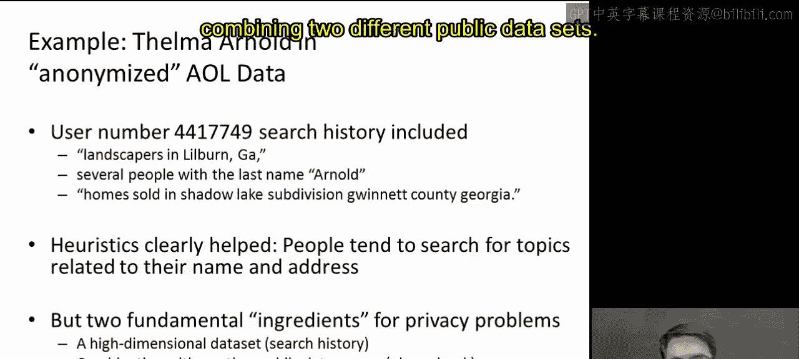

# 大规模数据科学：第2课：隐私泄露示例 🔍

在本节课中，我们将通过两个著名的案例，学习高维稀疏数据如何导致隐私泄露。我们将探讨其背后的核心原理，并理解为何简单的匿名化处理（如移除姓名）往往不足以保护用户隐私。

## 概述

我们将分析两个经典案例：Netflix电影评分数据集和AOL搜索记录数据集的隐私泄露事件。这两个案例揭示了数据科学中一个关键问题：当数据维度极高且稀疏时，即使移除了直接的个人标识信息，通过与其他公开数据集进行关联分析，个体的身份仍然可能被重新识别。

## 高维稀疏数据的特性

上一节我们介绍了隐私泄露的概念，本节中我们来看看导致泄露的核心技术背景：高维稀疏数据。

在数据集中，每一列代表一个特征（例如一部电影或一个搜索词）。当特征数量（即维度）非常庞大时，数据集会呈现出“稀疏”的特性。这意味着对于任何一个数据点（例如一个用户），其大部分特征值都为零或为空。例如，在电影评分数据中，一个用户只可能对少数电影进行过评分。

这种现象源于“维度灾难”：随着维度增加，数据点在高维空间中的分布会变得极其分散，彼此之间的相似度会急剧下降。用公式来描述，两个用户`u`和`v`在`d`维空间中的相似度会随着`d`的增大而趋近于零：

`相似度(u, v) ≈ 0 当 d → ∞`

因此，在高维空间中，几乎不可能找到两个完全相似的用户记录。这种独特性使得每条记录都像一个“指纹”，为重新识别个体身份创造了条件。

## Netflix数据集去匿名化案例

理解了高维数据的特性后，我们来看第一个具体案例：Netflix电影评分数据集的去匿名化。

Netflix曾发布一个匿名化的用户电影评分数据集，旨在举办推荐算法竞赛。数据集移除了用户的姓名等直接标识信息，只包含用户ID和他们对电影的评分。

然而，一篇研究论文指出，这个数据集可以被去匿名化。其原理正是利用了数据的高维度和稀疏性。

*   **数据维度高**：数据集包含成千上万部电影（列），每个用户（行）只对其中一小部分电影进行了评分。
*   **数据极度稀疏**：由于电影数量巨大，任意两个用户拥有完全相同评分记录的概率极低。研究表明，在该数据集中，没有两条用户记录的相似度超过50%。

攻击者如何利用这一点呢？以下是关键步骤：

1.  攻击者拥有另一个公开的数据源（如IMDb互联网电影数据库），其中包含了一些用户的真实身份及其公开的电影评分信息。
2.  攻击者将Netflix中的匿名用户记录与公开数据源中的记录进行匹配。
3.  由于高维稀疏性，一旦在公开数据源中找到某条记录与匿名记录的相似度达到一定阈值（例如接近50%），就有极大概率确定这两条记录属于同一个人。
4.  通过这种关联，匿名用户的身份便被成功识别。

## AOL搜索记录泄露案例

看完了基于评分的案例，我们再来看一个基于文本搜索的更直观的例子：AOL搜索记录泄露事件。

AOL曾出于研究目的发布了一批经过“匿名化”处理的用户搜索查询记录，其中移除了用户名等直接信息。然而，研究人员在极短时间内就成功识别出了其中一些用户的真实身份。

以用户`4417749`为例，其搜索历史包含以下内容：
*   “利尔本市（佐治亚州）的园林设计师”
*   多个姓氏为“阿诺德”的人名
*   “佐治亚州格威内特县影湖小区房屋出售”

即使没有复杂算法，人类也能根据这些搜索词进行推断：这位用户很可能住在佐治亚州利尔本或格威内特县附近，并且姓氏可能是“阿诺德”。攻击者正是结合了公开的电话簿等数据，通过地理位置和姓氏筛选，迅速锁定了特定个体。

这个案例同样包含了导致隐私泄露的两个核心要素：
1.  **高维稀疏数据集**：搜索查询词构成了一个极高维度的特征空间，每个用户的搜索组合几乎是独一无二的。
2.  **辅助的公开数据集**：通过结合电话簿等公开信息，可以将匿名记录中的模式与真实世界中的个体进行关联匹配。

## 总结

本节课中我们一起学习了隐私泄露的机制。通过Netflix和AOL两个案例，我们认识到：

*   **高维稀疏数据**本身具有极强的可区分性，每条记录都像独特的指纹。
*   简单的**匿名化（如移除姓名、ID）** 对于保护这类数据的隐私是远远不够的。
*   隐私泄露通常发生在**结合多个公开数据集进行关联分析**时。
*   数据科学家在处理用户数据时，必须超越简单的匿名化，考虑使用**差分隐私**、**数据脱敏**或**合成数据**等更高级的隐私保护技术。

理解这些原理是负责任地进行大规模数据科学实践的第一步。