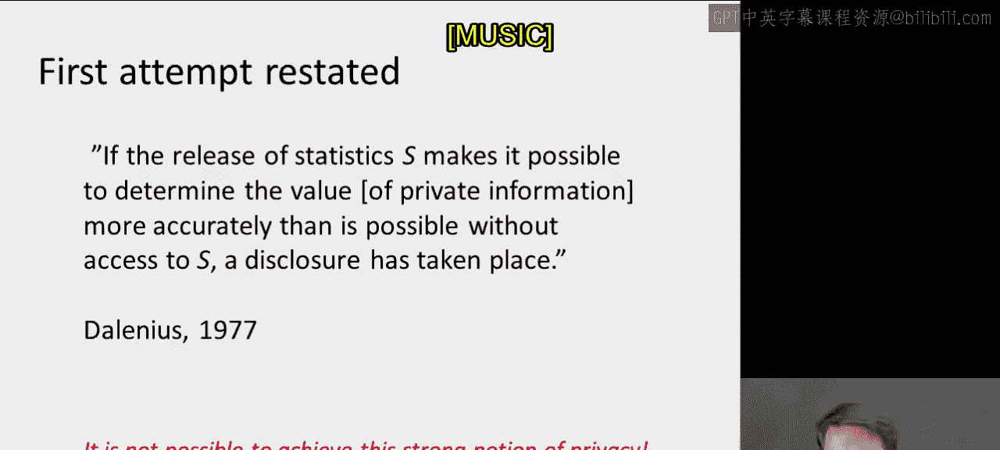

# 杜克大学《大规模数据科学（预测分析，交流数据科学结果，第2、3课⧸共3课有视频）｜Data Science at Scale》中英字幕 p92 22_形式化隐私问题.zh_en -BV1xf421Q7bH_p92-

。

Just one more example that this Massachusetts governor was identified in an anonymized medical database intentionally by someone who by Latania Swney。

 who actually。First formulated the canonymity conditions。And they made some first attempts at that。

 And what she was trying to show was so what had happened was the Massachusetts Group Insurance Commission released this anonymized data on state employees that showed every single hospital visit they had gone to And what she tried to show was。

 look， this is。Theonization is completely ineffective， it's not hard to break this at all。

 and so to prove a point， she know used public information about the governor。

That resided in Cambridge， Massachusetts。YouA city with not that many residents and only seven zip codes。

For $20， she purchased a complete the complete voter roles from the city of Cambridge。

 a database containing among other things， the name， address， zip code。

 birth date and gender of every voter。Only six people in Cambridge shared his birth because that was also public information。

 his birthday， only three of them were men and of those three men， only he lived in his zip code so。

In this case it was actually relatively low dimensional data right didn't really really require that many different fields to look at。

 but using public data sources and combining these different data sources was quickly quickly able to disambiguate who this person was and she sent him a message with his complete medical history hospital visit history。

To prove this point。And then actually in some followup work， she showed that zip code。

 you may have heard the statistic before is where it became religiously ta as that zip code。

 birth date， and sex is sufficient to uniquely identify about 87% of Americans。

So it doesn't always have to be high dimensional。Okay， so the as we said。

 these two recurring features of。好。Associated with privacy failures are highdiional data distinguished individuals and the combination of multiple data sets to reidentify those individuals And most of these methods。

 the ones we mentioned， even just briefly address neither of these issues they don't really handle the high dimensional data。

 although there are papers out that you can find that tackle this。 And then most importantly。

 they don't have much to say about combining multiple public data sets。

 And the reason is because it's hard to control that， right。

 If you're trying to design a system or design a formalism to prove privacy guarantees。

 you kind of have to think about here's your data and here's the。Recipients of the data。

 And here are the attackers trying to do untoward things。 But it's kind of a closed system there。

 If you have to kind of reason about the entire world of all possible data。

 of all possible other systems that you didn't design that you didn't control。

 it makes the problem somewhat intractable。 But that's the reality， right。

 The reality is that you do have access to this public information。

 So anything that doesn't consider those is not terribly useful。 And this。

Came to be understood after some time。Okay， so let's think about this problem more precisely。

 This is a slide adapted from Christine Taask at Purdue that I thought was a great way a great way of setting the stage。

 So you have a population of interest over here on the left。 and then various data sources。

 and these might be。And。Surveys handed out， but they might not be。

 they might be data collected for any any variety of purposes you can these different websites that you've logged into right you've given different information to each one or maybe one is your doctor。

 the other is Google Okay， so these are different data sources that have different。

Facets of your identity。And then there's some aggregated data set that might have access to all of these different data sources。

Then we want to do some privatized analysis of this aggregated data？Proreduce some results。

And share those results with the public。And then we want to guarantee or we want to reason about what the public can then deduce about the original sources of data and what they can de deduce about you。

 what kind of information can they learn。But this is this is the context in which we're in。

 And we're going to use a notation here。 We use P to describe the entire population of interest。

 I is some subset of pop。That are participating in these data sources， right。

 some people have never logged into a website， have never participated in a survey。

 never done anything， they won't be in they are in P but theyre not necessarily an I。

And then D sub I is a particular data set。Or data source in eye。And then the set D sub big I。

Is the set of all the Ds for all I and big eye， right， So this is just the collection of all。

Data sets aggregated together。And then we'll say Q of d sub I， and we'll write it this way。

 equals R some result。Okay， so given that notation。How do we define the problem of privacy。

 So the first attempt。Is， well， look， you know。I don't mind if some sketchy company has my data。

 if they could guarantee me to me that。For any query anyone else might ask。

 my data provided to sketchy company would not affect those results， right if giving that data。

Can't ever change the results。Then there's no harm to me and I don't mind sharing the data。

And so you can write this condition this way， you can say， well， a query。Query of D， I， without me。

You know， the set of all eyes， but subtract out any information from me is equal to the result of the query。

Over DI that includes me， so those results are exactly equal。So you can ask。

 is this possible to achieve。 And the answer is， no， because if my data had no effect。

 then no one's data would have any effect by induction and the results would be useless。

 Because if you， if this condition is true， then that implies that。

You can just keep taking people out of the data， applying the same rule。

The same equivalence expression until you get down to where there's no people at all and there's no data at all。

 And apparently the query the query you're interested in has to return the same result over the empty data set as it does over any arbitrary data set。

 And there's not very many there's no interesting queries you can define that would。Achieve that。

 right， there were constant value queries。Actually you can't count things， you can't。

Agr things you can't do anything useful。 fine， So that's not achievable。Well。

Another way to restate this first attempt is， well。

 if the release of statistics S makes it possible to determine the value of private information more accurately than is possible without access to S Then a disclosure has taken place。

 This was a definition for。Securing private data。Proposed in 1977。

But it's not difficult to show that it's not possible to achieve。In the context we've described。

