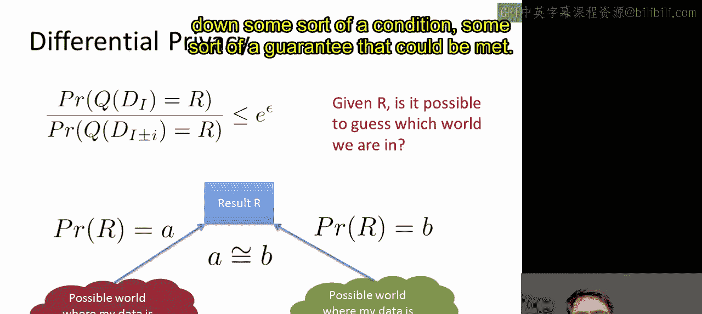
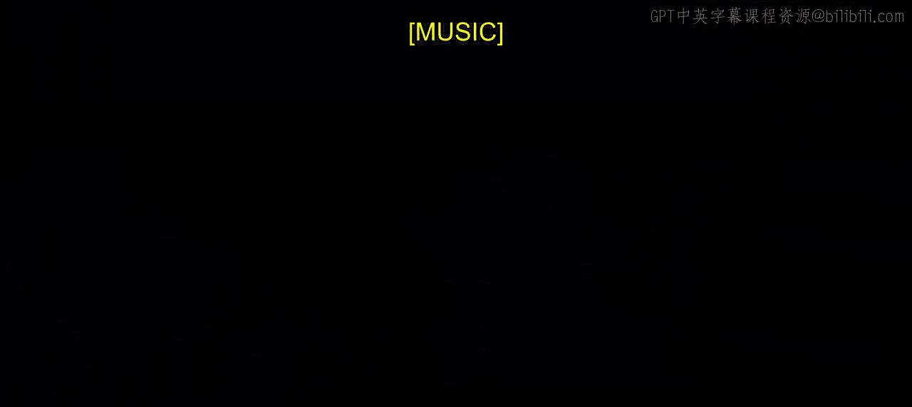

# 杜克大学《大规模数据科学（预测分析，交流数据科学结果，第2、3课⧸共3课有视频）｜Data Science at Scale》中英字幕 p93 23_差分隐私定义.zh_en -BV1xf421Q7bH_p93-

。

So let's make a second attempt。So we had some bad news with the strong guarantee， but you know。

 as long as I could be assured that no one would be able to discover anything private about me by looking at the published results。

That is that the probability of finding some secret about me。Is。given R。

 given the result of the study or the result of the release data site rather。

Is equal to the probability of finding that secret about me anyway without the result。

 So even if you never release the results， you still be able to figure that out as long as that probably is about the same or is the same。

 then then I'm happy。 So is this possible。 Well， no。

 if R shows the problem is that R could show there's a strong trend in my population。啊。

Then with high probability， the trend is true of me， too， even if I don't give you my data。

 So this is is， this is， you know， if you if you figure out that。

All men are more likely to get heart disease than women， which is not true， by the way。

You've discovered something about me just by virtue of you knowing the fact that I'm male。

Consider our example from Barrow， Alaska， where all you have to know is someone is from Barrow。

 Alaska， and now you've learned。Potentially learn information about them。呃。

Based on the results of the study， even if they had nothing to do with the study。

 they didn't participate， they weren't even there。Okay， and so the。

 the way to write this more precisely is that the probability of finding a secret about me。

 given some secret about the population is always going to be greater than。

Finding the probability of secret about me。Alone。Okay。

And so R might include some secret about the population。So our second attempt didn't work out either。

Other examples of this， you know， researchers if researchers show that red meat causes cancer。

 which was。Noown， but。Stated more publicly。Recently by the World Health Organization and your insurance company knows your dietary habits。

Then the company may conclude that you're now at a increased risk of cancer。

 and that's something you wanted to keep private， and you had nothing to do with the study that showed red meat causes cancer。

 and yet your insurance company now has violated your privacy has now been violated。

 even though you didn't participate。Okay， and then as I mentioned。

 the example from Be Alaska is relevant here as well。So this is。A sad， sad day， right。

 we can't guarantee anything we want。So a third attempt。We can't promise that my data。

 including my data won't affect the results at all。

 because then the results will be useless if that were true。

 and we can't promise that an attacker won't be able to learn some new information about me by looking at the results because they know they might know some other facts about me about some other public facts about me。

 and they'll be able to put the two together and derive some some new fact about me。

Because of the category I belong in usually。Well， so what if we promise that your information will not affect the results？

By that much， if the result are were just about as likely to occur with or without your data。

 you might as well provide it。IfIf it were exactly the same with or without your data。

 the data would be useless by induction as we showed。And so I've mentioned it several times。

 but just to reiterate， releasing R without your data in it could still cause you harm。

And this is why the ethical considerations that we talked about the social component that we talked about through these codes of conduct are important to inform experimental design and decide which kind of problems are appropriate to work on and which ones are not。

 for example， other kinds of design decisions throughout the study， how to present information。

 for example， and， when and when and where and how to release the results。

 which they didn't quite get right in the Barrow study。啊。You know， this isn't enough。

 these technical guarantees that we're talking about right now aren't going to be enough。To。

Achieve the societal outcomes that we want。Okay。So。Any study。

 even with all kinds of of even with these guarantees in place could still cause people harm。

 as we saw with Barrow。Now， but if you were going to release R anyway， you know。

 if that decisions already been made， the study is definitely going to come out。

Then your participation in that study。on't And And if they guarantee to you that your participation in that study won't change the result by much。

 then there's no additional harm in participating。 There may be harm in the study。

 as there was with Barrow， but there's no additional harm to participating。And so， for example。

 in the B， in the Barrow case， if someone had said， look， I'm not， I't want to be interviewed for my。

For my habits。You could set up the experiment， you could set up things using these techniques we'll talk about in a second to guarantee that there was no additional harm by participating than they would have occurred by the release of the study anyway。

 so there was a stigmatization effect， there was a financial effect where the bond rating went down for the entire town。

 these effects were going to be occurred anyway， whether you said yes to let the researchers come into your house and interview or not。

Okay， so I'm belaboing this， but I just want to bring that home。 I think it's。

 I think it's technically fascinating。 And I think it's also of crucial importance to anybody practicing data science that we understand the limitations of the technical approach。

 and we augment them with the。Social component with these codes of conduct with some consideration of ethics。

So differential privacy finally， differential privacy is a guarantee from the data collector to the individuals in the data set。

That the chance that the noisy publicized results， they're going to add some noise to the data is how we're going to actually do this。

Will be the chance that it will be some particular result R is about the same whether or not you include your data。

 And so we can state this a little more precisely by saying the probability。

That theres some query over D sub I。The entire data set。He's equal to R。

 so the probability that is equal to some result。Divided by the probability that the query over I without。

Some individual。HeIs equal to R。That those probabilities are about the same。

 that the top probability divided by the probability is about one。

 and holds this needs to hold for all big eye little I and R。Q is the privatized query。

 A is a value very close to 1， and remember if so if a is large。Then these probabilities become very。

 very different and not much privacy is provided if a equals exactly one。

 then the data has no utility。You can show that if you take out this individual's data and you don't change the result at all。

Then嗯。You could keep removing people indefinitely and you would lose all the value。

 you'd eventually have no data at all and you'd still somehow magically be achieving the same result。

ok。So what should A actually be It's got to be close to one。 What does that really mean， Well。

 we define typically define a to be E to the sigma。For some solve sigma sigma greater than zero。

 and why either the sigma， you can imagine one plus sigma。And it's because the math works out nicely。

 so you'll see this construct of starts a lot。Okay， and so Cynthia Dork。

In 2011 and many related publications is generally credited with really developing this theory。

 this particular slide again is from Christine Tas talk at Purdue。All right。

So let's look at this again。Now we have that the probability that the whole data set producers are and the probability that the data set without the。

Individual's information producers are about the same， and in particular。

 the ratio of those two probabilities is less than either the sigma for some small sigma。🤧咳。

So what does this mean， Well， it means that there's two possible worlds now。

 there's the possible world where my data is included in big D。

And there's the possible world where my data is not included in big D。And oops。

And then we derive some result R， and they are about the same。So， the probability that。

The probability of R。Equal to some value A， and the probability of R in the other possible world equal some value B。

The idea is that these two probabilities are about the same。 So now if you。

 if you're in this situation where you have these two possible worlds。

 you don't know which one it is， and all you're given is are。

 Is it possible to guess which of these two worlds produce this result。And the answer is no。

 because the probability is about the same in either case。And that's what that statement provides。

 So this is just a definition。 This doesn't tell you how to achieve this at all。

 This is just the condition that。嗯。Needs to be met， but it's remarkably powerful， right。

 because this actually reasons about all possible data sets。

 it covers the whole world of what you might need to consider。

 and it lays down some sort of a condition， some sort of a guarantee that could be that could be met。

