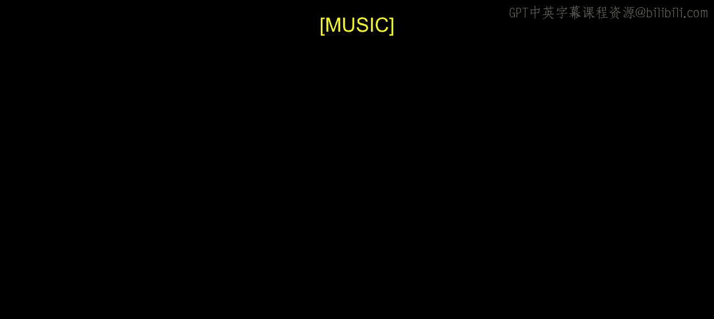
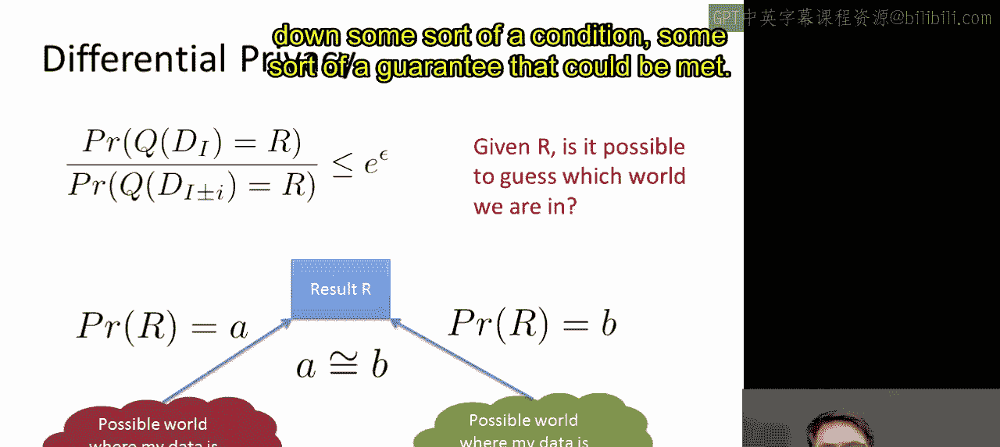
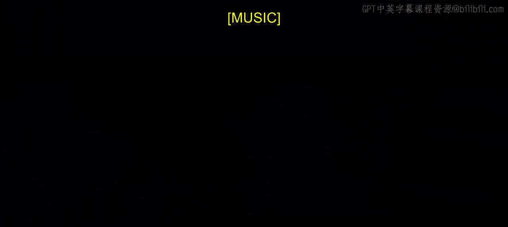

# 差分隐私：第2课：差分隐私定义

在本节课中，我们将学习差分隐私的核心定义。我们将探讨为何早期对隐私的严格保证难以实现，并最终理解差分隐私如何通过数学公式提供一个实用且强大的隐私保护框架。

上一节我们讨论了强隐私保证的局限性，本节中我们来看看差分隐私如何提供一个更可行的解决方案。

## 第二次尝试的失败

我们首先回顾第二次隐私保证尝试的逻辑。其目标是：即使研究结果R被公开发布，攻击者也无法从中发现关于我的任何新隐私信息。用概率表示，即：

`P(发现我的秘密 | 发布结果R) ≈ P(发现我的秘密)`

这意味着，知道研究结果R，并不会显著提高攻击者猜中我个人秘密的概率。然而，这个目标也难以实现。

以下是原因：
*   如果研究结果R揭示了整个群体的某种强趋势（例如，“所有男性患心脏病的概率高于女性”），那么即使我没有提供个人数据，只要攻击者知道我是男性，他就能以高概率推断出关于我的信息。
*   以阿拉斯加巴罗镇的研究为例。攻击者只需知道某人来自巴罗镇，再结合研究结果，就可能推断出关于此人的信息，即使此人从未参与研究。
*   更精确地说，问题在于：`P(我的秘密 | 群体秘密)` 总是大于 `P(我的秘密)`。而研究结果R可能就包含了关于群体的秘密。

因此，第二次尝试也失败了。其他例子还包括：如果研究显示红肉致癌，而你的保险公司知道你的饮食习惯，那么即使你未参与该研究，保险公司也可能推断你患癌风险增加，从而侵犯你的隐私。

## 转向差分隐私的思路

既然我们无法保证攻击者完全无法从结果中学习新信息，也无法保证个人数据完全不影响结果（否则结果将毫无用处），那么我们应该承诺什么？

关键在于：**承诺个人参与研究不会对最终发布的结果产生“太大”影响**。如果无论是否包含你的数据，某个结果R出现的概率都大致相同，那么你提供数据就没有额外的害处。

这一点至关重要。任何研究，即使有各种技术保证，仍可能对人们造成伤害（如巴罗镇的污名化和经济影响）。但是，如果我们能保证**你的参与本身不会带来“额外的”伤害**（即相比研究结果本身必然造成的伤害，你的参与并未增加新的风险），那么从个人角度看，参与就是安全的。

这引出了差分隐私的核心思想：它是一种数据收集者对数据集中个体的**保证**。

## 差分隐私的正式定义

差分隐私保证：经过噪声处理的公开发布结果，其成为某个特定结果R的概率，在包含你的数据和不包含你的数据两种情况下，大致相同。

我们可以更精确地表述。设：
*   `D` 为包含所有个人数据的完整数据集。
*   `D'` 为移除某个特定个人（例如“你”）数据后的数据集。
*   `M` 是一个随机化的算法（查询机制），它对数据集进行处理并输出一个结果。
*   `R` 是算法输出的任意一个可能结果。

对于所有可能的数据集 `D` 和 `D'`，以及所有可能的输出结果 `R`，差分隐私要求满足以下条件：

`P[M(D) = R] ≤ e^ε * P[M(D') = R]`

其中 `ε` (epsilon) 是一个大于0的很小参数，称为**隐私预算**。

**公式解读**：
*   `P[M(D) = R]`：当包含“你”的数据时，算法输出结果为R的概率。
*   `P[M(D') = R]`：当不包含“你”的数据时，算法输出结果为R的概率。
*   `e^ε`：这两个概率的比值上限。当 `ε` 接近0时，`e^ε` 接近1，这意味着两种情况下输出R的概率几乎完全相同，隐私保护强度最高，但添加的噪声也可能最大，可能影响数据效用。`ε` 值越大，允许的概率差异越大，隐私保护越弱，但数据效用可能更好。

这个定义意味着，存在两个可能的世界：一个包含你数据的世界，和一个不包含你数据的世界。观察者看到算法输出的结果R后，很难判断这个结果究竟来自哪个世界，因为两个世界产生这个结果的概率非常接近。

## 定义的重要性与总结

本节课中我们一起学习了差分隐私的定义及其背后的逻辑。

1.  **核心概念**：我们认识到，追求“攻击者完全无法学习新信息”或“个人数据完全不影响结果”的强保证是不切实际的。
2.  **思路转变**：差分隐私将目标转变为保证**个人参与不会显著改变输出结果的概率分布**，从而消除因参与而带来的额外隐私风险。
3.  **正式定义**：差分隐私通过一个简洁的数学公式 `P[M(D)=R] ≤ e^ε * P[M(D')=R]` 来量化这一保证。参数 `ε` 控制了隐私保护与数据效用之间的权衡。
4.  **强大之处**：这个定义是普适的，它考虑了所有可能的数据集和所有可能的输出，提供了一个可被验证的、强大的隐私保护框架。

这个定义本身并未说明如何实现差分隐私（例如如何添加噪声），但它为构建隐私保护算法树立了明确的目标。下一节，我们将探讨实现差分隐私的具体机制。