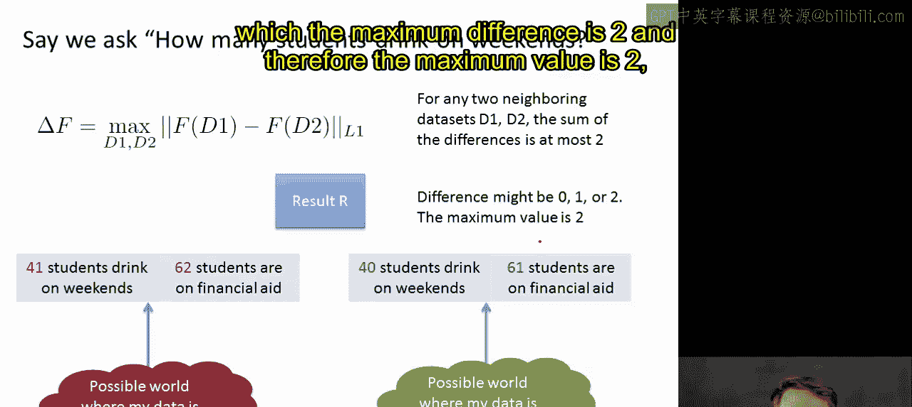

# 杜克大学《大规模数据科学（预测分析，交流数据科学结果，第2、3课⧸共3课有视频）｜Data Science at Scale》中英字幕 p94 24_全局敏感度.zh_en -BV1xf421Q7bH_p94-

。

Okay， so let's see how this actually works， say we want to ask。

How many students drink on weekends and we issued a survey that collected all sorts of information about the students。

 and we want to protect those individual students privacy。

 but we still want to allow researchers to answer this question we want to release the data in such a way to support this kind of question Well。

 the two possible worlds here， if you're an individual student considering whether to participate in this survey or not。

 the two possible worlds you can consider are whether I if I do participate in the survey or if I don't participate in the survey。

And if I do participate in the survey， then let's say I'm。

One of those students that does drink on weekends， then the total number would be 41 and if I don't participate in the survey。

 the total number will be。40， so the difference in the result of this question between these two possible worlds is at most one。

 and when I say at most， I mean。Considering any two data sets。That are neighbors。

 and what I mean my neighbors is they differ in only one record， you know。

 whether I'm included or whether I'm not included or whether somebody else is included。

 whether they're not included。It doesn't matter who it is。

 the most account can increase is just by one okay， and we're going to use this。

Nottion of sensitivity。To think about this。So generalizing。As I say。

 consider all neighboring data sets D1 and D2， where neighboring means they differ in just one record。

 Okay so these are our two possible worlds。 They given a query f that returns a single number for now that we'll say the global sensitivity of F。

Is the maximum difference across all possible pairs D1 D2。

Of the absolute value of the difference in that query that returns a single number。Okay。

 and remember D1Gs， you have to be these neighboring data sets。

 meaning to be different only in only one value。D1 is a set and D2 is a set。

 and they have to be exactly the same as over one record Okay， and we'll call that Delta。Delta F。

 And so that's the maximum difference we might find across all possible pairs of these neighboring。

Data sets。So now， if we ask how many students drink on weekends， we have this formula to sort of。

Explain our intuition that the differences of the simple countque is at most。1。

Because if you do the count query over G1。You'll get。41 you'll get the account over D2。

 you'll get 42， and no matter what data sets you pass in there。

 as long as they only differ in a single student。You'll only get a maximum difference ever of just one。

 And so Delta F is1。收。One particular query， one particular count query is not。All that useful。

 We really might want a battery of queries。 So how many can。

And financial now our query F might produce more than one result。

 or produces a result for each and every question that we're interested in answering。

So this query F that I give an example of here returns a vector of results。

 and so now when we consider what the maximum difference is going to be。

 we're going to consider the sum of the differences across all these possible questions。Okay。

 and so the sum of the absolute value， that should be value， not value。

 sum of the absolute value of the differences of a vector is the just the L1 norm。

 And so we can generalize our sensitivity equation a little bit。In this way。

 so instead of looking at the difference for just one number now we' now we've said the F now returns a vector and so we subtract one vector from the other。

 meaning that we get a vector of differences and then do the L1 norm of that vector of differences。

 which means take the absolute value of all the differences and then add them all up。

which that's the only1 norm。Maximum value of that L1 norm across all possible neighboring D1 and V2 data sets。

 we'll call that the global sensitivity of this function F。Fine， so what' does this look like？Here。

 so instead of asking how many drink on weekends， we actually say how many you are on financial aid as well。

 And now you have to think a little bit to see what the difference might be。

 Well the difference could be 0，1 or 2， if it's。You know if I don't drink on weekends and I'm not on financial aid。

 the difference， my inclusion will not change the result at all， so the difference will be zero。

 but if I am a student who drinks on weekends and is not on financial aid。

 the difference will the difference the maximum difference will be。

If there who exist students who drink on weekends and not on financial aid。

 the difference will be one， but there also might exist students who drink on weekends and on financial aid。

 in which case difference the maximum difference is two。Okay。

 so we can imagine a pair of data sets for which the maximum difference is too。

 which case and therefore， the maximum value is 2。 And the global sensitivity of this particular function is。

2。