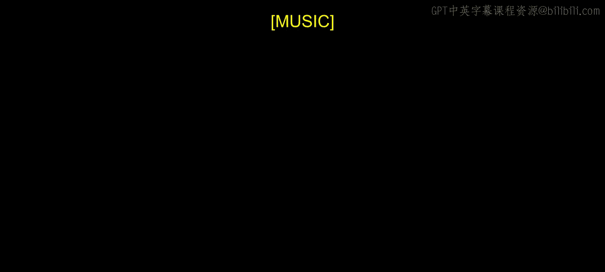
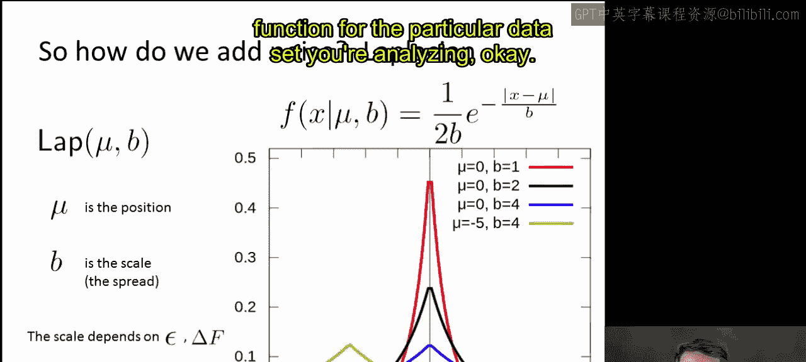

# 杜克大学《大规模数据科学（预测分析，交流数据科学结果，第2、3课⧸共3课有视频）｜Data Science at Scale》中英字幕 p95 25_拉普拉斯噪声.zh_en -BV1xf421Q7bH_p95-

。

So we talked about global sensitivity and we use an example of counting things。

And then we generalize it to a vector of counts。 and the reason why we're doing this is that actually lots of queries。

 lots of different kinds of analysis can be boiled down to。

A relatively small number of counting queries。 And as have been shown in some。And the paper there。

Lised on the slide is， you know， histograms， singular value decomposition for matrices。

 the decision trees that we learned about in the machine learning section， cans。

 clustering algorithms， mining association rules， which we haven't talked about。

 There's all sorts of things that basically boil down to to count。 So if we can figure out how to。

Reason about privacy in terms of counts， there's other analytics we can support directly。

 and histograms is the best one to think about here because that's why we generalize it to a vector of counts。

Is that。We need that immediately if we start thinking about collecting a histogram so give me the count for you know males and females or freshmen。

 sophomore， juniors and seniors， any other kind of breakdown like that。

 we're going to need to we need functions that can produce a vector of counts and that's exactly what we reasoned about in the previous section。

Okay， so。Fine， how do we actually go about adding noise。 Now， we have some notion of sensitivity。

 But I haven't really explained why we， why we care about that or how that gets back into this notion of of。

嗯。Differential privacy。We talked about what differential privacy means， we talked about some of the。

Alternative formulations of the privacy problem that don't quite work and why differential privacy was。

Formulate the way it was。And the basic idea here is that we're going to add noise to the answer。

So that you can't tell which possible world you're in right you can't tell for any particular user whether it came from the world where they did it where they were included or the world where they weren't included。

 and that's the formal definition of differential privacy。Let we talk about global sensitivity。

But we haven't said how to actually add that noise。 What kind of noise do we need to add， Okay。

 so we know that the noise needs to be a function of this sensitivity， right。

 if if a function or I'll state that and but it shouldn't be controversial that the amount of noise you need to add is going be more if the function is。

More sensitive， so we have a large vector of counts。That you're trying to protect。Against。

Then you're going to need to add more noise than you would。 if it was just a single question。

 for example。 Okay， so the higher sensitivity， the more we need to change the result to prevent some adversary from distinguishing between the two possible worlds。

 So what kind of noise， Well the simplest approach is to add lapplian。Noise。

And the plausant looks like。This， it's a peak distribution。 You the Gaussian is the bell curve。

 so smoother the top theplsian is two exponential functions back to back，1 positive， one negative。

 So it has two parameters。 It has the。Mu the position parameter。

 which is sort of where it is on the x axis and B， or you'll see lambmbda sometimes is the scale parameter。

 which is how spread out it is。Okay， and since it's just two exponential distributions back to back。

 B is the。Expenential scale parameter。 as the actual equation looks like this。

 it's 1 over 2 be E to this exponent。And just some examples of the costing here that the smaller the be。

 the more spike spiked the distribution is， and then you can offset it by adjusting the mu parameter。

 So this green value is with the mu parameter。Adjusted by five， so where the center is。So。

We know that the scale， how spread out this is。Needs to depend on。2 things。

 and needs to spend on epsilon。 And it needs to depends on on the global sensitivity。 this Delta A。

 And so epsilon， we said， that's the。Prammeter is somewhat difficult to said of。

A social tolerance for privacy， right， It's you know 10% privacy or 5% privacy。

 but it's some sort of a budget。That we'll talk about in a little bit。

 but that that was a parameter in the definition of differential privacy and then DelF。

 as we just discussed， a is a something you have to calculate for。呃。

Each family of queries you're trying to support。Okay。

 and then we know that the position should have been on the actual value of that function for the particular data set。

Analyzing。O。