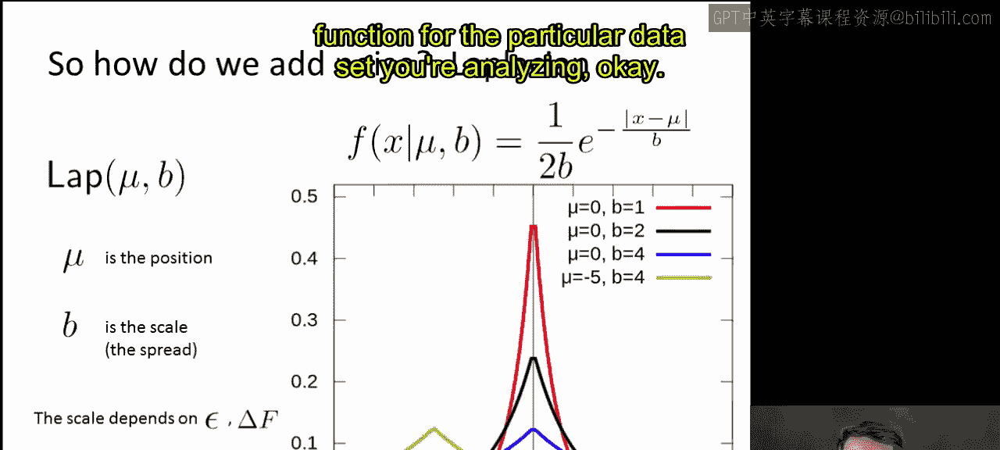

# 大规模数据科学（预测分析，交流数据科学结果）：第2课：拉普拉斯噪声

在本节课中，我们将学习如何通过添加拉普拉斯噪声来实现差分隐私。我们将从全局敏感度的概念出发，解释为何许多分析可以归结为计数查询，并最终介绍拉普拉斯噪声的数学形式及其参数设置。

## 全局敏感度与计数查询

上一节我们介绍了全局敏感度的概念，并以计数为例进行了说明。本节中，我们将这个概念推广到计数向量。

我们这样做的原因是，实际上许多查询、许多不同类型的分析都可以归结为相对少量的计数查询。正如幻灯片上引用的论文所示，直方图、矩阵的奇异值分解、我们在机器学习部分学过的决策树、聚类算法以及我们尚未讨论的关联规则挖掘等，所有这些基本上都可以归结为计数问题。

因此，如果我们能弄清楚如何在计数的框架下推理隐私问题，我们就能直接支持其他类型的分析。其中，直方图是最容易理解的例子，这也是为什么我们要将其推广到计数向量。一旦我们开始考虑收集直方图（例如，统计男性和女性的数量，或大一、大二、大三和大四学生的数量），我们就需要能够生成计数向量的函数，而这正是我们在上一节中推理的内容。

## 添加噪声的必要性与思路

那么，我们实际上如何添加噪声呢？我们现在有了敏感度的概念，但尚未解释为何要关注它，以及它如何与差分隐私的概念联系起来。

我们讨论过差分隐私的含义，也讨论过一些未能完全解决隐私问题的替代方案，以及差分隐私为何以当前的形式被提出。其基本思想是，我们将向答案中添加噪声，使得你无法分辨自己处于哪个可能的世界中——即无法针对任何特定用户，判断数据是来自包含他们的世界，还是不包含他们的世界。这正是差分隐私的形式化定义。

我们讨论了全局敏感度，但还没有说明如何实际添加噪声。我们需要添加哪种噪声呢？

我们知道，噪声量需要是敏感度的函数。这一点应该没有争议：如果函数更敏感，你需要添加的噪声就越多。例如，如果你试图保护一个大型计数向量，那么你需要添加的噪声就会比只回答单个问题时更多。敏感度越高，我们就需要越大幅度地改变结果，以防止攻击者区分两个可能的世界。

## 拉普拉斯噪声

那么，添加何种噪声呢？最简单的方法是添加拉普拉斯噪声。

拉普拉斯分布的形状如下：它是一个尖峰分布。高斯分布是钟形曲线，顶部平滑；而拉普拉斯分布是两个背对背的指数函数，一个正，一个负。因此它有两个参数：
*   **μ**：位置参数，决定分布在x轴上的中心位置。
*   **b**（有时也用 λ 表示）：尺度参数，决定分布的分散程度。

由于它只是两个背对背的指数分布，b 就是指数分布的尺度参数。其实际方程如下：

`f(x|μ, b) = 1 / (2b) * e^(-|x - μ| / b)`

以下是该分布的一些示例：b 越小，分布越尖锐；通过调整 μ 参数可以偏移其位置，例如图中绿色的分布就是 μ 参数偏移了5的结果。

## 噪声尺度参数的确定

我们知道，这个分布的尺度（即其分散程度）需要取决于两件事：
1.  **ε**：我们在差分隐私定义中讨论过的参数，可以理解为社会对隐私的容忍度或隐私预算。
2.  **全局敏感度 Δf**：正如我们刚刚讨论的，这是你需要为你试图支持的每一类查询计算的值。

位置参数 μ 则应基于该函数在特定数据集上的实际值。

## 总结

本节课中，我们一起学习了如何将差分隐私应用于实际查询。我们从计数查询的全局敏感度出发，理解了为何许多数据分析可归结为此类问题。接着，我们探讨了通过添加噪声实现隐私保护的核心思想，并重点介绍了拉普拉斯噪声的分布特性及其关键参数（位置参数 μ 和尺度参数 b）。最后，我们明确了决定噪声尺度的两个关键因素：隐私预算 ε 和查询函数的全局敏感度 Δf。这为后续具体实现差分隐私机制奠定了基础。