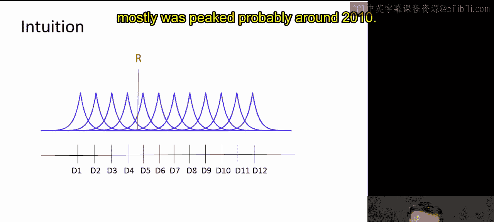

# 杜克大学《大规模数据科学（预测分析，交流数据科学结果，第2、3课⧸共3课有视频）｜Data Science at Scale》中英字幕 p96 26_添加拉普拉斯噪声和证明差分隐私.zh_en -BV1xf421Q7bH_p96-

。

All right， so that's what theplian distribution looks like， let's see how to use it。

So how do we actually add it to the result， Well， the probability that the result of the query is equal to particular value x。

 given that D is the true world is this。And what we've done is substituted in our values for the。

Prameterters of the La plausian so B。He's equal to Delta F over epsilon。And。Mu。Is equal to。

The actual function value over the data set producing the true world。

And so the the intuition here is that， you know Delta F as Del F increases， it should get more。

Spread out。Which it does because B is equal Dlta over epsilon and as epsilon。Increases。

 meaning we have more tolerance for privacy。Then， the。Sca parameter it can be more spiky。

 we don't need quite as much noise and we don't use as much noise in the result。Okay。

And so that's why that's the， you know， there's other ways you could sort of put this together。

 but that's the most。Straightfor one。ok。And so then to actually get our results to construct the privatized R。

 we take the function value over over D。 here is a D1。 but over the data we have and add in。

A laplacey a random。Number drawn from this laplastian distribution defined in this way。Okay。

 and that's what we're going to do every time we answer a query。

 say we're building an API or building a database and we can ask these kinds of counting queries。

 you wouldn ask for different histograms and different kinds of values。

 we're going to compute the answer， draw a sample from the Laplacesian。Distribution。

 add them together and return that as the answer。Okay。Now， let's。Check to see whether this。

Makes sense and satisfies the condition of differential。Privacy。

So remember the condition was that the probability。

For the possible world where my data is included over the possible world where my data is not included。

 that difference needs to be。Less than e to the epsilon。Given an epsilon。

 given given a privacy tolerance parameter epsilon。

 this is the condition that satisfies the definition of differential privacy。 And now you said， well。

 that probability is going to be。The value plus Laplian。

Plus Lalasty equal to R over the probability that the value over D2 plus Lalasty is equal to R。

And if you work through the algebra， substitute in the definition of Lalaium。You get this expression。

 and you can。Again， rearrange with the algebra， and you can check to see that。

The value is bounded by。This value， which is always going to be less than。Right。

 so the exponential is E to the。This is the exponent。

 and that's always going to be less than epsilon itself to be divided by。Us sensitivity。Yeah。Oh。Yeah。

So the intuition for this。Is that you've got all these。

Possible worlds that differ in only one individual。And。You're generating a result from that。

 And each one of the results is blurred into its neighboring ones by adding this Laplaceian noise。

 And so when I get a particular result R at a particular value。

 it's not possible for the attacker to。Claim with any more than a certain amount of confidence。

Which one of these two possible worlds it came from？Okay。

 and if you have a function with a higher global sensitivity or your epsilon is very， very， very。

 very low， you know， your tolerance harvest is very， very low。

 then it's going to get even more spread out and it's going to be even harder and harder to tell。

Which possible world you're in。Okay， and I should reiterate that laity is not the only way to achieve this。

 right， anything that satisfies that definition of differential privacy。Is。You know。

 satisfy the definition of differential privacy。 Lapaian is one mechanism。

That we can use to answer queries and it has certain properties that that。Make the math work out。

All right， but there's other ways to do it and there's an enormous number of papers that have studied this。

Save 2006 to 2012， and there's just one point off， but mostly it was。

Peed probably around 2010。All right。