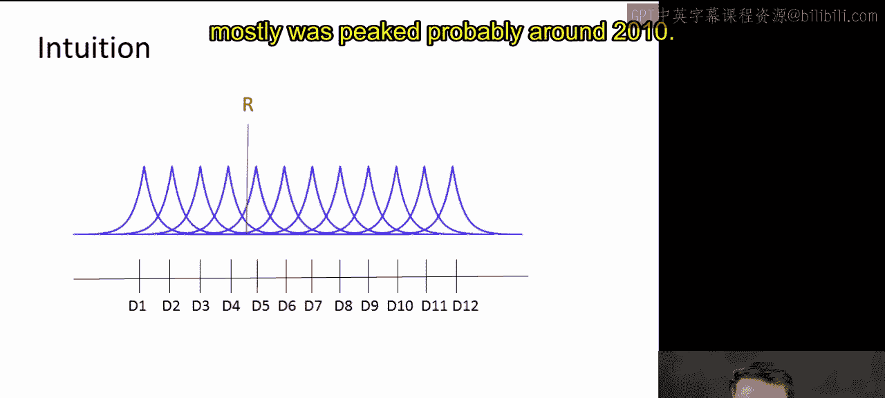

# 差分隐私：第2章：添加拉普拉斯噪声与证明

## 概述
在本节课中，我们将学习如何通过向查询结果添加拉普拉斯噪声来实现差分隐私。我们将详细解释拉普拉斯分布的参数设置、噪声添加的具体步骤，并最终证明该方法满足差分隐私的数学定义。

---

## 拉普拉斯分布的应用

上一节我们介绍了拉普拉斯分布的基本形态，本节中我们来看看如何具体应用它。

向查询结果添加噪声时，给定真实世界数据集 **D**，查询结果等于特定值 **x** 的概率由以下公式描述：

**P(result = x | D) = (1 / (2b)) * exp(-|x - μ| / b)**

我们已经将拉普拉斯分布的参数替换为差分隐私相关的值。其中，尺度参数 **b** 等于全局敏感度 **Δf** 除以隐私预算 **ε**：

**b = Δf / ε**

位置参数 **μ** 等于函数在真实世界数据集上的实际值：

**μ = f(D)**

这里的直观理解是：当全局敏感度 **Δf** 增大时，噪声分布应更加分散。这确实成立，因为 **b** 与 **Δf** 成正比。同时，当隐私预算 **ε** 增大（即我们对隐私的容忍度更高）时，尺度参数 **b** 会变小，分布变得更“尖峰”，意味着我们不需要添加那么多噪声。这是最直接的一种参数设置方式。

---

## 生成隐私化结果

以下是构建隐私化结果 **R‘** 的具体步骤：

1.  计算函数在真实数据集 **D** 上的值 **f(D)**。
2.  从参数为 **(μ = f(D), b = Δf/ε)** 的拉普拉斯分布中随机抽取一个噪声样本。
3.  将函数值与噪声相加，得到最终发布的隐私化结果：**R‘ = f(D) + Laplace(μ, b)**。

当我们构建一个API或数据库来响应此类计数查询（例如请求不同的直方图或统计值）时，每次回答查询都会执行此过程：计算答案，从拉普拉斯分布中抽取一个样本，将它们相加，然后返回该和作为答案。

---

## 验证差分隐私条件

现在，让我们检查这种方法是否合理并满足差分隐私的条件。

回忆一下，差分隐私的条件是：对于任意两个仅相差一个个体的相邻数据集 **D1** 和 **D2**，以及任意可能的输出结果 **R**，以下概率比值的界限必须成立：

**P(M(D1) = R) / P(M(D2) = R) ≤ exp(ε)**

其中 **ε** 是给定的隐私容忍度参数。这个条件满足了差分隐私的定义。

具体到我们的拉普拉斯机制，这个概率比值就是：

**[P(f(D1) + Laplace = R)] / [P(f(D2) + Laplace = R)]**

如果将拉普拉斯分布的定义代入并进行代数运算，可以得到以下表达式。经过重新整理，可以验证该比值始终以 **exp(ε)** 为界：

**比值 ≤ exp( |f(D1) - f(D2)| / b )**

由于 **|f(D1) - f(D2)| ≤ Δf**，且 **b = Δf/ε**，因此：

**比值 ≤ exp( Δf / (Δf/ε) ) = exp(ε)**

---

## 核心思想与扩展

这个证明的直观理解是：存在许多仅相差一个个体的可能世界（数据集）。通过添加拉普拉斯噪声，每个世界产生的结果都被“模糊”到其相邻的结果区域中。因此，当攻击者观察到一个特定的结果 **R** 时，他无法以超过某个特定阈值的置信度来断定这个结果究竟来自哪一个相邻的可能世界。

如果函数的全局敏感度 **Δf** 更高，或者隐私预算 **ε** 设置得非常低（即隐私要求极其严格），那么添加的噪声分布会更加分散，想要区分来自哪个可能世界就会变得越发困难。

需要重申的是，拉普拉斯机制并非实现差分隐私的唯一方法。任何满足上述差分隐私定义的方法都是有效的。拉普拉斯机制只是我们用来回答查询的一种具体机制，其数学性质使得证明过程相对简洁。自2006年概念提出以来，尤其是到2010年左右，已有大量论文研究了实现差分隐私的其他多种机制。

---

## 总结
本节课中，我们一起学习了实现差分隐私的核心机制之一——拉普拉斯机制。我们掌握了如何根据全局敏感度 **Δf** 和隐私预算 **ε** 设置拉普拉斯噪声的参数 **b**，了解了向查询结果添加噪声以生成隐私化输出的完整步骤，并通过数学推导证明了该机制严格满足差分隐私的定义。最后，我们探讨了该机制的直观含义，并了解到拉普拉斯机制是众多可行方案中的一种。