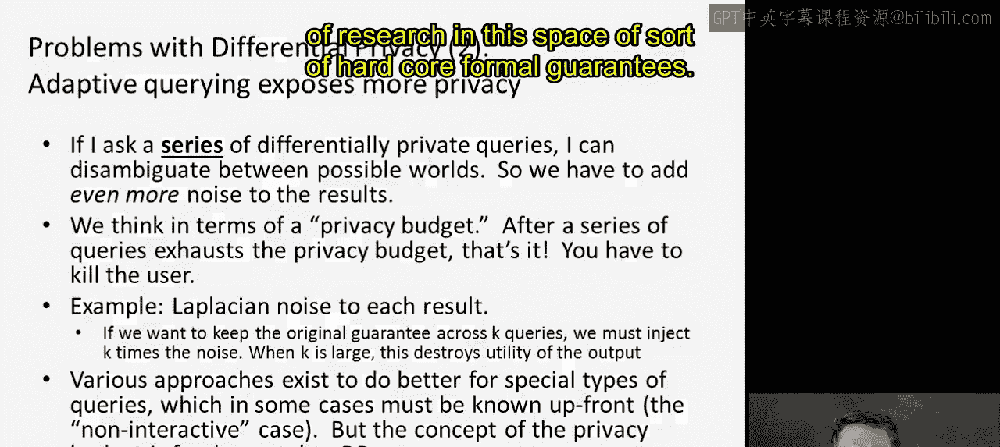

# 杜克大学《大规模数据科学（预测分析，交流数据科学结果，第2、3课⧸共3课有视频）｜Data Science at Scale》中英字幕 p97 27_差分隐私的弱点.zh_en -BV1xf421Q7bH_p97-

。

So we motivated differential privacy in a couple of ways。 We said we wanted to explore， you know。

 what kind of formal technical guarantees can we make in this in this space。

 in contrast to the more behavioral，Guidance kinds of approaches， you know。

 based on codes of conduct by professional organizations。 So that's maybe a one into the spectrum。

 and the other end into the spectrum is formal technical guarantees。

 what can we say about the privacy problem And further we said that some of the attempts to formalize and solve the privacy problem tended to ignore the most the one feature that's true about almost every attack。

 which is that it combines data sets from multiple different sources。

In order to drive more information， right， So you don't just use the Netflix data to。

violate the privacy of the Netflix users， you use the Netflix data along with external information。

 you don't just use the AOL search queries， use the AOLC search queries along with the phone book。

Okay so any formalization needs to take that into consideration， and most of them did not。

 differential privacy does。 it doesn't know there's no parameter in the definition that that tries to model what data set someone has access to。

t it doesn't have any dependency on that。ok。So that's good。There are some problems with it。

 and there's two in particular I wanted to talk about。

 One is that it's really designed for these low sensitivity queries。

 We talked about these counting queries that are。Indeed， low sensitivity， right， no matter what。

Is going on with with a particular person participating in the survey。

 the most they're going to change the values are in single single single units right that I can only increase account by one。

 no matter what's going on。 But if you think about sums queries involving sums of values。

 this could be different。 So considering questions around income， for example。

If I add I want to have a total amount of income earned by， you know， across gender in a particular。

Segment inclusion or exclusion of a single person could。Wildly change the the results， right。

 because incomes are are。Not really Gaussian distributed， right。

 they're really more of an exponential thing。 right， there's an 8020 rule in play here。

 though the top earners earnt exponentially more than the。嗯。Bottom runs。And you。

 maximum minimum may be even worse because if you're adding up a lot of values。

 you can maybe hide a large value。In that， in that， in that noise。

 But if you're just looking for the maximum value， it doesn't depend on the size of the data sets。

 So even if you have millions and millions of people， the maximum is still going to change。

Significantly depending on only an individual on the individual person's income。Okay， so for for a。あ。

For certain families of queries， you have to do a lot of work to derive a differentially private mechanism for answering those queries。

 and it's not obvious how to do that or whether that can be done effectively and in some cases what has been shown is that。

You end up needing to add so much noise that the utility is difficult to achieve。Okay。

The other big problem。 So one is classes of queries。

 The other big problem is this notion of adaptive querying。

 So we've talked about sort of answering one question and assuming that's differentially private。

 What if I'm allowed to ask a question and then ask another question。

 another one and another one and another one and you can maybe maybe this might remind you of you know what we're actually looked at in the in the when we talked about statistical reling methods right you've got some unknown distribution and you're going to。

Use resampling on a particular data set or just not even reampling if you just did the experiment over and over and over again。

 which is what resampling is trying to simulate。Ha。You could。

Derrive the form of the underlying distribution and answer questions。

 So statistical inference is exactly trying to crack this problem of differential privacy。

 differential privacy is adding noise in order to ob things。

 and statistical inferences is trying to do repeated experiments in order to。

Infer things and so you can imagine if I'm allowed to ask multiple queries and you're going to add noise to them。

 I might be able to sort out what signal and what noise given these queries。ok。So。

This was well understood from the beginning in differential privacy。

 And the only solution is really to add even more noise to the results。

 And so it's easy to show that。嗯。A series of K differentially private queries that are。

Independently privatized in the manner we described with the Laplusian。

Are still differential private， private with a。All up to。K times the original privacy。Prameter。

So what I mean by that is。It scales linearly right if you've got a certain level of privacy achieved with one query。

 you ask k times then the privacy you've allowed K times more privacy leakage。By asking K queries。

 okay， and you can actually people have derived even tighter bounds on that。So。

 but it's at least that that private。 And in some sense。

 that's a good thing because I means all that means we have one simple trick is that we can just take the。

Privacy parameter sigma and just divide by K。 if somehow you knew that no one's ever going to write more than 10 queries。

 you could just divide by 10 and then add the noise as normal。

And so because of this sort of reasoning， it really makes more sense to think of this in terms of a privacy budget after a series of queries exhausts that privacy budget。

That's it。That user is no longer allowed to answer ask any more queries。

 and if you start to allow for collusion between users。

 you start to get into trouble with what this privacy budget means on a per user basis。

 maybe maybe you need to have one privacy budget for the entire world。And then if you say， well。

 what if we can't really track the user because they could make fake accounts on our system or they could otherwise hide their identity？

You got nothing， you you basically the joke is you have to kill the user at that point。Okay。

 so for the example here， if you add the play noise each result。

 if you wanted to keep the as I explained， if we want to keep the original guarantee across K queries。

 you have to inject K times the noise and so when K is large。

 if you want to support thousands and thousands of queries。

Youve just destroyed the utility of the output， right you add so much noise on a per query basis that there's nothing you can really derive from it。

Okay， and so the various approach is to tackling this problem for special families with queries like Boolean predicates。

There's a distinction between the interactive case and the non interactive case。

 given a set of 100 queries， what can we do versus a adaptive？

Where I get to ask one query and inspect the results and then ask another query adversararily again。

Based on those results and on what I know。嗯。But in all these cases。

 the concept of a privacy budget is very fundamental differential privacy。

 and this severely limits its utility in practice。Okay。So it's still the。

The reason I wanted to work through this concept is because I wanted to expose some of the limits of the technical guarantees one can make about。

Privacy。And differential privacy is still one of the most promising lines of research。

In this space of sort of hardcore for formal guarantees。

