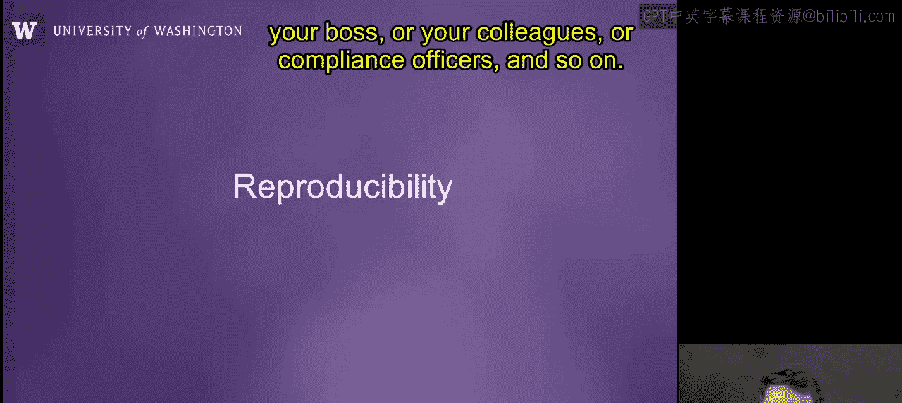
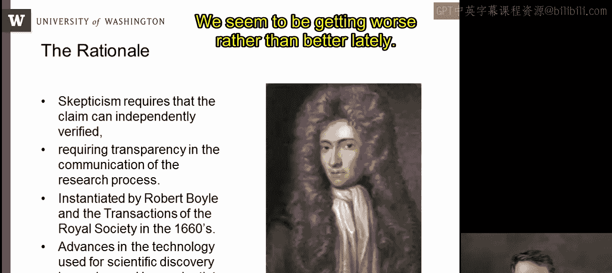
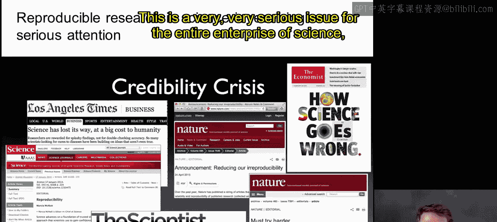
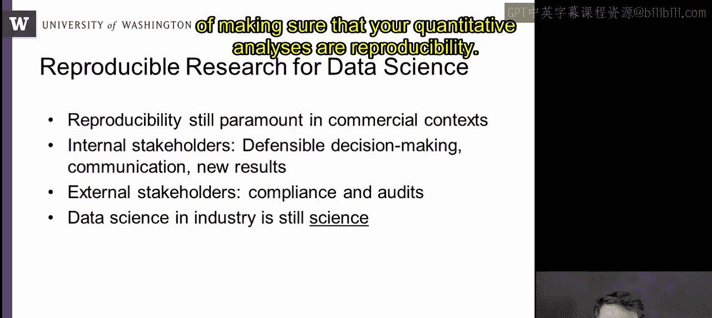

# 杜克大学《大规模数据科学（预测分析，交流数据科学结果，第2、3课⧸共3课有视频）｜Data Science at Scale》中英字幕 p98 28_可重复性和数据科学.zh_en -BV1xf421Q7bH_p98-

。

So in this module， I want to talk about reproducibility and the topic doesn't always lend itself to a core structure。

 at least not our course structure， in that we like to give an overview along with technical deep dives on particular topics that are important and that we can convey in an introductory course。

And the title。Subtopics of reproducibility tend to be associated with specific tools and specific contexts and I'm not necessarily excited about any of them at this excited enough about any of them at this point in time to spend too much time on them in this course。

 but I've got an argument I want to present and will' work through that but。The starting point here。

 I think， is to make sure that we realize data science is science。 first and foremost。

 It is a research exercise， right， You've got questions， you've got hypotheses。

 you're testing hypotheses， you're gathering data， and the output of those research exercises cannot just be the answer。

 It's got to be the steps you took just like as if you were publishing a paper， even if you're。

Recipients of those steps are。Not the public at large。

 but your boss or your colleagues or compliance officers and so on。

 And so I think it's reasonable to。

Start from the very， very top， which is。That at you know。

 the epistemological foundation of the scientific enterprise is skepticism。

 and that skepticism requires that a claim can be independently verified。 If you don't have this。

 you don't have anything。 And so you can't。Go run your R script in a closet and produce the result to someone and have any kind of confidence that anyone' is going to believe you or make any sort of decisions on it。

 You must walk through the steps required。 And so there has to be this transparency in the and communication of the research process。

 And this was began in the 1660s with Robert Boyle in the Trans of the Royal Society。

AndBut as advances technology have proceeded， the nature of what reproducibility means has changed and in particular。

 as things have become more computational。And more data intensive。

The situation has actually gotten harder， perhaps rather than easier。

 And you know one thing I've said in the past is that as a computer scientist is actually embarrassing to me that。

The problem has gotten worse as research has shifted to be more computational。

 It should be much harder to extract。Information out of the world than it is out of ones and zeros。

 It should be much harder to reproduce。The experiments that do the knowledge extraction from the world in the wet lab。

 you know， the chemistry experiments， the biology experiments。The physics experiments。

 then it is to do it once everything is encoded as ones and zeroes in a digital form。

 and yet that doesn't seem to be the case。 We seem to be getting worse rather than better。

Wei wei。So its's this topic is receiving serious attention。

 there's been an enormous amount of trouble and increasing attention on the fact that there is trouble in science itself。

 and this slide is from as was the last one from Victoria Stadden， who's an expert in this。Space。And。

It's across all aspects of science， across all fields of science。

 and there's been a number of studies that have shown that the information coming out in the scientific literature is indeed not。

 reproducible and many of the results，Don't seem to hold water。 So this is a very。

 very serious issue for the entire enterprise of。

Science。So what does this mean for data science as opposed to？You know， basic。Public research。 Well。

 it's still paramount in commercial context， even if it's not。Quite yet recognized as such， right。

 the internal stakeholders require some degree will require some degree reproducibility whether or not they're asking for it。

 you know today or tomorrow。 and you need this for defensible decision making。

 decision making If decisions are going to be made in a quantitative basis based on some kind of scientific result。

 there has to be you have to be able to go back to the facts understand。What they were。

 especially if something goes wrong， if the decision doesn't turn out to be right。

 people are going to want to make sure that they followed it correctly。

Also just for internal communication and training， when you move on to a different job or when you want to pass a project on to someone else。

 you have to have the steps there written down in some reproducible way for other people to build on。

And even for training purposes。You know， business decisions are increasingly going to be made on the results of a series of experiments。

 and those experiments have exactly the same criteria for validity that they do in。Basic research。

And then external stakeholders put other kinds of pressures on here， right。

 there's compliance officers， there's audits。And there's requirements and meeting the letter of the law in terms of how long you keep data around or what kind of records you keep and so on is part of it。

 but there's also the general approach of making sure that your'。

Quantitative analyses are reproducibility。

So again， data science and industry is still。It's still science。

