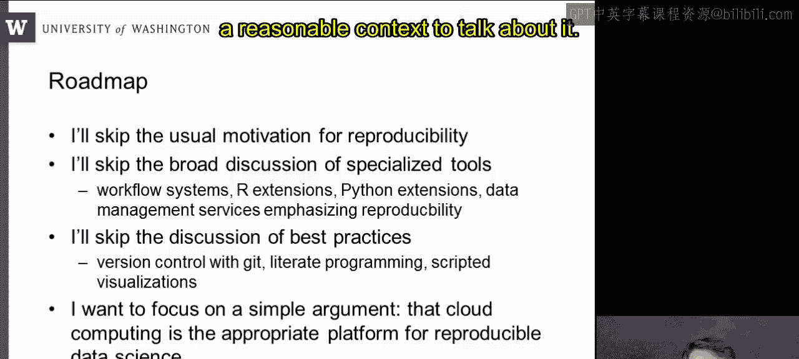

# 杜克大学《大规模数据科学（预测分析，交流数据科学结果，第2、3课⧸共3课有视频）｜Data Science at Scale》中英字幕 p99 29_可重复性黄金标准.zh_en -BV1xf421Q7bH_p99-

。

So as I mentioned there's increasingly high profile problems in 2011 Bay researchers reported that they were able to reproduce only 17 of 67 important pharmaceutical studies in 2012 Amgen did a similar kind of reproducibility experiment and found that only six out of 53 cancer studies had results that they were able to reproduce。

In August 2015， thepeability Project in Virginia reported they were reproduce only 39 to 100 psychology studies。

There's a lot of press about that in September 2015， the US。

 Federal Reserve was able to produce reproduce only 29 of 67 economic studies。

This notion of back test overfitting in computational finance has emerged as a major problem。

 and this is essentially exactly what it sounds like。

Overfitting as we discussed in the previous course。

And back test refers to looking at historical data。

 and so if you've got a signal that does this in computational finance。

 it's trivial to find some model that will capture that。Perfectly。And worse， the habits of what。

Essentially， unscrupulous financial advisors will do is try。You know。

1 thousand models report the one that's the best。And advertise it。

 and then act surprise when it doesn't do a very good job predict future results。 There's。

 there's a fundamental lack of scientific。Protocol and honestly integrity in that community。

 which may or may not be surprising， but let us' an issue and reproducibility。As well as kind of。

A scientific mindset， an empirical mindset is seen as part of the solution there in March 2014。

West Virginia research reported that they were unable to reproduce  Volkswagens claimed emissions figures。

And as we've seen this now exploded into an international scandal。Where。

It turns out they were cheating。So I would claim that the gold standard for reproducibility。Is that。

Others can use your exact environment， as it was at the time of the experiment。The same software。

 the same software environment， the same hardware， know， the same lighting in the room， let's say。

Everything was exactly the same。Moreover， you know。

 the tension with that is that your experimental procedures in order to。Ensure reproducibility。

At the next step are unaffected in that you don't have to worry about it all。

 it just naturally happens， right。After the fact， you could flip a switch， save your entire room。

 save your office， save everything in it and package it up and ship it to someone else。Cted。

Make it available， and it make it reproduce all the results。There's a。

Argument that this is a bad definition for a gold standard for reproducibility。

 and we'll come back to that in a while that you can think about what that might be。

 so some would argue that this is a bad definition for a bad ideal to achieve or that there's parts of the idea that are missing。

But even if you settle for this。We can't achieve this。

 but we can get close with virtual machines and I want to。

Move through this argument in the course of this module。Okay。

 so what we're going to do is I'm going to skip the usual longer motivation for reproducibility。

 although I did I did a little bit of it。 I'm going to skip the broad discussion of specialized tools。

 These are the scientific workflow systems that that purport to。Support better reproducibility。

Clugins and extensions for， you know， our environments and Python environments that will sort of watch what you're doing and。

Save state。You can make calls to attach metadata to things。

 there's all kinds of systems to be able to sort of make。

Day to day work in our Python more reproducible in the future。

 there's data management services that emphasize reproducibility when you save versions of data sets。

But again， I'm not excited enough about any one of those particular tools to advance it as a recommendation or to really explore it plus an in- depth discussion of these tools tend to be more interesting to people who are interested in building those tools as opposed to just only using those tools。

I'm also going to skip the discussion of best practices， which includes things like version control。

 typically with Git nowadays since it's。Done such a good job in sort of unifying。

Atttracting people's attention。Really honestly solving the problem through GitHub。

 I'm going to skip literate programming。Making sure things like your visualizations and your figures are all sort of scripted so you can rerun them and change them。

Software engineering principles， test driven development， these kinds of things。

And I want to focus on what is ultimately a simple argument that cloud computing。

 whether public cloud or some version of a private cloud。

 is really the appropriate platform for reproducible data science and。Through that argument。

 we'll bring out some of the features of reproducibility。

 but we'll also bring out features of cloud computing itself。

 which is this is a reasonable context to。

So you talk about it。

