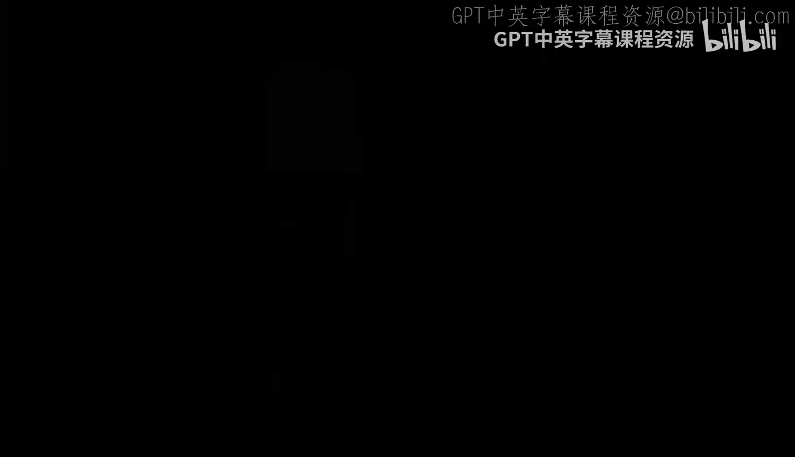

# 大型语言模型实践：1.1：认识课程讲师阿尔弗雷德·德萨 👨‍🏫

在本节课中，我们将认识本课程的讲师阿尔弗雷德·德萨，并了解他的专业背景与教学理念。

大家好，我是阿尔弗雷德·德萨。我很高兴为大家带来这门关于生成式人工智能的入门课程。本课程将涵盖生成式人工智能的方方面面，包括它的工作原理，以及拥有或与生成式人工智能应用互动究竟意味着什么。

我的背景是编程。我曾担任多年的软件工程师。

我最初是一名系统管理员，之后转型从事了一些开发运维的工作。

我将软件工程应用于开发运维和运营的原则与概念。

我曾担任发布经理，并在多种不同类型的工程团队中工作过。

在我的整个职业生涯中，我对教学充满热情。我不仅热爱教学，也乐于分享我的知识。我希望你能发现这些关于生成式人工智能的基础知识，以及我作为一名软件工程师、运营人员，乃至如今作为杜克大学兼职教授的教学经验，都能以一种易于消化和理解的方式呈现给你。

我认为这门课程包含了众多不同的方面和概念。希望你能发现这些基础知识很有用，从而能在你的学习旅程中迈出下一步，并在你发现更多可以运用生成式人工智能的潜在方式时，尝试应用其中的一些概念。

本节课中，我们一起认识了讲师阿尔弗雷德·德萨，了解了他从软件工程到开发运维的丰富技术背景，以及他致力于以清晰易懂的方式分享生成式人工智能基础知识的教学热情。这为后续课程内容的学习奠定了良好的基础。