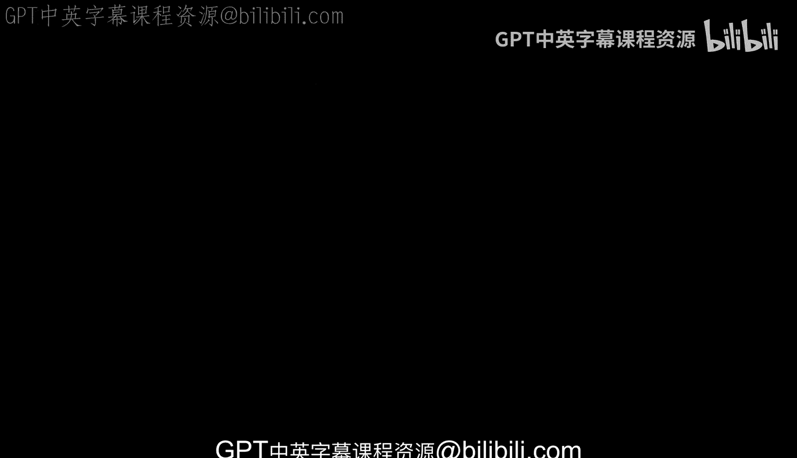

# 大型语言模型实践：P3：03_01_04：关于本课程 📚

在本节课中，我们将概述整个课程将要探讨的核心概念与主题。课程旨在为您提供生成式AI的坚实基础，涵盖从基础理论到实际应用部署的完整流程。

我们将从生成式AI的基础知识开始，了解其基本构成。接着，我们会深入探讨大型语言模型及其在当前生成式AI领域中的现状。

上一节我们介绍了课程的整体框架，本节中我们来看看具体的课程模块。

以下是本课程将涵盖的主要主题：

*   **生成式AI基础与大型语言模型**：学习生成式AI的基本原理，并了解当前主流的大型语言模型。
*   **提示工程**：掌握与大型语言模型有效沟通的技巧，以获得更优质的响应。缺乏良好的提示技巧可能导致响应质量不佳。
*   **构建健壮的生成式AI系统**：例如，学习如何扩展或增强大型语言模型应用中的响应能力。
*   **检索增强生成**：探索一种称为RAG的技术。其核心概念是：`RAG = 大型语言模型 + 外部知识检索`。该技术能扩展模型的能力，使其能够利用训练时未掌握的新信息。
*   **实践应用与部署**：学习如何将构建的应用部署到云端，了解结合了RAG、云端服务和大型语言模型的API如何工作，以及这些组件如何协同运作。
*   **动手实践**：包括使用OpenAI等API构建应用、生成图像，以及进行微调。微调是指基于新信息，让大型语言模型获得额外特定能力的技术。

所有这些内容旨在为您打下坚实的知识基础。这些概念和知识将引导您迈出正确的第一步，帮助您更好地理解生成式AI，了解各个组件如何协同工作，并为您规划明确的后续学习路径，以便您在未来探索如何将这些概念应用于构建生成式AI应用。

本节课中我们一起学习了本课程的整体结构和核心模块，从理论基础到动手实践，为后续深入学习做好了准备。