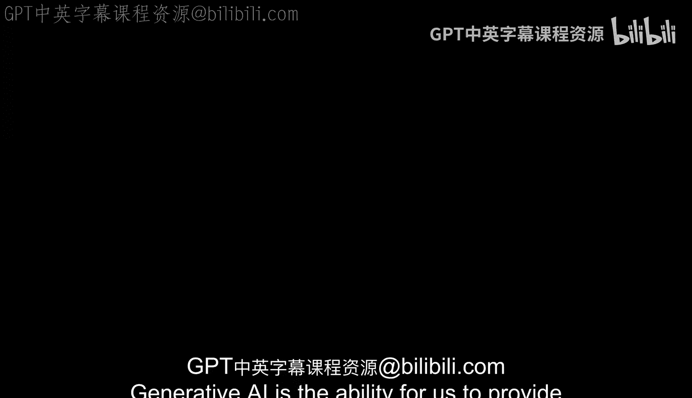
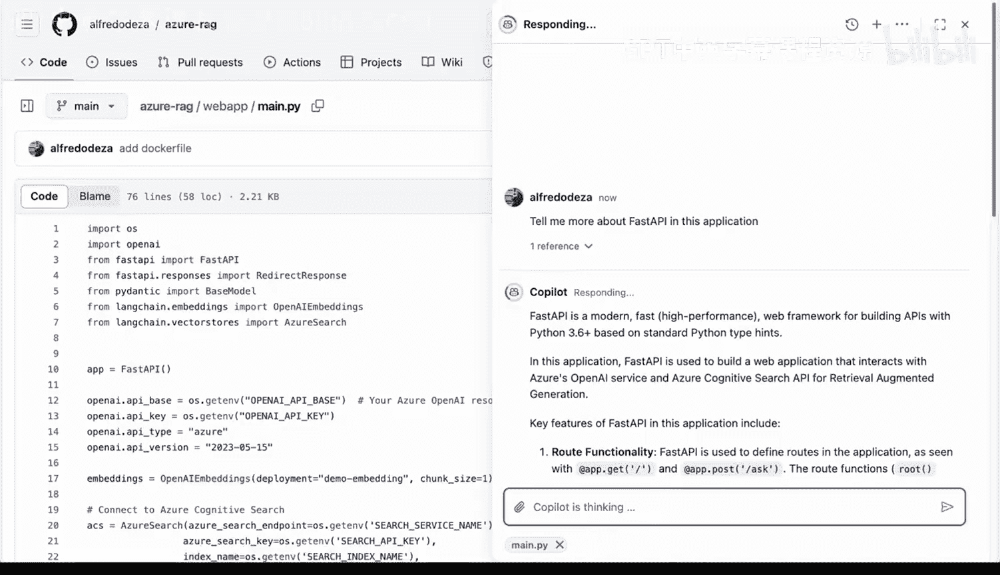

# 大型语言模型实践：1.1：什么是生成式人工智能 🤖

在本节课中，我们将要学习生成式人工智能的核心概念，理解其工作原理，并明确其作为“概率机器”的本质，而非事实数据库。

## 概述

生成式人工智能是指我们能够向人工智能提供一个输入，并得到一个响应或输出的能力。这个输出是由人工智能生成和创造的。基于我们的输入，人工智能现在能够生成文本、图像、声音或视频。

## 生成式AI的核心概念

上一节我们概述了生成式AI的定义，本节中我们来看看其核心运作机制。

生成式AI是一种**概率机器**。它并非基于事实的机器，尤其是在处理文本时。有些人可能会因为AI给出的答案听起来非常可信，而误以为这些答案就是事实或真理。然而，即使答案看起来正确或与事实相符，也并非总是如此。用户有责任去验证这些响应、生成的文本或输出，确保其准确、正确且可用。

因此，理解我们应如何与这种“概率机器”互动，是至关重要的基础。我们很容易习惯于得到的响应，并假设所有返回的内容都是事实。但我们已经看到许多案例，例如新闻报道中，人们盲目信任从大型语言模型或聊天界面输出的内容，并将其当作事实使用。

**核心要点**：生成式AI **不是** 数据库。它并非基于可验证的真实事实。

当然，这其中存在一些细微差别。我们可以通过一些方法让这些大型语言模型变得更“聪明”，我们将在课程中探讨这些内容。然而，最重要的是理解：生成式人工智能是人工智能基于概率来产生、生成输出的能力。在大多数情况下，这涉及自然语言处理，生成基于文本的响应，但也可以生成类似视频、图像甚至声音的内容。

## 与AI互动的正确心态

以下是使用生成式AI时需要牢记的几个关键点：

*   **保持验证意识**：始终对AI生成的内容保持批判性思维，并自行核实重要信息。
*   **理解概率本质**：认识到输出是基于训练数据中的模式和概率计算得出的，不保证绝对正确。
*   **明确适用范围**：将其视为强大的创意辅助或信息处理工具，而非终极事实权威。

## 总结

本节课中我们一起学习了生成式人工智能的基本定义，明确了其作为“概率机器”而非事实数据库的核心本质。我们强调了用户验证信息的重要性，并建立了与AI工具互动的正确基础认知。记住这一点，是安全、有效利用生成式AI力量的第一步。